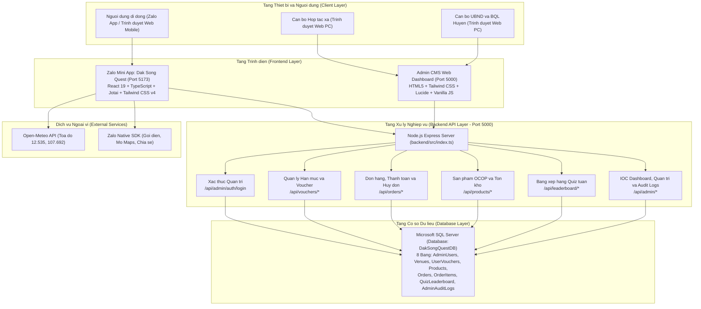
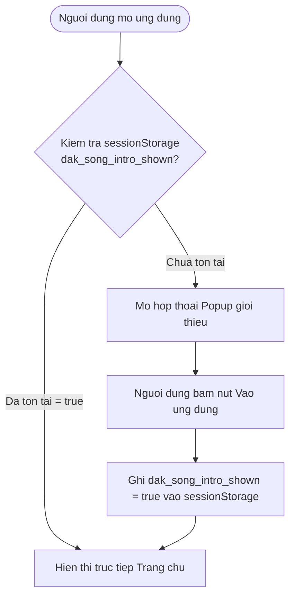
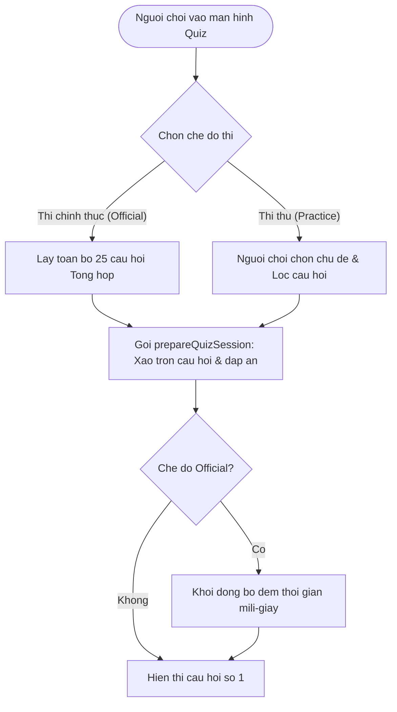
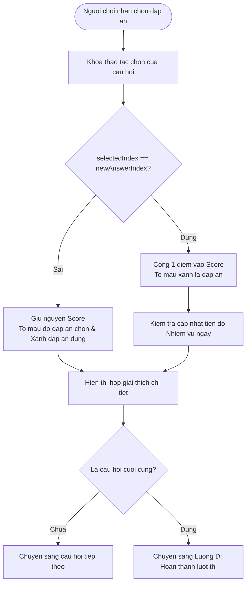
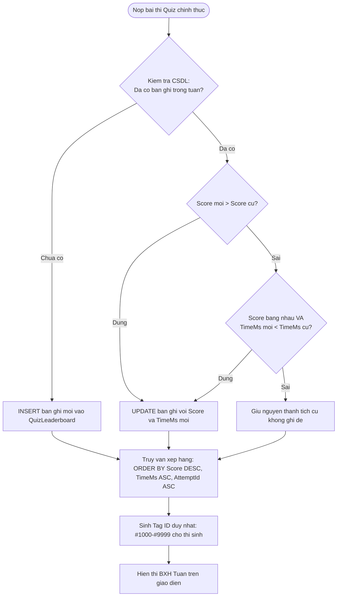
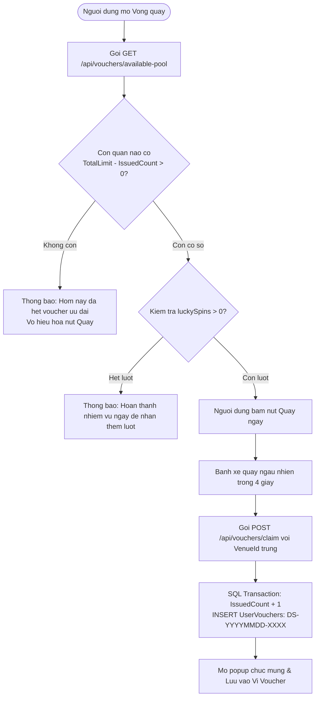

# TAI LIEU MO TA HE THONG TOAN DIEN
# DU AN: DAK SONG QUEST (ZALO MINI APP VA HE THONG QUAN TRI ADMIN CMS)

---

## 1. TONG QUAN HE THONG

### 1.1. Ten he thong
- Ten du an: Dak Song Quest.
- Phien ban tai lieu: 2.1 (Cap nhat theo kien truc he thong va ma nguon thuc te).
- Loai hinh he thong: Ung dung di dong tich hop Zalo Mini App ket hop Cong thong tin Quan tri noi bo Web Admin CMS va Co so du lieu quan he Microsoft SQL Server.

### 1.2. Muc dich xay dung
Dak Song Quest duoc xay dung voi muc tieu thuc day chuyen doi so trong linh vuc du lich va nong nghiep tai huyen Dak Song, tinh Dak Nong. He thong ung dung co che tro choi hoa (Gamification) de thu hut du khach tim hieu ve lich su, danh lam thang canh, van hoa ban dia; dong thoi tao kenh ket noi thuong mai truc tiep giua du khach, cac co so dich vu luu tru - am thuc va cac hop tac xa nong nghiep san xuat dac san OCOP tren dia ban huyen.

### 1.3. Bai toan nghiep vu can giai quyet
1. Tiep can du khach qua kenh so: Giai quyet han che ve kenh quang ba truyen thong bang cach tiep can hon 75 trieu nguoi dung tren nen tang Zalo ma khong yeu cau nguoi dung phai cai dat them ung dung tu kho ung dung App Store hay Google Play.
2. Nang cao nhan thuc van hoa - du lich dia phuong: Cung cap he thong cau hoi trac nghiem sinh dong ve cac dia danh (Canh dong dien gio Nam Binh, Doi thong Dak Song, Rung dac dung canh quan, Thien vien Truc Lam Dao Nguyen...) va van hoa truyen thong (su thi, cong chieng Tay Nguyen).
3. Kich cau tieu dung tai cho: Tao dong luc thuc te cho du khach den trai nghiem tai cac co so am thuc, nha hang, khach san thong qua co che san voucher giam gia thuc te duoc kiem soat han muc phat hanh chat che tren he thong.
4. So hoa chuoi cung ung nong san dac san OCOP: Xay dung san thuong mai dien tu thu nho giup Hop tac xa Nong san Dak Song tiep can truc tiep khach hang, kiem soat ton kho thuc te, dieu phoi van chuyen va minh bach hoa quy trinh thanh toan tien mat hoac vi dien tu.
5. Phan dinh ro rang trach nhiem quan ly hanh chinh va san xuat kinh doanh: Tich hop hai phan he quan tri rieng biet tren cung mot ha tang may chu duy nhat: Hop tac xa chi quan ly don hang va san pham OCOP; UBND va Ban Quan ly Huyen chi quan ly han muc voucher du lich, bang xep hang va giam sat nhat ky kiem toan toan he thong.

### 1.4. Doi tuong su dung he thong
1. Khach du lich va nguoi dan dia phuong: Su dung Zalo Mini App tren dien thoai di dong de tham gia do vui, quay thuong voucher, mua nong san OCOP va tra cuu thong tin du lich, thoi tiet dia phuong.
2. Can bo Hop tac xa Nong san Dak Song (Vai tro COOP): Su dung he thong Quan tri Admin CMS Web de quan ly danh muc dac san OCOP, dieu chinh gia ban, theo doi ton kho, xac nhan don hang, dieu phoi van chuyen va xu ly huy don hoan kho.
3. Can bo UBND va Ban Quan ly Huyen Dak Song (Vai tro DISTRICT): Su dung he thong Quan tri Admin CMS Web de quan ly danh ba co so am thuc - luu tru, cap phat han muc voucher du lich, giam sat bang xep hang nguoi choi quiz, xu ly gian lan va theo doi nhat ky kiem toan he thong.
4. Nhan vien co so kinh doanh dich vu (Nha hang, khach san): Tiep nhan va xac thuc ma voucher cua khach hang mang den su dung tai quan.

### 1.5. Pham vi chuc nang
- Pham vi ho tro hien tai:
  - Trai nghiem nguoi dung tren trinh duyet di dong va moi truong WebView cua Zalo Mini App.
  - Tro choi do vui voi 2 che do: Thi chinh thuc tinh gio luu bang xep hang tuan va Che do Luyen tap theo chu de tich luy voucher.
  - Vong quay may man quay thuong voucher voi co che loc co so con han muc thuc te tu co so du lieu.
  - He thong nhiem vu hang ngay tu dong lam moi theo ngay de tang luot quay thuong.
  - San thuong mai nong san OCOP voi gio hang, chiet khau voucher, 2 phuong thuc thanh toan (Vi ZaloPay mo phong va Tien mat COD), cap nhat thong tin giao hang va theo doi tien do 4 buoc.
  - Co che huy don hoan tra 100% ton kho san pham vao co so du lieu SQL Server.
  - Tra cuu thong tin thoi tiet thoi gian thuc tai toa do Dak Song thong qua API ve tinh Open-Meteo.
  - He thong Quan tri Admin CMS da phan quyen nghiem ngat dua tren Role (COOP va DISTRICT), ngan chan truy cap trai phep o ca giao dien va tang API (ma loi 403 Forbidden).
  - Ghi nhan nhat ky kiem toan he thong (Admin Audit Logs) cho moi hanh vi thay doi han muc, gia ca, ton kho, huy don va xoa ket qua thi.
- Pham vi ngoai he thong hien tai:
  - He thong chua tich hop cong thanh toan truc tuyen that voi ZaloPay Merchant Gateway (dang dung co che mo phong thanh toan in-app).
  - Du lieu cau hoi quiz hien duoc luu tru tinh tai tep ma nguon chu chua duoc quan tri dong qua co so du lieu.
  - Chua tich hop dich vu tin nhan Zalo ZNS thong bao trang thai giao hang den so dien thoai nguoi mua.

### 1.6. Moi lien he giua tro choi kham pha va thong tin du lich dia phuong
He thong thiet ke tro choi do vui va vong quay may man nhu mot cong cu dan du du khach:
- Bo cau hoi do vui duoc bien soan truc tiep tu cac thong tin dia danh, di tich lich su, dac san nong nghiep va tap quan van hoa cua dong bao Dan toc thieu so tai Dak Song.
- Nguoi choi tra loi dung cau hoi trong che do luyen tap se nhan duoc voucher giam gia tu 10% den 20% tai cac nha hang, quan an, khach san tren dia ban.
- Thong tin voucher duoc gan lien voi ten quan, dia chi va so dien thoai, kem tinh nang mo ban do Google Maps de chi duong truc tiep cho du khach den tan co so tieu thu dich vu.

---

## 2. CONG NGHE VA KIEN TRUC HE THONG

### 2.1. Ngan xep cong nghe chi tiet

| Thanh phan | Cong nghe hoac Vi tri ma nguon | Vai tro | Ghi chu ky thuat |
| :--- | :--- | :--- | :--- |
| Framework giao dien Mini App | React 19.0.0, TypeScript 5.7 | Xay dung giao dien Single Page Application phia nguoi dung | Su dung Functional Components va React Hooks |
| Cong cu dong goi va chay dev | Vite 7.3.0 | Bundler va dev server voi toc do bien dich cao | Ho tro Hot Module Replacement (HMR) va cau hinh dev proxy |
| CSS va Giao dien | Tailwind CSS 4.0.0 | He thong class tien ich (utility-first) | Toi uu CSS nho gon, co dan giao dien tuong thich man hinh dien thoai |
| Quan ly trang thai ung dung | Jotai 2.12.1 | Atomic State Management | Quan ly trang thai toan cuc, tu dong luu cache qua atomWithStorage vao localStorage |
| Bo bieu tuong vector | Lucide React 1.16.0 | Hien thi icon truc quan tren giao dien | Icon vector nhe, khong dung anh bitmap |
| Tich hop nen tang Zalo | ZMP SDK (zmp-sdk 2.53.0) | Thu vien giao tiep voi tinh nang native cua ung dung Zalo | Ho tro goi dien thoai thoai, chia se chat/feed, dieu huong ung dung |
| May chu Backend | Node.js (v20+), Express 4.21.2 | Xay dung RESTful API backend va may chu tinh | Ngon ngu TypeScript, bien dich bang tsc sang dist/ |
| Trinh dieu khien CSDL | mssql 11.0.1, msnodesqlv8 4.2.3 | Ket noi va thuc thi truy van tren Microsoft SQL Server | Ho tro Windows Authentication (Trusted Connection) va Transaction ACID |
| He quan tri CSDL | Microsoft SQL Server (SQLEXPRESS / LocalDB) | Luu tru toan bo du lieu nghiep vu quan he | Ten co so du lieu mac dinh: DakSongQuestDB |
| Giao dien Quan tri Admin | Single Page Application (HTML5, Tailwind CSS, Vanilla JS) | Bang dieu khien quan tri danh cho Hop tac xa va Huyen | File backend/public/admin.html, tich hop truc tiep tren may chu Express |
| Du bao khi tuong thoi gian thuc | Open-Meteo Satellite API | Lay thong tin nhiet do, do am, gio, UV tai toa do Dak Song | Toa do: 12.535, 107.692. API mo, khong can API key |

### 2.2. So do kien truc tong the

Kien truc he thong tuan thu mo hinh 3 tang tieu chuan (3-Tier Architecture) ket hop Client-Server:



### 2.3. To chuc ma nguon du an

Cau truc thu muc ma nguon duoc to chuc ro rang giua phan frontend va backend:

```text
dak-song-quest-fixed/
|-- app-config.json              Cau hinh thong tin Zalo Mini App
|-- package.json                 Khai bao thu vien Frontend (React, Jotai, Tailwind...)
|-- tsconfig.json                Cau hinh bien dich TypeScript phia Frontend
|-- vite.config.ts               Cau hinh Vite, Port 5173 va Dev Proxy den Backend
|-- MO_TA_HE_THONG.md            Tai lieu mo ta kien truc va nghiep vu he thong
|-- README.md                    Tai lieu huong dan cai dat va van hanh he thong
|-- backend/                     Phan he Backend Node.js Express va Admin CMS
|   |-- .env                     Bien moi truong: PORT va Chuoi ket noi SQL Server
|   |-- package.json             Khai bao thu vien Backend (express, mssql, cors...)
|   |-- tsconfig.json            Cau hinh bien dich TypeScript Backend
|   |-- public/
|   |   `-- admin.html           Giao dien Admin CMS Dashboard da phan quyen RBAC
|   `-- src/
|       |-- index.ts             Khoi tao may chu Express, dang ky routes va static files
|       |-- config/
|       |   `-- db.ts            Ket noi CSDL SQL Server, khoi tao bang va du lieu mau ban dau
|       `-- routes/
|           |-- admin.ts         API Dashboard stats, CRUD co so, phan quyen va Audit Logs
|           |-- leaderboard.ts   API Bang xep hang, nop diem va cap nhat ten thi sinh
|           |-- orders.ts        API Tao don hang, ZaloPay, COD, huy don hoan kho va doi dia chi
|           |-- products.ts      API Lay danh sach san pham OCOP va ton kho
|           `-- vouchers.ts      API Han muc voucher, quay thuong va doi voucher tai quan
`-- src/                         Phan he Frontend Zalo Mini App
    |-- App.tsx                  Router ung dung va Layout khung chinh
    |-- main.tsx                 Entry point khoi chay React DOM
    |-- components/              Cac thanh phan giao dien tai su dung
    |   |-- BottomNav.tsx        Thanh dieu huong duoi man hinh (Trang chu, Thi, Cua hang, Map, Voucher)
    |   |-- Header.tsx           Thanh tieu de ung dung va thong tin nguoi dung
    |   |-- LuckyWheelModal.tsx  Modal Vong quay may man kiem tra han muc co so
    |   |-- UserProfileModal.tsx Modal doi ten va chon 1 trong 5 avatar chibi Tay Nguyen
    |   |-- WeatherCard.tsx      The hien thi thoi tiet ve tinh thoi gian thuc
    |   `-- ...
    |-- data/                    Du lieu tinh
    |   |-- questions.ts         Ngan hang 25 cau hoi quiz ve lich su, dia ly, van hoa Dak Song
    |   `-- venues.ts            Danh ba co so am thuc, luu tru, hotline va toa do Google Maps
    |-- pages/                   Cac man hinh nghiep vu chinh
    |   |-- Home.tsx             Trang chu: Popup gioi thieu, thoi tiet, vong quay, danh ba dich vu
    |   |-- Quiz.tsx             Trang thi quiz: Che do thi chinh thuc va Che do luyen tap
    |   |-- Leaderboard.tsx      Trang bang xep hang tuan, the hien Tag ID va thoi gian mili-giay
    |   |-- Store.tsx            Trang cua hang OCOP: Gio hang, thanh toan, theo doi va huy don
    |   |-- Vouchers.tsx         Trang vi voucher nguoi dung va ma QR doi uu dai tai quan
    |   `-- MapPage.tsx          Trang cam nang du lich, danh lam thang canh va ban do
    |-- services/                Giao tiep dich vu ben ngoai
    |   |-- api.ts               Axios/Fetch client giao tiep RESTful API backend
    |   |-- weather.ts           Service goi Open-Meteo API lay thoi tiet ve tinh
    |   `-- zalo.ts              Service boc ZMP SDK cho cac tinh nang native Zalo
    |-- state/                   Quan ly trang thai
    |   `-- store.ts             Jotai atoms luu giu gio hang, voucher, diem so, luot quay
    |-- types/                   Dinh nghia kieu du lieu TypeScript toan he thong
    `-- utils/                   Cac ham tien ich
        `-- quiz.ts              Thuat toan Fisher-Yates, tinh tuan ISO, tinh Tag ID nguoi choi
```

### 2.4. Co che luu tru va phan loai du lieu

He thong phan dinh ro rang 3 cap do luu tru du lieu:

1. Du lieu luu tru lau dai tren Co so du lieu SQL Server (Server Persistence):
   - Tai khoan quan tri va vai tro phan quyen (AdminUsers).
   - Danh muc co so du lich, han muc tong, so luong voucher da phat va da dung (Venues).
   - Danh sach voucher da cap cho nguoi dung kem ma duy nhat (UserVouchers).
   - Danh muc dac san OCOP, bang gia niem yet va so luong ton kho kha dung (Products).
   - Danh sach don hang, trang thai giao hang, nguon huy don va phuong thuc thanh toan (Orders).
   - Chi tiet cac mat hang trong tung don hang (OrderItems).
   - Bang xep hang ket qua thi quiz tuan theo diem so va thoi gian mili-giay (QuizLeaderboard).
   - Toan bo nhat ky kiem toan cac hanh vi quan tri tren he thong (AdminAuditLogs).

2. Du lieu luu tru cuc bo tren trinh duyet nguoi dung (Client LocalStorage):
   - Ho so nguoi dung bao gom ten hien thi, ma nguoi dung noi bo va avatar duoc chon (dak_song_user_profile).
   - So luot quay may man con lai cua nguoi choi (luckySpinsStorageAtom).
   - So luong voucher da nhan trong ngay qua che do thi thu (dailyPracticeVouchersCountAtom).
   - Danh sach ma cac nhiem vu hang ngay da hoan thanh trong ngay (dailyTasksCompletedStorageAtom).
   - Danh sach voucher ca nhan da nhan de nguoi dung xem nhanh khi ngoai tuyen (claimedVouchersAtom).
   - Gio hang hien tai va danh sach ma don hang da dat tren thiet bi (cartStorageAtom, ordersStorageAtom).
   - Ket qua luot thi quiz gan nhat cua nguoi choi (weeklyAttemptStorageAtom).

3. Du lieu tam thoi trong phien truy cap (Session / In-Memory State):
   - Co kiem tra hien thi hop thoai popup gioi thieu ung dung (dak_song_intro_shown trong sessionStorage). Hop thoai nay chi xuat hien dung 1 lan khi nguoi dung bat dau phien lam viec moi, khong lap lai khi bam nut dieu huong ve Trang chu.
   - Trinh tu xao tron cau hoi va thu tu dap an trong phien thi quiz (duoc tao moi moi lan bat dau luot thi bang thuat toan Fisher-Yates va chi ton tai trong bo nho RAM).
   - Thoi gian dem mili-giay bai thi dang chay (su dung Date.now() noi bo component Quiz.tsx).

---

## 3. DANH SACH CHUC NANG HE THONG

Bang tong hop toan bo cac chuc nang nghiep vu thuc te duoc trien khai trong ma nguon:

| Ma chuc nang | Ten chuc nang | Muc dich | Dau vao | Cach xu ly | Ket qua dau ra | Trang thai trien khai | Gioi han hoac Luu y |
| :--- | :--- | :--- | :--- | :--- | :--- | :--- | :--- |
| FN-HOME-01 | Hop thoai popup gioi thieu ung dung | Gioi thieu tong quan ve Dak Song Quest cho nguoi dung moi vao | Su kien mount component Trang chu | Kiem tra sessionStorage khoa dak_song_intro_shown; neu chua co thi bat openIntroModal, sau do danh dau da hien thi | Hop thoai gioi thieu xuat hien, cho phep bam nut Vao ung dung | Hoan thien va hoat dong | Chi xuat hien 1 lan moi phien, khong lap lai khi bam chuyen tab ve Trang chu |
| FN-HOME-02 | The thoi tiet ve tinh thoi gian thuc | Hien thi thong so khi tuong thuc te tai Dak Song | Toa do ve tinh (12.535, 107.692) | Goi Open-Meteo API, lay nhiet do, do am, toc do gio, chi so UV, anh xa ma WMO code sang mo ta tieng Viet | The thoi tiet hien thi thong so thuc va hinh anh minh hoa | Hoan thien va hoat dong | Tu dong fallback ve du lieu khi tuong mau neu mat ket noi mang |
| FN-HOME-03 | Danh ba co so luu tru va am thuc | Giup du khach tra cuu nha hang, khach san va lien he | Danh sach co so tu data/venues.ts va SQL Server | Hien thi thong tin, dia chi, hotline va nut chi duong | Du khach xem duoc danh sach, bam goi hotline hoac mo Google Maps | Hoan thien va hoat dong | Su dung ZMP SDK openPhoneApp hoac tel: protocol |
| FN-QUIZ-01 | Khoi tao phien thi do vui | Thiet lap de thi ngau nhien va xao tron dap an | Che do thi (Official hoac Practice), Chu de lua chon | Chon 25 cau (Official) hoac loc theo chu de (Practice), ap dung Fisher-Yates xao tron ca cau hoi lan thu tu dap an | Phien thi san sang, luu index dap an dung moi, reset bo dem gio | Hoan thien va hoat dong | Toan bo 25 cau hoi deu tu tap du lieu questions.ts |
| FN-QUIZ-02 | Chon dap an va kiem tra ket qua | Xu ly cau tra loi cua nguoi choi va tinh diem | Index dap an duoc nguoi choi chon | So sanh voi newAnswerIndex cua cau hoi, cong diem neu dung, hien giai thich va cap nhat tien do | Giao dien doi mau xanh/do, hien thi hop loi giai chi tiet | Hoan thien va hoat dong | Trong che do Practice cho xem giai thich ngay, che do Official chuyen cau tiep |
| FN-QUIZ-03 | Nop bai va xep hang tuan | Ghi nhan ket qua bai thi vao bang xep hang thoi gian thuc | ZaloUserId, DisplayName, AvatarUrl, Score, TimeMs | Gui POST /api/leaderboard/submit len backend, SQL Server kiem tra va chi cap nhat neu thanh tich moi cao hon | Ban ghi BXH duoc luu, hien thi thu hang ca nhan | Hoan thien va hoat dong | Sap xep uu tien: Diem cao hon -> Thoi gian nhanh hon -> Nop truoc |
| FN-QUIZ-04 | Ho so nguoi choi va Avatar chibi | Cho phep ca nhan hoa thong tin nguoi thi | Ten hien thi moi, ma avatar chon (1 trong 5 avatar chibi) | Luu thong tin vao localStorage va goi PUT /api/leaderboard/rename len backend | Thong tin nguoi choi cap nhat tren toan ung dung va BXH | Hoan thien va hoat dong | 5 avatar chibi Tay Nguyen mang ban sac van hoa dia phuong |
| FN-WHEEL-01 | Vong quay may man | Phat voucher ngau nhien cho nguoi choi tu kho thuc | Su kien bam nut Quay ngay | Goi GET /api/vouchers/available-pool de lay quan con han muc; neu con thi quay va goi POST /api/vouchers/claim de tru han muc | Banh xe dung o o trung thuong, sinh ma voucher DS-YYYYMMDD-XXXX | Hoan thien va hoat dong | Tu dong bo qua quan da het han muc tren CSDL, khong phat voucher ao |
| FN-TASK-01 | Nhiem vu hang ngay | Tao dong luc cho nguoi choi quay lai va tich luy luot quay | Ket qua hoan thanh hanh dong trong ngay | Kiem tra dieu kien nhiem vu (tra loi 3 cau, hoan thanh quiz, dung chu de), cong them 1 luot quay | Tang so luot quay may man trong luckySpinsStorageAtom | Hoan thien va hoat dong | Tu dong reset trang thai nhiem vu vao 00:00 moi ngay theo gio VN (UTC+7) |
| FN-STORE-01 | Danh muc va ton kho OCOP | Cho phep khach hang xem dac san va so luong kha dung | Danh sach san pham tu SQL Server | Goi GET /api/products, hien thi anh, xuat xu, don gia, don vi va InStockQuantity | Danh sach nong san hien thi kem trang thai con hang/het hang | Hoan thien va hoat dong | Du lieu lay truc tiep tu bang Products trong SQL Server |
| FN-STORE-02 | Tao don hang va Dat mua | Tiep nhan don hang cua khach, kiem tra ton kho an toan | Gio hang, ho ten, so dien thoai, dia chi, ma voucher, PT thanh toan | Goi POST /api/orders/create; backend bat Transaction, kiem tra InStockQuantity, tru kho va tao don ORD-YYYYMMDD-XXXX | Don hang tao thanh cong voi trang thai PendingConfirm, giam ton kho | Hoan thien va hoat dong | Ho tro 2 phuong thuc: Vi ZaloPay (mo phong) va COD (Tien mat) |
| FN-STORE-03 | Cap nhat thong tin nhan hang | Cho phep nguoi mua sua dia chi/so dien thoai khi don chua dong goi | Ho ten, so dien thoai, dia chi nhan hang moi | Goi PUT /api/orders/:id/update-shipping; chi cho phep khi OrderStatus = 'PendingConfirm' | Cap nhat thong tin don hang tren SQL Server, hien popup thong bao thanh cong | Hoan thien va hoat dong | Nut xac nhan doi mau xanh ro rang, tu dong ngan chan sua khi don da dong goi |
| FN-STORE-04 | Huy don hang va Hoan kho 100% | Nguoi dung hoac Hop tac xa huy don, hoan tra ton kho | Ma don hang, ly do huy | Goi PUT /api/orders/:code/cancel hoac API admin; cong lai 100% so luong vao InStockQuantity va cap nhat CancelledBy | Don hang chuyen sang Cancelled, kho hang duoc hoan lai day du tren DB | Hoan thien va hoat dong | Tu dong khoa nut huy don khi trang thai don hang da chuyen sang Shipping |
| FN-ADMIN-01 | Xac thuc va Phan quyen RBAC | Phan dinh quyen han giua Hop tac xa va Huyen | Username, Password | Goi POST /api/admin/auth/login; tra ve thong tin Role (COOP hoac DISTRICT) | Giao dien Admin tu dong hien thi dung giao dien va tab nghiep vu theo vai tro | Hoan thien va hoat dong | Ho tro chuyen doi nhanh vai tro 1-click tren header; chan 403 o tang backend |
| FN-ADMIN-02 | Dieu phoi don hang OCOP | Hop tac xa quan ly tien do don hang nong san | Ma don hang, trang thai moi (ReadyToShip, Shipping, Completed, Cancelled) | Goi PUT /api/admin/orders/:id/status; backend kiem tra Role = COOP; neu huy don thi ghi ly do va hoan kho | Trang thai don hang thay doi, luu vet nhat ky kiem toan | Hoan thien va hoat dong | Chi tai khoan COOP moi duoc phep thao tac; DISTRICT bi chan 403 Forbidden |
| FN-ADMIN-03 | Quan tri kho hang va gia OCOP | Hop tac xa dieu chinh gia ban va bo sung ton kho nong san | ProductId, gia ban moi, so luong ton kho bo sung | Goi PUT /api/admin/products/:id; backend cap nhat gia, tang ton kho va ghi Audit Log | Thong tin gia va ton kho duoc cap nhat ngay tren San OCOP Mini App | Hoan thien va hoat dong | Chi tai khoan COOP moi duoc phep thao tac; DISTRICT bi chan 403 Forbidden |
| FN-ADMIN-04 | Quan tri han muc voucher du lich | UBND Huyen quan ly danh ba quan va cap phat han muc voucher | VenueId, TotalLimit moi, so luong voucher cap them | Goi cac API PUT /api/admin/venues/:id/limit va POST .../add-vouchers | Han muc co so duoc tang, anh huong ngay den ty le quay thuong | Hoan thien va hoat dong | Chi tai khoan DISTRICT moi duoc phep thao tac; COOP bi chan 403 Forbidden |
| FN-ADMIN-05 | Quan tri BXH va Kiem toan | UBND Huyen giam sat thi sinh va nhat ky kiem toan | AttemptId can xoa | Goi DELETE /api/admin/leaderboard/:id de xoa ket qua gian lan, xem nhat ky kiem toan | Ket qua thi bi xoa khoi BXH, ghi nhan thao tac vao AdminAuditLogs | Hoan thien va hoat dong | Chi tai khoan DISTRICT moi duoc phep thao tac; COOP bi chan 403 Forbidden |

---

## 4. MO TA CHI TIET TUNG LUONG NGHIEP VU

### 4.1. Luong A: Mo ung dung lan dau va xem huong dan
1. Muc dich: Cung cap thong tin gioi thieu ve Dak Song Quest va huong dan nguoi dung trai nghiem cac tinh nang san voucher, thi do vui va mua dac san OCOP.
2. Tac nhan: Nguoi dung (Du khach / Nguoi dan).
3. Dieu kien tien quyet: Nguoi dung mo ung dung Zalo Mini App tren thiet bi.
4. Du lieu dau vao: Khoa dak_song_intro_shown trong sessionStorage cua phien trinh duyet.
5. Cac buoc thuc hien:
   - Buoc 1: Component Home.tsx duoc mount khi nguoi dung vao ung dung.
   - Buoc 2: He thong doc gia tri tu sessionStorage voi khoa dak_song_intro_shown.
   - Buoc 3: Neu khoa chua ton tai hoac co gia tri khac 'true', he thong set openIntroModal = true de mo hop thoai popup gioi thieu.
   - Buoc 4: Hop thoai gioi thieu hien thi voi tieu de Chao mung den voi Dak Song Quest va cac noi dung: San voucher am thuc & luu tru, Chinh phuc thu thach do vui van hoa, Mua sam dac san OCOP giao tan noi.
   - Buoc 5: Nguoi dung doc thong tin va nhan nut Vao ung dung.
   - Buoc 6: He thong dong hop thoai (openIntroModal = false) dong thoi ghi dak_song_intro_shown = 'true' vao sessionStorage va danh dau bien memory dak_song_intro_shown de ghi nho trong phien.
6. Diem re nhanh:
   - Neu nguoi dung dang o tab khac (Quiz, Store, Map...) va nhan chuyen ve tab Trang chu: Vi session da ghi nhan co 'true', hop thoai popup se khong hien thi lai.
   - Neu nguoi dung dong trinh duyet/Zalo va mo lai trong phien moi: sessionStorage duoc tao moi, hop thoai popup se hien thi lai 1 lan duy nhat.
7. Ket qua dau ra: Nguoi dung nam bat duoc thong tin tong quan va bat dau su dung cac tinh nang ung dung ma khong bi lam phien lien tuc.
8. Xu ly ngoai le: Neu trinh duyet chan sessionStorage (che do Private dac biet), ung dung su dung bien in-memory fallback de dam bao popup khong xuat hien lap lai khi nguoi dung chuyen giua cac tab.
9. Cap nhat trang thai: Cap nhat sessionStorage (dak_song_intro_shown: 'true').
10. Gioi han ky thuat: Hop thoai chi luu trong phien (session), khong luu vinh vien vao localStorage vi can gioi thieu lai khi nguoi dung bat dau phien truy cap moi trong tuong lai.



---

### 4.2. Luong B: Bat dau luot choi moi (Thi chinh thuc va Thi thu)
1. Muc dich: Cho phep nguoi choi lua chon giua che do ren luyen kien thuc (Thi thu) hoac tham gia thi dua thanh tich xep hang tuan (Thi chinh thuc).
2. Tac nhan: Nguoi choi.
3. Dieu kien tien quyet: Nguoi dung dang o man hinh Quiz.tsx.
4. Du lieu dau vao: Che do thi duoc chon (mode: 'official' hoac 'practice'), chu de duoc chon (neu la practice).
5. Cac buoc thuc hien:
   - Buoc 1: Giao dien man hinh sanh cho (Lobby) hien thi 2 lua chon: Thi chinh thuc va Thi thu / Luyen tap.
   - Buoc 2: Nguoi choi lua chon che do:
     - Truong hop Thi chinh thuc: He thong tu dong chon toan bo 25 cau hoi trong tap questions.ts thuoc danh muc Tong hop.
     - Truong hop Thi thu: Nguoi choi chon 1 trong cac chu de chuyen biet (Dia ly, Lich su, Van hoa, Nong nghiep - OCOP) hoac Tat ca. He thong loc cac cau hoi tuong ung.
   - Buoc 3: Nguoi choi nhan nut Bat dau.
   - Buoc 4: He thong goi ham tien ich prepareQuizSession():
     - Su dung thuat toan Fisher-Yates de xao tron ngau nhien thu tu cac cau hoi.
     - Voi tung cau hoi, xao tron ngau nhien thu tu 4 dap an lua chon, dong thoi truy vet va cap nhat chi so newAnswerIndex cho dap an chinh xac.
   - Buoc 5: He thong khoi tao bo dem gio:
     - Thi chinh thuc: Ghi nhan startTime = Date.now(), khoi dong setInterval do thoi gian chinh xac theo mili-giay.
     - Thi thu: Khong ap dung dem nguoc thoi gian bat buoc.
   - Buoc 6: Chuyen sang man hinh giao dien hien thi cau hoi so 1.
6. Diem re nhanh:
   - Neu nguoi choi da tham gia thi chinh thuc trong tuan: He thong van cho phep thi lai, tuy nhien ket qua tren bang xep hang se chi duoc ghi nhan de len neu thanh tich moi tot hon thanh tich cu.
7. Ket qua dau ra: Giao dien cau hoi dau tien xuat hien voi cac dap an da duoc xao tron, san sang tiep nhan thao tac chon lua.
8. Xu ly ngoai le: Neu chu de duoc chon khong co cau hoi nao thoa man, he thong mac dinh su dung toan bo 25 cau hoi.
9. Cap nhat trang thai: Cap nhat session state noi bo: currentQuestionIndex = 0, score = 0, elapsedMs = 0, isFinished = false.
10. Gioi han ky thuat: So luong cau hoi toi da hien tai la 25 cau duoc bien soan trong file questions.ts.



---

### 4.3. Luong C: Tra loi cau hoi va kiem tra dap an
1. Muc dich: Tiep nhan dap an nguoi choi lua chon, kiem tra dung/sai tuc thi, phan hoi truc quan va cap nhat tien do bai thi.
2. Tac nhan: Nguoi choi.
3. Dieu kien tien quyet: Phien thi dang dien ra o cau hoi thu i.
4. Du lieu dau vao: Chi so dap an lua chon (selectedIndex: 0, 1, 2 hoac 3).
5. Cac buoc thuc hien:
   - Buoc 1: Nguoi choi nhan chon mot trong 4 phuong an tra loi A, B, C, D.
   - Buoc 2: He thong khoa thao tac chon de ngan chan viec nhan doi hoac thay doi dap an (isAnswered = true).
   - Buoc 3: So sanh selectedIndex voi newAnswerIndex cua cau hoi hien tai:
     - Neu selectedIndex == newAnswerIndex: Tra loi dung. He thong cong 1 diem vao score, phat am thanh/hieu ung thong bao dung, to mau xanh la cho lua chon.
     - Neu selectedIndex != newAnswerIndex: Tra loi sai. He thong to mau do cho lua chon sai, dong thoi to mau xanh la cho dap an dung de nguoi choi hoc hoi.
   - Buoc 4: Kiem tra nhiem vu hang ngay: Neu tra loi dung va cau hoi thuoc danh muc yeu cau cua nhiem vu trong ngay, cap nhat tien do nhiem vu hang ngay.
   - Buoc 5: Hien thi hop thong tin loi giai thich chi tiet (explanation) ben duoi cau hoi de cung cap kien thuc bo tro cho nguoi choi.
   - Buoc 6: Nguoi choi xem giai thich va nhan nut Tiep tuc (hoac he thong tu dong chuyen sau khoang tre o che do thi chinh thuc).
   - Buoc 7: Neu chua phai cau cuoi, tang currentQuestionIndex len 1 va hien thi cau tiep theo; neu da la cau cuoi cung, chuyen sang luong Hoan thanh luot choi.
6. Diem re nhanh:
   - Che do Practice: Nguoi choi chu dong bam nut Cau tiep theo sau khi doc ky loi giai.
   - Che do Official: Nhap dap an xong se lap tuc chuyen cau sau 800ms de toi uu hoa thoi gian lam bai.
7. Ket qua dau ra: Diem so duoc cap nhat, nguoi choi nam duoc loi giai thich dung/sai.
8. Xu ly ngoai le: Neu xay ra loi khong xac dinh chi so dap an dung, he thong mac dinh ghi nhan sai va cho phep bo qua cau hoi de khong lam treo luot thi.
9. Cap nhat trang thai: Tang bien diem so score, cap nhat dailyTasksCompletedStorageAtom neu hoan thanh nhiem vu ngay.
10. Gioi han ky thuat: Moi cau hoi chi duoc chon mot dap an duy nhat va khong the quay lai sua dap an da chon.



---

### 4.4. Luong D: Hoan thanh luot choi va tinh diem
1. Muc dich: Tong ket diem so, thoi gian hoan thanh, xep hang danh hieu va trao phan thuong voucher tuong ung.
2. Tac nhan: Nguoi choi, Backend API.
3. Dieu kien tien quyet: Nguoi choi hoan thanh toan bo so cau hoi trong phien thi.
4. Du lieu dau vao: score, totalQuestions, startTime, mode.
5. Cac buoc thuc hien:
   - Buoc 1: He thong dung bo dem gio, tinh tong thoi gian lam bai: elapsedMs = Date.now() - startTime.
   - Buoc 2: Tinh ty le phan tram dung: percentage = (score / totalQuestions) * 100.
   - Buoc 3: Xac dinh danh hieu thanh tich:
     - Ty le >= 90%: Hang Kim Cuong (Nha thong thai Dak Song).
     - Ty le >= 80%: Hang Vang (Kham pha xuat sac).
     - Ty le >= 70%: Hang Bac (Nguoi yeu van hoa).
     - Ty le < 70%: Hang Dong (Can tiep tuc ren luyen).
   - Buoc 4: Xu ly phan thuong theo che do thi:
     - Neu la che do Thi thu (Practice):
       - Kiem tra so luong voucher thi thu da nhan trong ngay (dailyPracticeVouchersCount). Neu chua vuot qua gioi han MAX_PRACTICE_VOUCHERS = 3 voucher/ngay va dat tu Hang Bac tro len (>= 70%), he thong tu dong cap tang 1 voucher giam gia tuong ung vao Vi voucher cua nguoi choi (Kim Cuong: 20%, Vang: 15%, Bac: 10%).
       - Tang bien dem dailyPracticeVouchersCount len 1 va luu vao localStorage.
     - Neu la che do Thi chinh thuc (Official):
       - Khong phat voucher tuc thi.
       - Tu dong dong goi payload: { userId, displayName, avatarUrl, score, totalQuestions: 25, timeMs: elapsedMs, weekId }.
       - Gui POST /api/leaderboard/submit len backend de cap nhat bang xep hang tuan (xem Luong E).
       - Luu ket qua vao weeklyAttemptStorageAtom de hien thi thong tin thi sinh da tham gia tuan nay.
   - Buoc 5: Hien thi man hinh Tong ket ket qua kem 2 nut dieu huong: Xem Bang Xep Hang Tuan va Thi lai / Luyen tap.
6. Diem re nhanh:
   - Che do Thi thu vuot qua 3 voucher/ngay: Van cho thi va hien ket qua danh hieu nhung kem thong bao Ban da nhan du 3 voucher luyen tap trong ngay hom nay.
7. Ket qua dau ra: Man hinh tong ket diem, thoi gian dinh dang mm:ss.S, danh hieu, thong bao voucher nhan duoc (neu co).
8. Xu ly ngoai le: Neu mat ket noi mang khi nop bai thi chinh thuc, ung dung luu tam ket qua vao LocalStorage va thong bao nguoi dung kiem tra lai ket noi.
9. Cap nhat trang thai: Ghi vao weeklyAttemptStorageAtom, dailyPracticeVouchersCountAtom, claimedVouchersAtom (neu nhan voucher).
10. Gioi han ky thuat: Thoi gian hoan thanh tinh bang mili-giay dua tren thoi diem bat dau va ket thuc thuc te tai client.

---

### 4.5. Luong E: Xu ly bang xep hang va giai quyet truong hop bang diem
1. Muc dich: Xep hang thanh tich nguoi choi trong tuan thi dau, dam bao tinh cong bang va giai quyet triet de truong hop dong diem so.
2. Tac nhan: Backend API, Microsoft SQL Server, Nguoi choi xem BXH.
3. Dieu kien tien quyet: Nguoi choi gui ket qua tu che do Thi chinh thuc qua API /api/leaderboard/submit.
4. Du lieu dau vao: ZaloUserId, DisplayName, AvatarUrl, Score, TotalQuestions (25), TimeMs, WeekId (dinh dang YYYY-Www).
5. Cac buoc thuc hien:
   - Buoc 1: Backend tiep nhan POST /api/leaderboard/submit, tinh weekId hien tai theo chuan ISO-8601 gio Viet Nam (UTC+7).
   - Buoc 2: Backend truy van bang QuizLeaderboard kiem tra xem ZaloUserId da co ban ghi trong weekId hien tai chua:
     ```sql
     SELECT * FROM QuizLeaderboard WHERE ZaloUserId = @userId AND WeekId = @weekId
     ```
   - Buoc 3: Xet dieu kien ghi nhan thanh tich tot nhat (Best Record Policy):
     - Truong hop A: Nguoi choi chua co ban ghi nao trong tuan: Thuc hien INSERT ban ghi moi vao QuizLeaderboard.
     - Truong hop B: Nguoi choi da co ban ghi truoc do: So sanh thanh tich moi voi thanh tich cu:
       - Neu Score_moi > Score_cu: Thuc hien UPDATE diem so va thoi gian moi.
       - Neu Score_moi == Score_cu VA TimeMs_moi < TimeMs_cu: Thuc hien UPDATE vi thoi gian lam bai nhanh hon.
       - Cac truong hop con lai (diem kem hon hoac bang diem nhung thoi gian cham hon): Giu nguyen thanh tich cu, bo qua ket qua moi.
   - Buoc 4: Khi nguoi dung mo trang Bang xep hang (Leaderboard.tsx), frontend goi GET /api/leaderboard?weekId=...
   - Buoc 5: Backend thuc thi truy van voi thu tu uu tien sap xep 3 cap:
     ```sql
     SELECT * FROM QuizLeaderboard 
     WHERE WeekId = @weekId 
     ORDER BY Score DESC, TimeMs ASC, AttemptId ASC
     ```
   - Buoc 6: Giai quyet truong hop trung ten thi sinh:
     - De tranh nham lan khi nhieu nguoi choi dat cung ten (vi du: Nguyen Van A) hoac dung avatar mac dinh giong nhau, he thong goi ham getPlayerTag(userId, displayName).
     - Ham thuc hien bam chuoi userId va displayName thanh ma bam so hoc, anh xa vao khoang 1000 den 9999 de tao Tag nhan dien duy nhat (vi du: Nguyen Van A #4821).
   - Buoc 7: Xac dinh Top 5 tuan:
     - Vao cuoi tuan (Chu Nhat 23:59), top 5 thi sinh dung dau bang xep hang se duoc trao tang voucher dac biet giam gia 30% tai cac nha hang, co so du lich lon nhat huyen.
6. Diem re nhanh:
   - Neu backend mat ket noi, frontend su dung danh sach mockFallbackLeaderboard luu trong bo nho de hien thi giao dien mau cho nguoi dung xem thu.
7. Ket qua dau ra: Bang xep hang tuan the hien day du thu hang (Hang 1, 2, 3 co mau huy chuong vang/bac/dong), ten thi sinh kem Tag ID, avatar, diem so tren 25 va thoi gian lam bai mm:ss.S.
8. Xu ly ngoai le: Truong hop gian lan hoac can bo admin phat hien bat thuong, can bo Huyen (vai tro DISTRICT) co quyen xoa ban ghi qua API DELETE /api/admin/leaderboard/:id de yeu cau thi sinh thi lai trung thuc.
9. Cap nhat trang thai: Cap nhat bang QuizLeaderboard trong CSDL SQL Server.
10. Gioi han ky thuat: Bang xep hang duoc reset theo tung tuan (WeekId YYYY-Www). Nguoi choi co the xem lai lich su cac tuan truoc bang cach chon dropdown tuan.



---

### 4.6. Luong F: Co che nhan va su dung voucher
1. Muc dich: Cap phat voucher giam gia thuc te cho nguoi dung va cho phep su dung tai cac co so kinh doanh tren dia ban.
2. Tac nhan: Nguoi dung, Nhan vien co so an uong / luu tru, Backend API, SQL Server.
3. Dieu kien tien quyet: Nguoi dung nhan duoc voucher qua Vong quay may man, Thi do vui hoac Top BXH tuan.
4. Du lieu dau vao: VoucherCode, VenueId, UserId, Status.
5. Cac buoc thuc hien:
   - Nhan voucher:
     - Khi nguoi dung trung thuong, backend thuc thi transaction tao ban ghi trong bang UserVouchers voi ma dinh dang DS-YYYYMMDD-XXXX (vi du: DS-20261011-8842).
     - He thong dong thoi tang chi so IssuedCount cua quan tuong ung trong bang Venues len 1.
     - Voucher duoc tu dong them vao danh sach claimedVouchersAtom tai phia client de nguoi dung tra cuu trong tab Vi Voucher.
   - Su dung voucher tai quan:
     - Buoc 1: Nguoi dung den truc tiep nha hang, quan an hoac khach san tai Dak Song.
     - Buoc 2: Nguoi dung mo man hinh Vouchers.tsx, chon the voucher muon su dung va nhan nut Su dung tai quan.
     - Buoc 3: Ung dung hien thi hop thoai chua ma code voucher kem ma QR truc quan va thong tin giam gia (vi du: Giam 20%).
     - Buoc 4: Nguoi dung xuat trinh ma QR hoac ma code cho nhan vien thu ngan cua quan.
     - Buoc 5: Nhan vien co so kiem tra tinh hop le va xac nhan ap dung giam tru truc tiep vao hoa don thanh toan cua khach.
     - Buoc 6: Nguoi dung nhan nut Xac nhan da su dung tren ung dung (hoac nhan vien quan goi API /api/vouchers/redeem).
     - Buoc 7: He thong cap nhat trang thai voucher thanh Used trong CSDL va dong thoi tang chi so UsedCount cua quan len 1 trong bang Venues.
6. Diem re nhanh:
   - Voucher da o trang thai Used: Giao dien hien thi mo voi nhan Da su dung va khong cho phep kich hoat lai ma QR.
7. Ket qua dau ra: Du khach duoc giam tru tien mat tai quan, co so kinh doanh tieu thu duoc dich vu va du lieu duoc dong bo len CSDL.
8. Xu ly ngoai le: Neu mat ket noi mang khi o quan, nguoi dung van co the mo ma code offline da duoc luu trong claimedVouchersAtom tai localStorage de doi chieu voi thu ngan.
9. Cap nhat trang thai: Cap nhat Status = 'Used', UsedAt = GETDATE() trong UserVouchers; cap nhat UsedCount = UsedCount + 1 trong Venues.
10. Gioi han ky thuat: Moi voucher chi co gia tri su dung 1 lan duy nhat tai dung co so duoc chi dinh.

---

### 4.7. Luong G: Vong quay may man va nhiem vu hang ngay
1. Muc dich: Kich thich tuong tac hang ngay, phat voucher ngau nhien mot cach cong bang dua tren han muc ton kho thuc te cua cac co so.
2. Tac nhan: Nguoi choi, Backend API, SQL Server.
3. Dieu kien tien quyet: Nguoi choi con it nhat 1 luot quay (luckySpins > 0).
4. Du lieu dau vao: UserId, So luot quay hien co.
5. Cac buoc thuc hien:
   - Buoc 1: Nguoi choi mo hop thoai Vong quay may man tai Trang chu hoac qua the tien ich.
   - Buoc 2: Ung dung goi GET /api/vouchers/available-pool len backend.
   - Buoc 3: Backend thuc thi truy van SQL Server de loc cac quan con han muc:
     ```sql
     SELECT * FROM Venues 
     WHERE IsActive = 1 AND (TotalLimit - IssuedCount) > 0
     ```
   - Buoc 4: Xet danh sach co so tra ve:
     - Neu khong con quan nao con han muc (danh sach rong): He thong thong bao Hom nay cac co so da phat het voucher uu dai, vui long quay lai ngay mai. Banh xe quay bi vo hieu hoa.
     - Neu con co so thoa man: Backend tra ve danh sach quan kha dung cho frontend de gan vao cac o cua banh xe quay.
   - Buoc 5: Nguoi choi bam nut Quay ngay.
   - Buoc 6: He thong giam so luot quay di 1 (luckySpins = luckySpins - 1).
   - Buoc 7: Banh xe quay xoay ngau nhien trong 4 giay voi hieu ung giam toc va am thanh mo phong.
   - Buoc 8: Banh xe dung lai tai o quan duoc chon. Frontend goi POST /api/vouchers/claim len backend kem { userId, venueId }.
   - Buoc 9: Backend mo transaction SQL Server:
     - UPDATE Venues SET IssuedCount = IssuedCount + 1 WHERE VenueId = @venueId.
     - INSERT INTO UserVouchers (...) VALUES (...).
   - Buoc 10: Backend tra ve ma voucher chinh thuc, frontend mo hop thoai chuc mung va tu dong luu voucher vao Vi voucher nguoi dung.
   - Tich luy luot quay qua Nhiem vu hang ngay:
     - Nguoi choi kiem tra danh sach nhiem vu ngay trong modal:
       - Tra loi 3 cau hoi bat ky (+1 luot).
       - Hoan thanh 1 luot thi quiz (+1 luot).
       - Tra loi cau hoi chu de Nong nghiep / Dia ly (+1 luot).
     - Khi nguoi choi thuc hien dung yeu cau, ham checkDailyTask() se ghi nhan hoan thanh vao dailyTasksCompletedStorageAtom va tu dong cong 1 luot vao luckySpinsStorageAtom.
6. Diem re nhanh:
   - Neu nguoi choi het luot quay: He thong vo hieu hoa nut quay va hien thi goi y Hoan thanh nhiem vu ngay de nhan them luot quay.
7. Ket qua dau ra: Nguoi choi nhan duoc voucher that duoc kiem soat han muc, luot quay va nhiem vu duoc cap nhat.
8. Xu ly ngoai le: Neu trong luc quay xay ra loi mang khi goi /api/vouchers/claim, he thong se hoan lai 1 luot quay cho nguoi choi va thong bao thu lai sau.
9. Cap nhat trang thai: Cap nhat bang Venues, UserVouchers tren DB; cap nhat luckySpinsStorageAtom tren client.
10. Gioi han ky thuat: Moi ngay he thong tu dong lam moi trang thai nhiem vu va cap luot quay mac dinh vao 00:00 theo gio Viet Nam (UTC+7).



---

### 4.8. Luong H: Dat hang OCOP va xu ly don hang
1. Muc dich: Cho phep nguoi dung mua dac san OCOP, thanh toan linh hoat, theo doi tien do giao van va cho phep huy don hoan tra ton kho tu dong.
2. Tac nhan: Nguoi mua hang, Hop tac xa Nong san Dak Song (Admin COOP), Backend API, SQL Server.
3. Dieu kien tien quyet: Nguoi dung da them it nhat 1 san pham vao gio hang trong Store.tsx.
4. Du lieu dau vao: Danh sach san pham trong gio (productId, quantity, price), Ho ten, So dien thoai, Dia chi giao hang, Ma voucher giam gia OCOP, Phuong thuc thanh toan (ZaloPay hoac COD).
5. Cac buoc thuc hien:
   - Buoc 1: Nguoi dung chon san pham va vao man hinh Gio hang / Thanh toan.
   - Buoc 2: Nguoi dung nhap day du thong tin giao hang gom: Ho ten, So dien thoai, Dia chi nhan hang.
   - Buoc 3: Chon phuong thuc thanh toan:
     - Phuong thuc 1: Vi ZaloPay.
     - Phuong thuc 2: Tien mat khi nhan hang (COD).
   - Buoc 4: Nguoi dung nhan nut Dat hang.
   - Buoc 5: Frontend goi POST /api/orders/create len backend.
   - Buoc 6: Backend mo Transaction SQL Server va thuc hien kiem tra khoa bi quan (Pessimistic Locking):
     - Kiem tra InStockQuantity cua tung san pham trong gio hang.
     - Neu bat ky san pham nao co InStockQuantity < quantity dat mua: Backend huy bo Transaction, tra ve HTTP 400 Bad Request voi thong bao So luong ton kho khong du.
     - Neu du ton kho: Backend thuc hien tru kho ngay lap tuc:
       ```sql
       UPDATE Products SET InStockQuantity = InStockQuantity - @quantity WHERE ProductId = @productId
       ```
     - Sinh ma don hang duy nhat ORD-YYYYMMDD-XXXX.
     - Tao ban ghi Orders voi trang thai OrderStatus = 'PendingConfirm', PaymentMethod = 'ZaloPay' hoac 'COD', PaymentStatus = 'Pending'.
     - Tao cac ban ghi chi tiet trong OrderItems.
     - Commit Transaction va tra ve thong tin don hang.
   - Buoc 7: Xu ly theo phuong thuc thanh toan:
     - Neu chon ZaloPay: Frontend mo hop thoai popup xac nhan thanh toan Vi ZaloPay (giao dien chuyen nghiep khong chu sandbox). Nguoi dung bam Xac nhan thanh toan -> Goi POST /api/orders/simulate-zalopay-success -> Backend cap nhat PaymentStatus = 'Paid'.
     - Neu chon COD: He thong xac nhan don hang COD thanh cong, tien thu ho se duoc shipper thu khi giao hang.
   - Buoc 8: Don hang duoc luu vao danh sach ordersStorageAtom tai client de nguoi dung tra cuu trong tab Don hang cua toi.
   - Buoc 9: Hop tac xa tiep nhan va dieu phoi don hang tren Admin CMS (Role COOP):
     - Don hang moi o buoc Cho duyet (PendingConfirm).
     - HTX lien he nha vuon kiem tra hang va nhan nut Xac nhan con hang -> Chuyen trang thai sang Dong goi (ReadyToShip).
     - HTX dong goi xong, ban giao cho don vi van chuyen (Viettel Post) va nhan nut Giao Viettel Post -> Chuyen trang thai sang Dang giao (Shipping).
     - Khi giao hang thanh cong, HTX nhan nut Giao thanh cong -> Chuyen trang thai sang Hoan tat (Completed). Neu la don COD, he thong tu dong cap nhat PaymentStatus = 'Paid'.
   - Buoc 10: Cap nhat thong tin giao hang boi khach hang:
     - Khi don o trang thai Cho duyet (PendingConfirm), nguoi dung co the bam nut Sua thong tin de cap nhat lai ho ten, so dien thoai hoac dia chi. Form cap nhat hien thi nut luu mau xanh ro rang, sau khi luu hien thi popup thong bao thanh cong.
   - Buoc 11: Quy trinh Huy don va Hoan kho 100%:
     - Khach hang tu huy don:
       - Chi duoc phep khi don hang dang o trang thai PendingConfirm hoac ReadyToShip.
       - Khi don da chuyen sang Shipping (Dang giao), he thong tu dong KHOA nut huy de bao ve tien do cua don vi van chuyen.
       - Khi khach bam Huy don, hop thoai popup xac nhan hien thi. Khach xac nhan -> Frontend goi PUT /api/orders/:code/cancel.
       - Backend mo Transaction cong tra lai 100% so luong vao InStockQuantity trong bang Products, cap nhat OrderStatus = 'Cancelled', CancelledBy = 'USER', Note = 'Nguoi dung huy don'.
     - Hop tac xa chu dong huy don:
       - Trong truong hop kiem tra nha vuon phat hien nong san khong dat pham cap hoac dot bien thoi tiet khong the thu hoach, can bo HTX nhan nut Huy don tren Admin CMS.
       - He thong cap nhat OrderStatus = 'Cancelled', CancelledBy = 'HTX', kem ghi chu ro rang: Don hang do Hop tac xa huy do mot so van de ve chat luong cung nhu so luong nong san chua dam bao tai thoi diem nay. Hop tac xa chan thanh xin loi quy khach!
       - Backend tu dong cong tra lai 100% ton kho ve bang Products va ghi nhat ky vao AdminAuditLogs.
6. Diem re nhanh:
   - Khi don da chuyen sang trang thai Shipping, ca khach hang va HTX deu khong the huy don qua cac nut thao tac thong thuong.
7. Ket qua dau ra: Don hang duoc luu vet chi tiet, ton kho san pham luon nhat quan voi thuc te, nguoi mua theo doi duoc 4 buoc tien do ro rang.
8. Xu ly ngoai le: Neu thanh toan ZaloPay that bai hoac khach huy thanh toan trong popup, don hang van o trang thai cho thanh toan hoac nguoi dung co the chu dong huy don de hoan kho.
9. Cap nhat trang thai: Cap nhat bang Orders, OrderItems, Products, AdminAuditLogs tren CSDL SQL Server.
10. Gioi han ky thuat: Tinh nang ZaloPay hien tai hoat dong duoi co che mo phong in-app, chua ket noi cong IPN thanh toan ngan hang that.


---

### 4.9. Luong I: Quan tri he thong va phan quyen RBAC (Role-Based Access Control)
1. Muc dich: Dam bao tinh bao mat, phan dinh ro rang quyen han giua co quan quan ly nha nuoc (UBND Huyen) va don vi san xuat kinh doanh (Hop tac xa) tren cung mot he thong.
2. Tac nhan: Can bo Hop tac xa (COOP), Can bo UBND & Ban Quan ly Huyen (DISTRICT).
3. Dieu kien tien quyet: Nguoi dung quan tri truy cap vao trang Web Admin CMS tai dia chi http://localhost:5000/admin.html.
4. Du lieu dau vao: Username, Password (hoac su dung tinh nang chuyen doi vai tro 1-click tren header).
5. Cac buoc thuc hien:
   - Buoc 1: Dang nhap vao he thong quan tri:
     - Tai khoan Hop tac xa: htx_daksong / 123 -> He thong xac thuc tra ve Role: COOP.
     - Tai khoan UBND Huyen: huyen_daksong / 123 -> He thong xac thuc tra ve Role: DISTRICT.
   - Buoc 2: Bien hoa giao dien tu dong theo vai tro (Role-Based Dynamic UI):
     - Khi dang nhap vai tro Hop tac xa (COOP):
       - Header mang gam mau xanh nong nghiep Emerald, tieu de SAN NONG SAN OCOP DAK SONG.
       - Dashboard the hien so lieu kinh doanh: Doanh thu San OCOP, Don cho duyet kho, Dong goi & Van chuyen, Kho nong san OCOP, Don hoan tat.
       - Hien thi 2 tab nghiep vu: Don hang nong san OCOP va Kho hang & Gia OCOP.
       - An hoan toan 3 tab quan ly nha nuoc: Quan & Han muc Voucher, BXH Nguoi choi Quiz, Lich su kiem toan.
     - Khi dang nhap vai tro UBND va BQL Huyen (DISTRICT):
       - Header mang gam mau Slate va Vang Amber, tieu de DAK SONG QUEST (UBND HUYEN - DISTRICT).
       - Dashboard the hien so lieu dieu hanh du lich: Co so hop tac, Voucher dung tai quan, Thi sinh thi Quiz, Lich su kiem toan. Bang kiem toan gan day tren Dashboard chi loc hien thi cac thao tac ve Voucher va BXH.
       - Hien thi 3 tab nghiep vu: Quan & Han muc Voucher, BXH Nguoi choi Quiz, Lich su kiem toan.
       - An hoan toan 2 tab kinh doanh: Don hang nong san OCOP va Kho hang & Gia OCOP (UBND Huyen khong dung va khong can can thiep vao khau van hanh don hang nong san).
   - Buoc 3: Bao ve phan quyen o tang Backend API (Backend Enforcement):
     - Backend khong chi dua vao an giao dien ma kiem tra quyen tren tung API endpoint bang middleware xac thuc:
       - Neu tai khoan COOP gui request can thiep vao Voucher, BXH: Backend tu dong tra HTTP 403 Forbidden.
       - Neu tai khoan DISTRICT gui request sua gia san pham hoac sua kho nong san cua HTX: Backend tu dong tra HTTP 403 Forbidden.
   - Buoc 4: Ghi nhan nhat ky kiem toan (Admin Audit Trail):
     - Moi thao tac thay doi quan trong (Sua han muc voucher, Them/xoa quan, Sua gia OCOP, Thay doi ton kho, Huy don hang, Xoa ket qua thi quiz) deu tu dong tao mot ban ghi vao bang AdminAuditLogs gom: ActionType, TargetType, TargetName, Details, AdminName, CreatedAt.
   - Buoc 5: Tien ich Chuyen doi vai tro 1-Click:
     - Tren thanh header co nut Chuyen doi vai tro quan tri, giup can bo kiem thu va quan ly de dang hoan doi giua giao dien COOP va DISTRICT trong 0.5 giay ma khong phai dang xuat va nhap lai mat khau.
6. Diem re nhanh:
   - Neu nguoi dung dang o tab Don hang ma chuyen sang vai tro Huyen: He thong tu dong chuyen tab hien tai ve Dashboard de tranh loi hien thi tab bi an.
7. Ket qua dau ra: Giao dien tach bach hoan toan ve chuc nang, du lieu bao mat, giam sat hanh vi minh bach qua nhat ky kiem toan.
8. Xu ly ngoai le: Khi phat hien truy cap bat hop phap hoac session het han, he thong dua nguoi dung ve hop thoai dang nhap.
9. Cap nhat trang thai: Cap nhat bang AdminAuditLogs cho moi thao tac quan tri.
10. Gioi han ky thuat: Hien tai phan quyen ap dung token/session noi bo don gian cho 2 vai tro dinh san, chua hoan thien module tu tao nhom quyen tuy bien.


---

## 5. QUY TAC NGHIEP VU HE THONG (BUSINESS RULES)

Bang chi tiet cac quy tac logic duoc ap dung xuyen suot ma nguon:

| Ma quy tac | Ten quy tac | Dieu kien ap dung | Cach xu ly cu the | Ket qua nghiep vu | Nguon xac minh trong ma nguon |
| :--- | :--- | :--- | :--- | :--- | :--- |
| BR-QUIZ-01 | Phau tach che do Thi Chinh thuc vs Thi thu | Khi nguoi choi chon bat dau bai thi | Thi chinh thuc: Lay dung 25 cau Tong hop, bat bo dem gio ms, khong tang voucher tuc thi, tinh diem vao BXH tuan. Thi thu: Cho loc chu de, khong ep gio, tang voucher neu diem cao. | Phien thi duoc thiet lap dung che do va co che cham diem | src/pages/Quiz.tsx (ham handleStartQuiz) |
| BR-QUIZ-02 | Xao tron ngau nhien Fisher-Yates | Khi khoi tao phien thi bat ky | Duyet nguoc tu cuoi mang den dau, hoan doi ngau nhien phan tu i voi phan tu j (j <= i). Ap dung xao tron danh sach cau hoi va xao tron 4 lua chon trong tung cau hoi. | Thu tu cau hoi va dap an A, B, C, D hoan toan khac biet giua cac luot choi, chong gian lan hoc thuoc vi tri | src/utils/quiz.ts (ham shuffle va prepareQuizSession) |
| BR-QUIZ-03 | Thu tu uu tien xep hang tuan | Khi truy van bang xep hang tuan tren SQL Server | Cau lenh truy van: ORDER BY Score DESC, TimeMs ASC, AttemptId ASC. Uu tien 1: So cau dung cao hon; Uu tien 2: Thoi gian lam bai it hon; Uu tien 3: Nop bai som hon. | Xep hang chinh xac, minh bach, khong xay ra tranh chap dong hang | backend/src/routes/leaderboard.ts (dong 30-45) |
| BR-QUIZ-04 | Ghi nhan thanh tich tot nhat trong tuan | Khi nop ket qua bai thi chinh thuc len backend | Kiem tra ban ghi cu cua thi sinh trong tuan: Chi UPDATE neu Score_moi > Score_cu HOAC (Score_moi == Score_cu VA TimeMs_moi < TimeMs_cu). Neu kem hon thi giu nguyen. | Thi sinh duoc phep thi lai nhieu lan de cai thien diem ma khong so bi tut hang | backend/src/routes/leaderboard.ts (ham submit) |
| BR-QUIZ-05 | Ma nhan dien thi sinh trung ten (Tag ID) | Khi hien thi thi sinh tren BXH | Bam chuoi userId + displayName thanh ma so nguyen tuong doi, anh xa vao dai so 1000 den 9999 bang cong thuc: Math.abs(hash) % 9000 + 1000. | Moi nguoi choi co Tag nhan dien duy nhat dang #1234, phan biet duoc cac thi sinh dat cung ten | src/utils/quiz.ts (ham getPlayerTag) |
| BR-QUIZ-06 | Han muc voucher thi thu hang ngay | Khi hoan thanh luot thi thu | Neu percentage >= 70% va dailyPracticeVouchersCount < 3: Cap voucher tuong ung theo rank (Kim cuong 20%, Vang 15%, Bac 10%) va tang bien dem. Neu da dat 3 voucher: Khong cap them. | Chong lam phat voucher, gioi han toi da 3 voucher thi thu moi ngay | src/pages/Quiz.tsx (MAX_PRACTICE_VOUCHERS = 3) |
| BR-WHEEL-01 | Loc co so con han muc thuc te | Khi nguoi dung quay Vong quay may man | Truy van CSDL: SELECT WHERE IsActive = 1 AND (TotalLimit - IssuedCount) > 0. Chi dua cac co so nay vao banh xe quay. | Tuyet doi khong phat voucher cua quan da het han muc phat hanh | backend/src/routes/vouchers.ts (/available-pool) |
| BR-WHEEL-02 | Giao dich cap phat voucher an toan | Khi xac nhan trung thuong voucher | Mo Transaction SQL Server: Tang IssuedCount cua quan them 1, dong thoi INSERT ban ghi vao UserVouchers voi ma duy nhat DS-YYYYMMDD-XXXX. | Dam bao tinh toan ven du lieu, khong xay ra tru am han muc khi nhieu nguoi quay dong thoi | backend/src/routes/vouchers.ts (/claim) |
| BR-TASK-01 | Tu dong lam moi nhiem vu ngay | Khi sang ngay moi theo gio Viet Nam | Su dung ham getVietnamDate() (UTC+7) de xac dinh ngay YYYY-MM-DD. Neu ngay hien tai khac ngay luu trong storage, tu dong reset danh sach nhiem vu va bien dem voucher. | Nhiem vu va luot quay duoc lam moi cong bang vao 00:00 moi ngay | src/utils/quiz.ts (ham getVietnamDate) |
| BR-ORDER-01 | Kiem tra ton kho bi quan khi tao don | Khi khach nhan Dat hang OCOP | Backend mo Transaction kiem tra InStockQuantity tung mat hang. Neu khong du: rollback va tra 400. Neu du: tru kho ngay va tao don hang. | Ngan chan ban vuot ton kho (Overselling) khi nhieu khach cung dat 1 mat hang | backend/src/routes/orders.ts (/create) |
| BR-ORDER-02 | Dieu kien sua thong tin nhan hang | Khi khach muon sua ten, sdt, dia chi | Chi cho phep khi OrderStatus == 'PendingConfirm' (Cho duyet). Khi da o ReadyToShip hoac Shipping, he thong tu dong khoa tinh nang sua. | Tranh sai lech thong tin khi nha vuon da dong goi hoac shipper da lay hang | backend/src/routes/orders.ts (/update-shipping) |
| BR-ORDER-03 | Khoa huy don khi Dang van chuyen | Khi don hang o tien do van chuyen | Khi OrderStatus == 'Shipping' hoac 'Completed', he thong tu dong an hoac vo hieu hoa nut Huy don tren Mini App. | Bao ve quyen loi cua don vi van chuyen, tranh huy don khi hang dang tren duong giao | src/pages/Store.tsx (kiem tra canCancelOrder) |
| BR-ORDER-04 | Hoan kho 100% khi huy don hang | Khi don hang bi huy boi Khach hoac HTX | Mo Transaction SQL Server: Cong tra lai 100% so luong cua tung mat hang vao InStockQuantity trong bang Products, cap nhat CancelledBy = 'USER' hoac 'HTX'. | So luong ton kho luon chinh xac tuyet doi sau moi giao dich huy don | backend/src/routes/orders.ts (/cancel va admin status) |
| BR-ADMIN-01 | Phan quyen chuc nang theo vai tro RBAC | Khi thuc hien cac thao tac tren Admin CMS | Tai khoan COOP: Toan quyen tren Orders va Products; cam can thiep Venues, Leaderboard (tra 403). Tai khoan DISTRICT: Toan quyen tren Venues, Leaderboard, AuditLogs; cam sua Orders, Products (tra 403). | Phan dinh ro trach nhiem giua doanh nghiep nong san va co quan quan ly nha nuoc | backend/src/routes/admin.ts (kiem tra role) |

---

## 6. MO HINH DU LIEU HE THONG

### 6.1. So do quan he thuc the (Entity Relationship Diagram - ERD)


### 6.2. Chi tiet cac bang tren Microsoft SQL Server

#### 1. Bang dbo.AdminUsers (Tai khoan quan tri va phan quyen)
- UserId (INT, Identity, PK): Khoa chinh, dinh danh duy nhat quan tri vien.
- Username (NVARCHAR(50), Unique, Not Null): Ten dang nhap (mac dinh: htx_daksong, huyen_daksong).
- Password (NVARCHAR(100), Not Null): Mat khau dang nhap he thong.
- FullName (NVARCHAR(150), Not Null): Ho ten day du cua can bo dai dien.
- Role (NVARCHAR(50), Not Null): Vai tro phan quyen (COOP: Hop tac xa Nong san; DISTRICT: UBND va BQL Huyen).
- AgencyName (NVARCHAR(200), Null): Ten co quan hoac hop tac xa truc thuoc.
- CreatedAt (DATETIME, Default: GETDATE()): Thoi diem tao tai khoan.

#### 2. Bang dbo.Venues (Co so luu tru va am thuc tham gia voucher)
- VenueId (INT, Identity, PK): Khoa chinh co so.
- VenueName (NVARCHAR(200), Not Null): Ten quan an, nha hang, khach san hoac homestay.
- Category (NVARCHAR(50), Not Null): Nhom dich vu (An uong, Luu tru, Dac san).
- Discount (NVARCHAR(50), Not Null): Muc giam gia hien thi (vi du: Giam 20%, Giam 15%).
- TotalLimit (INT, Default: 50): Tong han muc voucher toi da duoc cap phat theo thoa thuan voi Huyen.
- IssuedCount (INT, Default: 0): So luong voucher thuc te da duoc phat cho nguoi dung qua vong quay.
- UsedCount (INT, Default: 0): So luong voucher khach da dem den su dung truc tiep tai quan.
- IsActive (BIT, Default: 1): Trang thai hoat dong (1: Dang hoat dong; 0: Tam ngung phat voucher).

#### 3. Bang dbo.UserVouchers (Voucher nguoi dung so huu)
- VoucherId (INT, Identity, PK): Khoa chinh voucher.
- VenueId (INT, FK -> Venues.VenueId): Ma co so ap dung voucher.
- UserId (VARCHAR(100), Not Null): Ma dinh danh nguoi dung Zalo.
- VoucherCode (VARCHAR(50), Unique, Not Null): Ma voucher duy nhat dang DS-YYYYMMDD-XXXX.
- DiscountPercent (INT, Not Null): Ty le chiet khau (10, 15, 20, 30%).
- Status (VARCHAR(20), Default: 'Active'): Trang thai voucher ('Active': Chua su dung; 'Used': Da su dung tai quan).
- ClaimedAt (DATETIME, Default: GETDATE()): Thoi diem quay trung hoac nhan voucher.
- UsedAt (DATETIME, Null): Thoi diem xac nhan su dung tai quan.

#### 4. Bang dbo.Products (San pham nong san dac san OCOP)
- ProductId (INT, Identity, PK): Khoa chinh san pham.
- ProductName (NVARCHAR(200), Not Null): Ten san pham dac san (Tieu den huu co, Ca phe Robusta...).
- Origin (NVARCHAR(100), Not Null): Xuat xu nguon goc (Xa Dak N'rung, Xa Nam Binh...).
- Category (NVARCHAR(50), Not Null): Phan loai nong san (Hat tieu, Ca phe, Hat dinh duong, Nong san kho).
- Price (DECIMAL(18,0), Not Null): Gia niem yet (VND).
- Unit (NVARCHAR(50), Not Null): Quy cach dong goi (Goi 500g, Hop 1kg, Hu 250g).
- InStockQuantity (INT, Default: 0): So luong ton kho thuc te kha dung tai kho HTX.
- IsActive (BIT, Default: 1): Trang thai kinh doanh (1: Dang mo ban; 0: Tam dung kinh doanh).

#### 5. Bang dbo.Orders (Don hang nong san OCOP)
- OrderId (INT, Identity, PK): Khoa chinh don hang.
- OrderCode (VARCHAR(50), Unique, Not Null): Ma don hang dinh dang ORD-YYYYMMDD-XXXX.
- UserId (VARCHAR(100), Not Null): Ma dinh danh nguoi dung dat hang.
- CustomerName (NVARCHAR(150), Not Null): Ho ten nguoi nhan hang.
- Phone (VARCHAR(20), Not Null): So dien thoai nguoi nhan.
- ShippingAddress (NVARCHAR(350), Not Null): Dia chi giao hang day du.
- TotalAmount (DECIMAL(18,0), Not Null): Tong gia tri tien hang truoc chiet khau.
- DiscountAmount (DECIMAL(18,0), Default: 0): So tien giam tru tu voucher OCOP.
- FinalAmount (DECIMAL(18,0), Not Null): So tien phai thanh toan cuoi cung.
- VoucherCodeApplied (VARCHAR(50), Null): Ma voucher da ap dung cho don.
- PaymentMethod (NVARCHAR(50), Not Null): Phuong thuc thanh toan ('ZaloPay' hoac 'COD').
- PaymentStatus (NVARCHAR(30), Default: 'Pending'): Trang thai thanh toan ('Pending', 'Paid', 'Refunded', 'Cancelled').
- OrderStatus (NVARCHAR(50), Default: 'PendingConfirm'): Tien do don hang ('PendingConfirm', 'ReadyToShip', 'Shipping', 'Completed', 'Cancelled').
- CancelledBy (NVARCHAR(50), Null): Nguon huy don ('USER' hoac 'HTX').
- Note (NVARCHAR(500), Null): Ghi chu don hang (kem ly do khi huy don).
- CreatedAt (DATETIME, Default: GETDATE()): Thoi diem dat hang.
- AdminConfirmedAt (DATETIME, Null): Thoi diem Hop tac xa xac nhan con hang.
- UpdatedAt (DATETIME, Default: GETDATE()): Thoi diem cap nhat gan nhat.

#### 6. Bang dbo.OrderItems (Chi tiet dong don hang)
- OrderItemId (INT, Identity, PK): Khoa chinh chi tiet don.
- OrderId (INT, FK -> Orders.OrderId): Ma don hang tuong ung.
- ProductId (INT, FK -> Products.ProductId): Ma san pham duoc dat.
- ProductName (NVARCHAR(200), Not Null): Ten san pham tai thoi diem mua.
- Price (DECIMAL(18,0), Not Null): Don gia tai thoi diem mua.
- Quantity (INT, Not Null): So luong mua.
- Subtotal (DECIMAL(18,0), Not Null): Thanh tien (Price * Quantity).

#### 7. Bang dbo.QuizLeaderboard (Bang xep hang thanh tich Quiz)
- AttemptId (INT, Identity, PK): Khoa chinh luot thi.
- ZaloUserId (VARCHAR(100), Not Null): Ma dinh danh nguoi choi.
- DisplayName (NVARCHAR(150), Not Null): Ten hien thi cua thi sinh.
- AvatarUrl (NVARCHAR(500), Null): Duong dan anh avatar chibi duoc chon.
- WeekId (VARCHAR(20), Not Null): Dinh danh tuan thi dau chuan ISO (vi du: 2026-W42).
- Score (INT, Not Null): So cau tra loi dung (tu 0 den 25).
- TotalQuestions (INT, Default: 25): Tong so cau hoi cua bai thi.
- TimeMs (INT, Not Null): Tong thoi gian lam bai tinh bang mili-giay.
- CreatedAt (DATETIME, Default: GETDATE()): Thoi diem nop bai thi dau tien.
- UpdatedAt (DATETIME, Default: GETDATE()): Thoi diem dat thanh tich tot nhat.

#### 8. Bang dbo.AdminAuditLogs (Nhat ky kiem toan he thong)
- LogId (INT, Identity, PK): Khoa chinh ban ghi nhat ky.
- ActionType (NVARCHAR(50), Not Null): Loai hanh dong (vi du: Cap nhat han muc, Cap them voucher, Xoa co so, Sua gia, Cap nhat ton kho, Huy don hang, Xoa BXH).
- TargetType (NVARCHAR(50), Not Null): Loai doi tuong (Voucher, Hang hoa OCOP, Don hang, Ket qua thi).
- TargetName (NVARCHAR(200), Not Null): Ten doi tuong chiu tac dong.
- Details (NVARCHAR(500), Not Null): Chi tiet noi dung thay doi (gia tri cu, gia tri moi).
- AdminName (NVARCHAR(100), Not Null): Nguoi thuc hien thao tac (Hop tac xa Nong san hoac Admin Huyen).
- CreatedAt (DATETIME, Default: GETDATE()): Thoi diem ghi nhan nhat ky.

### 6.3. Chi tiet cac kieu du lieu Client (TypeScript Interfaces)
- QuizQuestion: { id: string; category: string; question: string; options: string[]; answerIndex: number; explanation: string; points: number }
- QuizSession: { questions: QuizQuestion[]; currentQuestionIndex: number; score: number; selectedAnswer: number | null; isAnswered: boolean; startTime: number; elapsedMs: number }
- UserProfile: { id: string; name: string; avatar: string; phone?: string; address?: string }
- Voucher: { id: string; code: string; venueId: string; venueName: string; discount: string; discountPercent: number; expiryDate: string; isUsed: boolean; category: string }
- Product: { id: string; name: string; category: string; price: number; unit: string; origin: string; inStockQuantity: number; image: string; description: string }
- Order: { id: string; orderCode: string; items: OrderItem[]; customerName: string; phone: string; address: string; totalAmount: number; discountAmount: number; finalAmount: number; paymentMethod: 'ZaloPay' | 'COD'; paymentStatus: 'Pending' | 'Paid'; orderStatus: 'PendingConfirm' | 'ReadyToShip' | 'Shipping' | 'Completed' | 'Cancelled'; cancelledBy?: 'USER' | 'HTX'; createdAt: string }
- DailyTask: { id: string; title: string; reward: string; target: number; current: number; isCompleted: boolean }
- WeatherData: { temp: number; humidity: number; windSpeed: number; uvIndex: number; description: string; icon: string }

---

## 7. DANH SACH MAN HINH VA DIEU HUONG

### 7.1. Bang danh muc man hinh tren ung dung

| Ten man hinh | Duong dan Route / Hash | Muc dich | Thanh phan chinh | Dieu kien hien thi |
| :--- | :--- | :--- | :--- | :--- |
| Trang chu (Home) | / hoac #/ | Man hinh chinh khi vao ung dung | Header, Popup gioi thieu phien, The thoi tiet ve tinh, Nut Vong quay, Danh ba quan an & luu tru, BottomNav | Luon hien thi khi truy cap goc ung dung |
| Thi do vui (Quiz) | /quiz hoac #/quiz | Tham gia do vui van hoa va luyen tap | Sanh cho (Lobby), Chon chu de, Bo dem gio ms, Cau hoi, 4 phuong an lua chon, Hop giai thich, Man hinh tong ket | Khi nguoi dung chuyen den tab Thi hoac tu nut choi o Trang chu |
| Bang xep hang (Leaderboard) | /leaderboard hoac #/leaderboard | Xem bang vang thanh tich tuan cua cac thi sinh | Dropdown chon tuan, The Top 3 huy chuong, Danh sach thi sinh kem Tag ID va thoi gian ms, Thu hang ca nhan | Khi nhan Xem BXH tu man hinh tong ket quiz hoac the thong ke |
| Cua hang OCOP (Store) | /store hoac #/store | Mua sam dac san nong nghiep Dak Song | Bo loc phan loai, Danh sach dac san kem ton kho, Modal gio hang, Form nhap dia chi, Tab theo doi don hang 4 buoc | Khi nguoi dung chuyen den tab Cua hang tren BottomNav |
| Vi Voucher (Vouchers) | /vouchers hoac #/vouchers | Quan ly voucher ca nhan da so huu | Danh sach the voucher (Chua dung va Da dung), Modal hien thi ma QR va code doi thuong tai quan | Khi nguoi dung chuyen den tab Voucher tren BottomNav |
| Cam nang Du lich (MapPage) | /map hoac #/map | Huong dan dia diem tham quan va chi duong | Danh sach dia danh du lich noi tieng (Dien gio, Doi thong, Thien vien...), Thong tin mo ta, Nut mo Google Maps | Khi nguoi dung chuyen den tab Ban do tren BottomNav |
| Cong Quan tri Admin CMS | http://localhost:5000/admin.html | Bang dieu khien quan tri danh cho can bo | Form dang nhap, Header phan quyen, Nut chuyen vai tro 1-click, Dashboard IOC/Seller, Cac tab quan tri nghiep vu | Can bo truy cap tren trinh duyet Web may tinh |

### 7.2. So do luong dieu huong nguoi dung


---

## 8. GIOI HAN VA RUI RO KY THUAT

Bang phan tich cac gioi han ky thuat hien tai va giai phap xu ly:

| Gioi han ky thuat | Chi tiet han che trong ma nguon | Rui ro tiem an | Bien phap kiem soat hien tai | Giai phap khuyen nghi nang cap |
| :--- | :--- | :--- | :--- | :--- |
| Ngan hang cau hoi luu tru tinh | Du lieu 25 cau hoi nam trong file src/data/questions.ts chu chua duoc luu trong bang CSDL | Moi khi muon sua noi dung, them bot cau hoi thi phai sua ma nguon va deploy lai ung dung | Su dung cau truc du lieu chuan TypeScript de kiem soat loi cu phap | Xay dung them bang QuizQuestions tren SQL Server va giao dien CMS them sua cau hoi |
| Thanh toan ZaloPay mo phong | Luong thanh toan ZaloPay hien tai su dung modal xac nhan in-app va API mo phong simulate-zalopay-success | Khong co dong tien that chay qua he thong ngan hang; chua kiem soat duoc tai khoan nguon | Giao dien mo phong chuyen nghiep khong chu sandbox, phu hop cho muc dich trinh dien nghiem thu | Dang ky tai khoan ZaloPay Merchant chinh thuc, tich hop ZaloPay Gateway va IPN Webhook that |
| Dinh danh nguoi dung di dong | Client sinh ma nguoi dung ngau nhien hoac lay qua ZMP SDK va luu trong LocalStorage | Nguoi dung neu xoa cache trinh duyet tren dien thoai se bi mat ma dinh danh, tao thanh nguoi dung moi | Toan bo du lieu quan trong (Don hang, Voucher) deu luu song song theo ma code tren SQL Server | Tich hop Zalo Login OAuth 2.0 de dinh danh duy nhat theo Zalo User ID toan he thong |
| Ban do mo lien ket ngoai | Nut chi duong dang goi mo ung dung Google Maps ngoai hoac qua trinh duyet thay vi nhung ban do native | Nguoi dung phai roi khoi ung dung de xem chi duong, giam tinh lien mach cua trai nghiem | Su dung ZMP SDK openOutApp hoac window.open() an toan | Tich hop thu vien ban do tuong tac truc tiep (Mapbox GL hoac Leaflet) vao ben trong Mini App |
| Dong bo don hang va voucher | Client luu mot ban sao cuc bo trong LocalStorage de ho tro ngoai tuyen, CSDL luu ban goc | Co the lech so lieu hien thi neu nguoi dung mo dong thoi tren nhieu thiet bi khac nhau | Moi khi co ket noi mang, he thong chu dong fetch API de lay danh sach don hang va voucher moi nhat | Bo hanh che luu cuc bo, su dung co che React Query de cache va revalidate tu dong |

---

## 9. HUONG PHAT TRIEN VA KHUYEN NGHI KY THUAT

### 9.1. Tinh nang hien co (Da hoan thien va nghiem thu)
- Zalo Mini App voi giao dien toi uu hoa tren di dong, ho tro day du 5 man hinh nghiep vu.
- Popup gioi thieu xuat hien dung 1 lan moi phien truy cap (session).
- Du bao thoi tiet ve tinh thuc te tai toa do Dak Song.
- 2 che do thi quiz: Thi thu nhan voucher va Thi chinh thuc luu BXH tuan theo thoi gian ms.
- Xao tron cau hoi va dap an ngau nhien bang Fisher-Yates, sinh Tag ID #1000-#9999 chong trung ten.
- Vong quay may man tich hop kiem tra han muc thuc te tu CSDL SQL Server, khong phat voucher ao.
- He thong nhiem vu hang ngay tu dong lam moi 00:00 UTC+7.
- San OCOP voi gio hang, thanh toan ZaloPay mo phong va COD, cap nhat thong tin nhan hang, theo doi 4 buoc.
- Co che huy don hoan kho 100% tu dong, khoa huy don khi dang giao van, phan biet khach huy vs HTX huy.
- Admin CMS Web 1 Server 2 Giao dien phan quyen nghiem ngat COOP va DISTRICT, chan 403 o tang backend va ghi AdminAuditLogs toan dien.

### 9.2. De xuat mo rong cho giai doan tiep theo
1. Tich hop Cong thanh toan ZaloPay Merchant:
   - Dang ky giay phep doanh nghiep cho Hop tac xa Nong san Dak Song voi cong ty ZION (ZaloPay).
   - Thay the modal mo phong bang luong thanh toan that (Tao don hang app_trans_id -> Mo ZaloPay SDK thanh toan -> Nhan ket qua qua Server Webhook IPN).
2. Tich hop Thong bao Zalo ZNS (Zalo Notification Service):
   - Gui tin nhan thong bao tu dong den so dien thoai Zalo cua khach hang khi: Don hang duoc HTX xac nhan, don hang da ban giao Viettel Post, va don hang giao thanh cong.
3. Quan ly ngan hang cau hoi dong tren Admin CMS:
   - Bo sung bang dbo.QuizQuestions tren SQL Server.
   - Mo rong tab Quan tri danh cho Ban Quan ly Huyen de them, sua, an/hien cau hoi quiz ma khong can can thiep vao ma nguon.
4. Tich hop don vi van chuyen qua API (Viettel Post / GHTK):
   - Tich hop API tao van don tu dong khi Hop tac xa nhan nut Ban giao Viettel Post, tu dong sinh ma van don tracking that de nguoi mua tra cuu vi tri buu kien.
