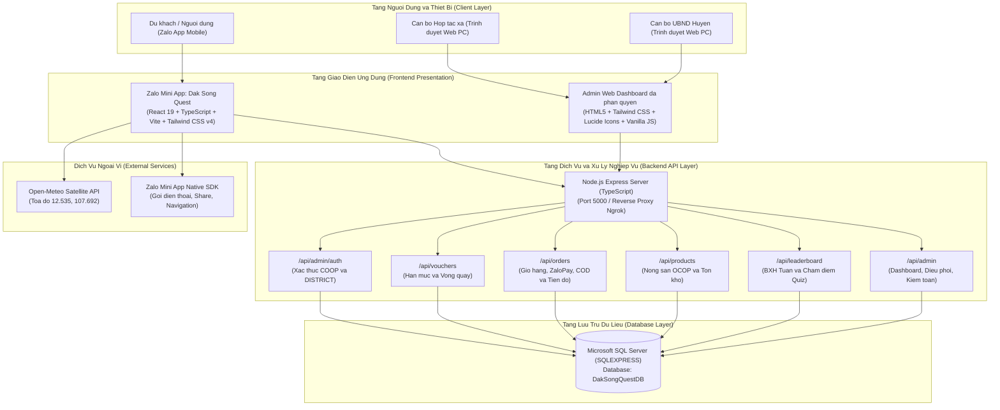
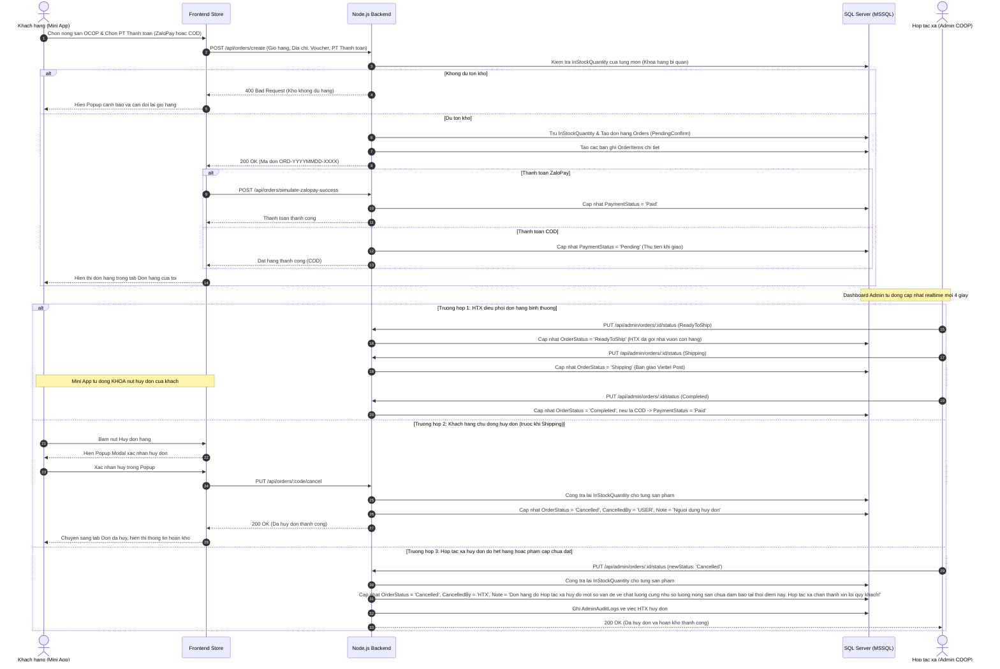
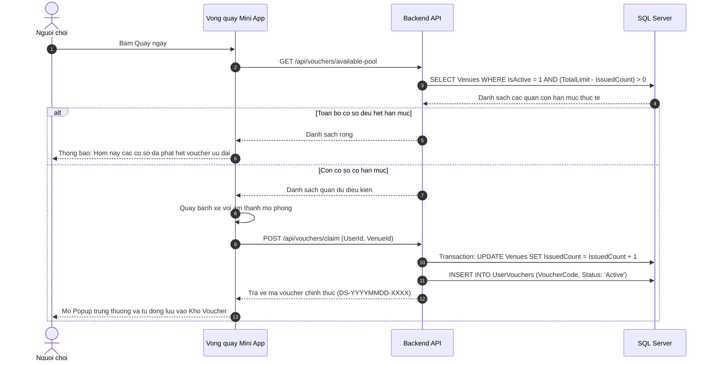

# TAI LIEU MO TA HE THONG TOAN DIEN
# DU AN: DAK SONG QUEST (ZALO MINI APP VA ADMIN CMS)

---

## 1. TONG QUAN DU AN (PROJECT OVERVIEW)

### 1.1. Gioi thieu chung
Dak Song Quest la nen tang so hoa du lich va quang ba nong san OCOP toan dien cua huyen Dak Song, tinh Dak Nong. Du an duoc trien khai duoi dang Zalo Mini App danh cho nguoi dung di dong, ket hop cung he thong quan tri Admin CMS Web va co so du lieu quan he Microsoft SQL Server.

He thong tich hop giua Gamification (Tro choi hoa du lich), Thuong mai dien tu nong san OCOP, va Tien ich du lich thuc te:
- Tro choi do vui (Quiz Game): Thu thach kien thuc van hoa, lich su, danh lam thang canh Dak Song voi che do Luyen tap va Thi chinh thuc co tinh gio, xep hang tuan thoi gian thuc.
- Vong quay may man (Lucky Wheel): Co che san voucher ngau nhien lien ket truc tiep voi han muc ton kho thuc te cua cac co so luu tru va an uong tai Dak Song tren co so du lieu.
- San giao dich Nong san OCOP: Mua sam dac san nong nghiep chinh goc (Ho tieu huu co Dak Song, Ca phe Robusta dac san, Hat Mac ca, Mang le rung kho...), thanh toan tien loi qua Vi ZaloPay hoac Tien mat khi nhan hang (COD), dieu phoi don hang va huy don tu dong hoan kho / hoan tien.
- Cua so Popup Gioi thieu: Hien thi thong tin gioi thieu ve Dak Song Quest moi khi nguoi dung truy cap ung dung de nang cao do nhan dien.
- Cam nang du lich so va Thoi tiet thoi gian thuc: Tra cuu du bao thoi tiet ve tinh toa do Dak Song, cam nang luu tru, an uong, hotline va chi duong Google Maps mot cham.
- He thong Quan tri Admin CMS da phan quyen (1 Server 2 Giao dien): Bang dieu khien tu dong bien hoa giao dien rieng biet theo vai tro:
  - Hop tac xa Nong san (Role COOP): Quan tri chuyen biet San TMDT OCOP, kho hang dac san, bang gia va dieu phoi van chuyen don hang.
  - UBND va Ban Quan ly Huyen (Role DISTRICT): Quan tri danh ba quan an, khach san, cap phat han muc voucher du lich, quan tri BXH Quiz va nhat ky kiem toan toan he thong.

---

### 1.2. Muc tieu he thong
1. Quang ba du lich va van hoa ban dia: Gioi thieu cac dia danh noi tieng (Canh dong dien gio Nam Binh, Doi thong Dak Song, Rung dac dung canh quan, Thien vien Truc Lam Dao Nguyen...), van hoa cong chieng M'Nong va dac san nong nghiep the manh.
2. Kich cau kinh te dia phuong: Tao cau noi dua du khach truc tiep den cac nha hang, quan an, khach san va hop tac xa nong san OCOP tren dia ban huyen thong qua voucher giam gia thuc te.
3. Tiep can toi da nguoi dung: Tan dung he sinh thai Zalo voi hon 75 trieu nguoi dung tich cuc tai Viet Nam, cho phep truy cap tuc thi ma khong can tai va cai dat them ung dung tu kho ung dung.
4. Van hanh tin cay, du lieu nhat quan: Dam bao an toan giao dich, kiem soat tranh chap kho hang (Race Conditions), chong gian lan diem so va duy tri tinh minh bach thong qua he thong nhat ky kiem toan (Audit Logs).
5. Phan dinh ro rang trach nhiem quan ly: Phan quyen rieng biet giua Hop tac xa (kinh doanh nong san) va UBND Huyen (quan ly nha nuoc ve du lich) tren cung mot he thong ha tang duy nhat.

---

## 2. KIEN TRUC HE THONG (SYSTEM ARCHITECTURE)

He thong duoc xay dung theo mo hinh phan tang chuan 3 lop (3-Tier Architecture) ket hop kien truc huong dich vu Client - Server:



### 2.1. Ngan xep cong nghe chi tiet (Technology Stack)

| Thanh phan | Cong nghe / Thu vien | Vai tro va Dac diem |
| :--- | :--- | :--- |
| Frontend Framework | React 19 + TypeScript | Xay dung giao dien Single Page Application (SPA), huong component, kiem soat kieu du lieu tinh nghiem ngat. |
| Bundler va Tooling | Vite 7.x | Toi uu hoa toc do build va Hot Module Replacement (HMR), xuat goi dist/ tuong thich 100% WebView Zalo Mini App. |
| Styling | Tailwind CSS v4 | He thong CSS utility-first hien dai, toi uu dung luong CSS nho gon, giao dien co gian responsive tren moi thiet bi. |
| Quan ly State | Jotai (Atomic State) | Quan ly trang thai phan tan (Atoms), tu dong luu tru va phuc hoi tu localStorage (gio hang, voucher nguoi dung). |
| Bieu tuong | Lucide React / Lucide Icons | Bo icon vector hien dai, sac net, dong bo cho ca Mini App va Admin CMS. |
| Native Bridge | ZMP SDK (zmp-sdk) | Cau noi giao tiep voi tinh nang native cua Zalo: goi hotline, chia se feed/chat, mo ban do. |
| Backend Runtime | Node.js (v20+) + Express (TypeScript) | Xu ly toan bo logic nghiep vu, RESTful API endpoints, xac thuc va phan quyen vai tro (RBAC). |
| Co so du lieu | Microsoft SQL Server (SQLEXPRESS) | He quan tri CSDL quan he chuan doanh nghiep, ho tro transaction ACID, khoa bi quan chong tranh chap kho hang. |
| Database Driver | mssql / msnodesqlv8 | Ket noi truc tiep tu Node.js den SQL Server qua Windows Authentication/Trusted Connection voi hieu nang cao. |
| API Khi tuong | Open-Meteo Realtime API | Trich xuat thong so thoi tiet Dak Song theo toa do ve tinh thuc, ho tro CORS, khong can API Key. |

---

## 3. THIET KE CO SO DU LIEU (DATABASE SCHEMA)

He thong su dung co so du lieu DakSongQuestDB tren Microsoft SQL Server voi cau truc quan he chuan hoa:


### 3.1. Chi tiet cac bang CSDL

#### 1. Bang dbo.AdminUsers (Tai khoan quan tri va phan quyen)
- UserId (INT, PK, Identity): Ma dinh danh nguoi dung quan tri.
- Username (NVARCHAR(50), Unique): Ten dang nhap (Vi du: htx_daksong, huyen_daksong).
- Password (NVARCHAR(100)): Mat khau xac thuc.
- FullName (NVARCHAR(150)): Ho va ten nguoi dai dien quan tri.
- Role (NVARCHAR(50)): Vai tro phan quyen (COOP = Hop tac xa | DISTRICT = UBND Huyen).
- AgencyName (NVARCHAR(200)): Ten co quan, don vi cong tac.
- CreatedAt (DATETIME): Thoi diem khoi tao tai khoan.

#### 2. Bang dbo.Venues (Co so luu tru va am thuc tham gia Voucher)
- VenueId (INT, PK, Identity): Ma dinh danh co so.
- VenueName (NVARCHAR(200)): Ten quan an, nha hang, khach san hoac homestay.
- Category (NVARCHAR(50)): Phan loai (An uong, Luu tru, Dac san).
- Discount (NVARCHAR(50)): Muc giam gia hien thi (Vi du: Giam 20%).
- TotalLimit (INT): Han muc phat voucher toi da do can bo Huyen thoa thuan va cai dat.
- IssuedCount (INT): So luong voucher da duoc cap cho du khach qua vong quay.
- UsedCount (INT): So luong voucher khach da mang den quan su dung thuc te.
- IsActive (BIT): Trang thai hoat dong (1 = Dang hoat dong, 0 = Tam dung).

#### 3. Bang dbo.UserVouchers (Voucher nguoi dung so huu)
- VoucherId (INT, PK, Identity): Ma voucher.
- VenueId (INT, FK -> Venues): Co so ap dung voucher.
- UserId (VARCHAR(100)): Dinh danh nguoi choi Zalo.
- VoucherCode (VARCHAR(50)): Ma voucher duy nhat (Vi du: DS-20261011-8842).
- DiscountPercent (INT): Ty le chiet khau giam gia (10, 15, 20, 30%).
- Status (VARCHAR(20)): Trang thai (Active = Chua dung, Used = Da dung tai quan).
- ClaimedAt (DATETIME): Thoi diem trung thuong.
- UsedAt (DATETIME): Thoi diem nhan vien co so xac nhan su dung.

#### 4. Bang dbo.Products (Nong san va Dac san OCOP Dak Song)
- ProductId (INT, PK, Identity): Ma san pham.
- ProductName (NVARCHAR(200)): Ten dac san (Vi du: Tieu den huu co Dak Song, Ca phe Robusta Dak N'rung).
- Origin (NVARCHAR(100)): Xuat xu (Xa Dak N'rung, Nam Binh, Thuan Hanh...).
- Category (NVARCHAR(50)): Phan loai (Hat tieu, Ca phe, Hat dinh duong, Nong san kho).
- Price (DECIMAL(18,0)): Don gia niem yet (VND).
- Unit (NVARCHAR(50)): Quy cach dong goi (Goi 500g, Hu 250g, Hop 1kg).
- InStockQuantity (INT): So luong ton kho thuc te kha dung trong kho HTX.
- IsActive (BIT): Trang thai kinh doanh.

#### 5. Bang dbo.Orders (Don hang mua dac san OCOP)
- OrderId (INT, PK, Identity): Ma so don hang noi bo.
- OrderCode (VARCHAR(50), Unique): Ma don dinh dang ORD-YYYYMMDD-XXXX.
- UserId (VARCHAR(100)): Ma nguoi dung dat hang.
- CustomerName (NVARCHAR(150)): Ho ten nguoi nhan hang.
- Phone (VARCHAR(20)): So dien thoai lien he nguoi nhan.
- ShippingAddress (NVARCHAR(350)): Dia chi giao hang chi tiet kem tinh thanh.
- TotalAmount (DECIMAL(18,0)): Tong tien hang truoc chiet khau.
- DiscountAmount (DECIMAL(18,0)): So tien giam gia tu voucher OCOP.
- FinalAmount (DECIMAL(18,0)): So tien thanh toan cuoi cung.
- VoucherCodeApplied (VARCHAR(50)): Ma voucher giam gia da su dung.
- PaymentMethod (NVARCHAR(50)): Phuong thuc thanh toan (ZaloPay hoac COD - Tien mat).
- PaymentStatus (NVARCHAR(30)): Trang thai tien (Pending, Paid, Refunded, Cancelled).
- OrderStatus (NVARCHAR(50)): Tien do don hang:
  - PendingConfirm: Cho xac nhan (khach duoc phep sua thong tin nhan hang va huy don).
  - ReadyToShip: HTX xac nhan con hang va dong goi (khach van duoc phep huy don).
  - Shipping: Dang van chuyen Viettel Post (tu dong khoa tinh nang huy don).
  - Completed: Da giao hang thanh cong den tay nguoi mua.
  - Cancelled: Don hang da huy (hoan lai 100% ton kho ve CSDL).
- CancelledBy (NVARCHAR(50)): Nguon huy don (USER = Khach tu huy | HTX = Hop tac xa huy).
- Note (NVARCHAR(500)): Ghi chu chi tiet:
  - Khi khach huy: "Nguoi dung huy don".
  - Khi HTX huy: "Don hang do Hop tac xa huy do mot so van de ve chat luong cung nhu so luong nong san chua dam bao tai thoi diem nay. Hop tac xa chan thanh xin loi quy khach!".
- CreatedAt (DATETIME): Thoi diem dat hang.
- AdminConfirmedAt (DATETIME): Thoi diem HTX xac nhan don hang.
- UpdatedAt (DATETIME): Thoi diem cap nhat gan nhat.

#### 6. Bang dbo.OrderItems (Chi tiet cac mat hang trong don)
- OrderItemId (INT, PK, Identity): Ma dinh danh dong don.
- OrderId (INT, FK -> Orders): Ma don hang.
- ProductId (INT, FK -> Products): Ma san pham.
- ProductName (NVARCHAR(200)): Ten san pham tai thoi diem mua.
- Price (DECIMAL(18,0)): Don gia ban tai thoi diem mua.
- Quantity (INT): So luong dat mua.
- Subtotal (DECIMAL(18,0)): Thanh tien (Price * Quantity).

#### 7. Bang dbo.QuizLeaderboard (Bang xep hang nguoi choi Quiz)
- AttemptId (INT, PK, Identity): Ma luot thi.
- ZaloUserId (VARCHAR(100)): Dinh danh nguoi choi.
- DisplayName (NVARCHAR(150)): Ten hien thi nguoi choi.
- AvatarUrl (NVARCHAR(500)): Duong dan anh dai dien nguoi choi.
- WeekId (VARCHAR(20)): Dinh danh tuan thi dau (Dinh dang ISO: YYYY-Www, vi du 2026-W42).
- Score (INT): So cau tra loi dung (0 den 25 cau).
- TotalQuestions (INT): Tong so cau cua de thi (mac dinh 25).
- TimeMs (INT): Tong thoi gian hoan thanh bai thi tinh bang mili-giay.
- CreatedAt / UpdatedAt (DATETIME): Thoi diem nop bai va cap nhat diem cao nhat.

#### 8. Bang dbo.AdminAuditLogs (Nhat ky lich su kiem toan Admin)
- LogId (INT, PK, Identity): Ma ban ghi nhat ky.
- ActionType (NVARCHAR(50)): Loai thao tac (Cap nhat han muc, Cap them voucher, Xoa voucher, Cap nhat ton kho, Sua gia ban, Huy don hang, Xoa ket qua thi...).
- TargetType (NVARCHAR(50)): Phan loai doi tuong nghiep vu (Voucher, Hang hoa OCOP, Don hang, Ket qua).
- TargetName (NVARCHAR(200)): Ten doi tuong bi tac dong.
- Details (NVARCHAR(500)): Chi tiet noi dung thay doi.
- AdminName (NVARCHAR(100)): Don vi thuc hien thao tac (HTX Nong san Dak Song hoac Admin Huyen).
- CreatedAt (DATETIME): Thoi diem ghi nhan thao tac.

---

## 4. CHI TIET CAC PHAN HE NGHIEP VU (CORE MODULES)

### 4.1. Phan he Nguoi dung (Zalo Mini App)

#### 1. Trang Chu (Home Page)
- Popup Gioi thieu Web Dak Song: Hien thi hop thoai gioi thieu ve Dak Song Quest moi khi nguoi dung vao ung dung, trinh bay cac tinh nang san voucher, thi quiz va mua sam nong san OCOP.
- Thoi tiet Ve tinh Thoi gian thuc: Ket noi tram khi tuong toa do Dak Song (12.535, 107.692), the hien nhiet do thuc te, do am, toc do gio va chi so UV.
- Vong quay May man Dong bo Ton kho: Banh xe 8 o quay voi am thanh mo phong truc quan. Tu dong loai bo co so da het han muc tren CSDL, khong phat voucher ao.
- Danh ba Dich vu Dia phuong: Danh sach quan an, nha nghi, khach san kem so dien thoai hotline va chi duong Google Maps.

#### 2. Phan he Thi Do Vui (Quiz va BXH Tuan)
- 2 Che do thi:
  - Che do Luyen tap: Ren luyen khong gioi han theo chu de, xem loi giai chi tiet sau moi cau.
  - Che do Thi chinh thuc: Bo de 25 cau hoi tinh gio theo mili-giay, moi tai khoan luu diem cao nhat trong tuan.
- Phan biet thi sinh trung ten: Tu dong sinh Tag ID nhan dien (Vi du: Thi sinh #104).
- Bo nut dieu huong ro rang: Sau khi hoan thanh bai thi, hien thi nut Xem Bang Xep Hang Tuan va Thi lai / Luyen tap.
- Ho so nguoi choi: Cho phep doi ten hien thi va chon trong bo 8 avatar van hoa dac trung.

#### 3. Cua hang Nong san OCOP va Quan ly Don hang (Store Page)
- Danh muc dac san OCOP: Thong tin nguon goc, gia ca va ton kho thuc te tu SQL Server.
- Thanh toan da kenh khong co chu Sandbox:
  - Vi ZaloPay: Quy trinh mo phong chuan thanh toan In-App co popup xac nhan.
  - Tien mat khi nhan hang (COD): Cho phep nguoi mua thanh toan truc tiep cho shipper khi nhan hang.
  - Khong hien thi chu sandbox tren giao dien nguoi dung de tao su chuyen nghiep va thuc te.
- Cap nhat thong tin nhan hang:
  - Form chinh sua ho ten, so dien thoai, dia chi nhan hang.
  - Nut xac nhan doi sang mau xanh noi bat.
  - Hien thi popup thong bao khi cap nhat thanh cong.
- Theo doi tien do don hang 4 buoc: Cho duyet -> Dong goi -> Dang giao -> Hoan tat.
- Co che Huy don hoan kho thong minh:
  - Khi don o buoc Cho duyet hoac Dong goi: Cho phep nguoi dung huy don kem hop thoai popup xac nhan.
  - Tu dong hoan tra 100% so luong vao kho hang Products trong SQL Server.
  - Khi don da chuyen sang Dang giao: Khoa nut huy don de bao ve tien do cua don vi van chuyen.

#### 4. Cam nang Du lich va Kho Voucher
- Ban do va Diem tham quan: Gioi thieu Dien gio Nam Binh, Doi thong, Rung dac dung, Thien vien Truc Lam...
- Kho Voucher ca nhan: Luu tru cac voucher trung thuong tu vong quay va quiz, cung cap ma de quan an xac nhan su dung.

---

### 4.2. Phan he Quan tri Admin CMS Web (Phan quyen 1 Server 2 Giao dien)

He thong hoat dong tai dia chi http://localhost:5000/admin.html, tu dong nhan dien vai tro de khoac len giao dien thuong hieu rieng biet:

#### 1. Giao dien Hop tac xa Nong san Dak Song (Tai khoan: htx_daksong / 123 - Role: COOP)
- Bo nhan dien thuong hieu Nong nghiep:
  - Header va banner mang gam mau xanh ngoc / xanh la Emerald dac trung cua nong nghiep.
  - Tieu de he thong: SAN NONG SAN OCOP DAK SONG (Huy hieu: HOP TAC XA - COOP).
- Dashboard OCOP Seller Center:
  - The 1: Doanh thu San OCOP (Tong tien don da thanh toan).
  - The 2: Don cho duyet kho (Cac don moi can kiem tra nha vuon).
  - The 3: Dong goi va Van chuyen (Don san sang giao hoac dang giao Viettel Post).
  - The 4: Kho nong san OCOP (Tong mat hang dac san kem canh bao san pham ton kho duoi 20).
  - The 5: Don hoan tat (Tong so don da giao thanh cong).
  - So do 3 buoc dieu phoi: Kiem tra con hang -> Dong goi ban giao Shipper -> Quy trinh huy don hoan kho.
- Tab nghiep vu:
  - An toan bo cac tab thuoc tham quyen Huyen (Quan & Han muc Voucher, BXH Quiz, Nhat ky kiem toan).
  - Mo toan quyen: Dieu phoi Don hang OCOP (nut Xac nhan con hang, Giao Viettel Post, Giao thanh cong, Huy don) va Kho Nong san & Gia OCOP.
  - Quy dinh huy don cua HTX: Khi HTX huy don do chat luong hoac so luong khong dam bao, he thong tu dong ghi chu "Don hang do Hop tac xa huy do mot so van de ve chat luong cung nhu so luong nong san chua dam bao tai thoi diem nay. Hop tac xa chan thanh xin loi quy khach!", dong thoi tu dong hoan tra 100% ton kho ve CSDL.
  - Bao ve API: Neu tai khoan HTX co tinh gui request can thiep vao co so voucher hoac BXH, backend tu dong tra ma loi 403 Forbidden.

#### 2. Giao dien UBND va Ban Quan ly Huyen (Tai khoan: huyen_daksong / 123 - Role: DISTRICT)
- Bo nhan dien Co quan Quan ly Nha nuoc:
  - Header va banner mang gam mau Slate, Indigo va Vang Amber sang trong.
  - Tieu de he thong: DAK SONG QUEST (Huy hieu: UBND HUYEN - DISTRICT).
- Trung tam Dieu hanh IOC Du lich va Dich vu:
  - The 1: Co so hop tac (Tong quan an, khach san va tong han muc voucher phat hanh).
  - The 2: Voucher dung tai quan (So voucher khach da den su dung thuc te).
  - The 3: Thi sinh thi Quiz (Luong du khach tham gia tim hieu van hoa Dak Song).
  - The 4: Lich su kiem toan (Tong so luot dieu chinh han muc voucher va ket qua thi).
  - Bang nhat ky kiem toan gan day: Chi hien thi cac thao tac lien quan den voucher va ket qua thi Quiz.
- Tab nghiep vu:
  - Mo toan quyen: Quan & Han muc Voucher (Them co so, Cap them voucher, Sua han muc, Xoa co so), BXH Nguoi choi Quiz (Xoa ket qua gian lan, reset ve 0 de thi lai), va Lich su kiem toan (chi xem va loc the BXH va Voucher).
  - An hoan toan: Tab Don hang OCOP va tab Kho Nong san & Gia OCOP vi UBND & BQL Huyen khong su dung cac tinh nang nay.
  - Bao ve API: Neu tai khoan Huyen co tinh gui request sua gia hoac kho hang nong san cua HTX, backend tu dong tra ma loi 403 Forbidden.

#### 3. Tien ich Chuyen doi Vai tro 1-Click
- Tren header luon co nut "Chuyen doi vai tro quan tri", cho phep hoan doi tuc thi giua HTX va Huyen trong 0.5 giay ma khong can nhap lai mat khau.

---

## 5. CAC QUY TRINH NGHIEP VU COT LOI (CORE WORKFLOWS)

### 5.1. Quy trinh Dat hang - Thanh toan - Dieu phoi - Huy don hoan kho



---

### 5.2. Quy trinh Vong quay may man va Dong bo Han muc co so



---

## 6. DANH MUC API ENDPOINTS TOAN HE THONG

### 6.1. Nhom API Don hang va San pham OCOP (/api/orders, /api/products)
| Phuong thuc | Endpoint | Mo ta |
| :--- | :--- | :--- |
| GET | /api/products | Lay danh muc san pham OCOP kem so luong ton kho thuc te. |
| POST | /api/orders/create | Tao don hang moi, ho tro thanh toan ZaloPay va COD, tru ton kho an toan. |
| POST | /api/orders/simulate-zalopay-success | Gia lap xac nhan thanh toan ZaloPay thanh cong. |
| POST | /api/orders/zalopay-callback | Webhook tiep nhan thong bao thanh toan chinh thuc tu ZaloPay. |
| PUT | /api/orders/:id/cancel | Khach hang chu dong huy don khi chua giao, tu dong hoan kho 100%. |
| PUT | /api/orders/:id/update-shipping | Cap nhat lai ten, so dien thoai, dia chi nhan hang khi don o buoc Cho duyet. |
| GET | /api/orders/track/:orderCode | Tra cuu tien do don hang theo ma don thoi gian thuc. |

### 6.2. Nhom API Vong quay va Voucher (/api/vouchers)
| Phuong thuc | Endpoint | Mo ta |
| :--- | :--- | :--- |
| GET | /api/vouchers/available-pool | Lay danh sach cac co so con han muc thuc te cho Vong quay. |
| POST | /api/vouchers/claim | Cap phat voucher trung thuong, tang so luong phat hanh IssuedCount. |
| GET | /api/vouchers/user/:userId | Lay danh sach toan bo voucher nguoi dung dang so huu. |
| POST | /api/vouchers/redeem | Nhan vien co so xac nhan dung voucher tai cho, tang UsedCount. |

### 6.3. Nhom API Bang xep hang Quiz (/api/leaderboard)
| Phuong thuc | Endpoint | Mo ta |
| :--- | :--- | :--- |
| GET | /api/leaderboard?weekId=... | Lay bang xep hang diem tuan cua thi sinh (sap xep theo diem va thoi gian). |
| GET | /api/leaderboard/weeks | Danh sach cac tuan thi dau co du lieu. |
| GET | /api/leaderboard/status?userId=... | Kiem tra ket qua thi tuan hien tai cua nguoi choi. |
| POST | /api/leaderboard/submit | Nop bai thi Quiz chinh thuc, luu diem va thoi gian mili-giay. |
| PUT | /api/leaderboard/rename | Doi ten hien thi va cap nhat avatar thi sinh tren bang xep hang. |

### 6.4. Nhom API Quan tri Admin CMS (/api/admin)
| Phuong thuc | Endpoint | Quyen han | Mo ta |
| :--- | :--- | :--- | :--- |
| POST | /api/admin/auth/login | Tat ca | Dang nhap quan tri, xac thuc vai tro COOP hoac DISTRICT. |
| GET | /api/admin/dashboard/stats | Tat ca | Thong ke tong hop so lieu Dashboard (Co so, Voucher, Don hang, OCOP, Thi sinh, Audit Logs). |
| GET | /api/admin/venues | Tat ca | Lay danh sach toan bo co so va han muc voucher. |
| POST | /api/admin/venues | DISTRICT | Them co so du lich moi (COOP bi chan 403). |
| PUT | /api/admin/venues/:id/limit | DISTRICT | Thay doi han muc voucher toi da cua mot quan (COOP bi chan 403). |
| POST | /api/admin/venues/:id/add-vouchers | DISTRICT | Cap them so luong voucher cho quan (COOP bi chan 403). |
| DELETE | /api/admin/venues/:id | DISTRICT | Xoa co so khoi he thong va vong quay (COOP bi chan 403). |
| GET | /api/admin/orders | Tat ca | Quan tri vien xem danh sach don hang kem phan loai CancelledBy. |
| GET | /api/admin/orders/:id/items | Tat ca | Xem chi tiet cac san pham ben trong don hang. |
| PUT | /api/admin/orders/:id/status | COOP | Dieu phoi don hang (ReadyToShip, Shipping, Completed, Cancelled). DISTRICT bi chan 403. |
| POST | /api/admin/products | COOP | Them mat hang dac san OCOP moi. DISTRICT bi chan 403. |
| PUT | /api/admin/products/:id | COOP | Cap nhat gia ban niem yet va so luong ton kho nong san. DISTRICT bi chan 403. |
| GET | /api/admin/audit-logs | Tat ca | Lay danh sach nhat ky lich su kiem toan he thong. |
| DELETE | /api/admin/leaderboard/:id | DISTRICT | Xoa ket qua thi gian lan, reset diem tuan ve 0 de thi lai. COOP bi chan 403. |

---

## 7. HUONG DAN CAI DAT VA TRIEN KHAI (DEPLOYMENT GUIDE)

### 7.1. Yeu cau moi truong
- Node.js: Phien ban 20.x tro len.
- Package Manager: npm phien ban 10.x tro len.
- Co so du lieu: Microsoft SQL Server 2019/2022 hoac SQL Server Express (.\SQLEXPRESS).
- ODBC Driver: ODBC Driver 18 for SQL Server (hoac Driver 17).
- Zalo CLI: zmp-cli (cho viec kiem thu va trien khai Zalo Mini App).

---

### 7.2. Cau hinh Co so du lieu SQL Server
1. Mo SQL Server Management Studio (SSMS).
2. Tao co so du lieu:
   ```sql
   CREATE DATABASE DakSongQuestDB;
   ```
3. Cau hinh chuoi ket noi trong file backend/.env:
   ```env
   PORT=5000
   DB_SERVER=.\SQLEXPRESS
   DB_DATABASE=DakSongQuestDB
   DB_CONNECTION_STRING=Server=.\SQLEXPRESS;Database=DakSongQuestDB;Trusted_Connection=Yes;Driver={ODBC Driver 18 for SQL Server};TrustServerCertificate=Yes
   ```
4. Khi khoi chay backend lan dau, he thong se tu dong khoi tao toan bo cac bang CSDL (AdminUsers, Venues, UserVouchers, Products, Orders, OrderItems, QuizLeaderboard, AdminAuditLogs) va nap san du lieu mau ban dau.

---

### 7.3. Khoi chay Backend Server va Admin CMS
Mo Terminal tai thu muc backend:
```bash
cd backend
npm install
npm run build
node dist/index.js
```
- May chu API Backend hoat dong tai: http://localhost:5000
- Trang Quan tri Admin CMS truy cap tai: http://localhost:5000/admin.html

Tai khoan dang nhap quan tri:
- Hop tac xa Nong san Dak Song (Role: COOP): htx_daksong / 123
- UBND va Ban Quan ly Huyen (Role: DISTRICT): huyen_daksong / 123

---

### 7.4. Khoi chay Frontend Zalo Mini App
Mo Terminal tai thu muc goc cua du an:
```bash
npm install
npm run dev
```
- Mo trinh duyet tai: http://localhost:5173 de trai nghiem giao dien Mini App.

---

### 7.5. Trien khai len moi truong Zalo Mini App that
1. Dang nhap tai khoan Zalo Developer:
   ```bash
   zmp login
   ```
   (Quet ma QR bang ung dung Zalo tren dien thoai de xac thuc dang nhap).
2. Dong goi va tai phien ban len may chu Zalo:
   ```bash
   npm run deploy
   ```
3. Dien thong tin phien ban kiem thu (Testing) va mo ta cap nhat. Sau khi tai len thanh cong, quet ma QR tren Zalo Mini App Developer Console (mini.zalo.me) bang dien thoai de chay thu nghiem truc tiep tren app Zalo.

---

## 8. KET LUAN VA DINH HUONG MO RONG
Du an Dak Song Quest da hoan thien 100% cac chuc nang cot loi theo dung thiet ke, van hanh on dinh tren ca moi truong Web may tinh va Zalo Mini App tren dien thoai thong minh. He thong giai quyet tron ven bai toan kich cau du lich dia phuong, so hoa nong san OCOP, phan dinh quyen han ro rang giua Hop tac xa va UBND Huyen tren cung 1 may chu duy nhat, minh bach hoa quy trinh thanh toan - giao van va luu vet kiem toan chat che.
