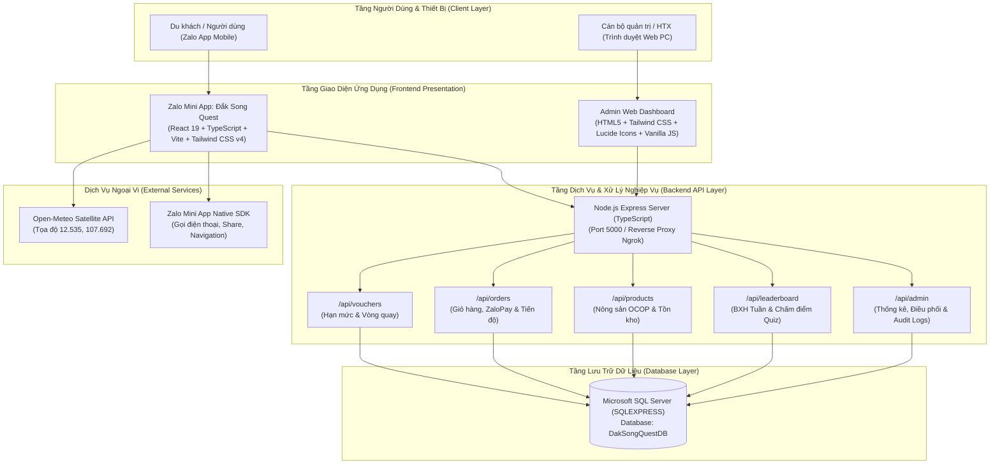
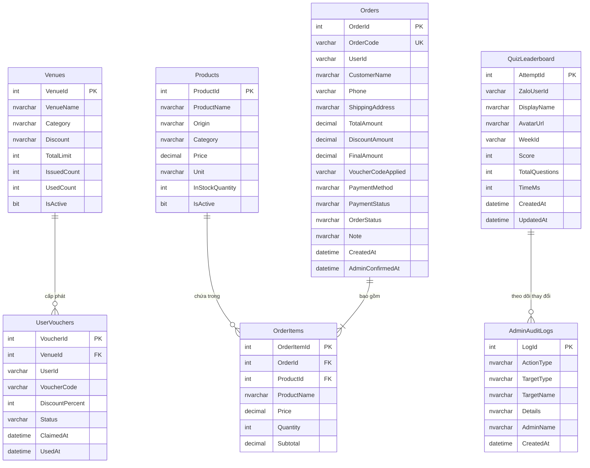
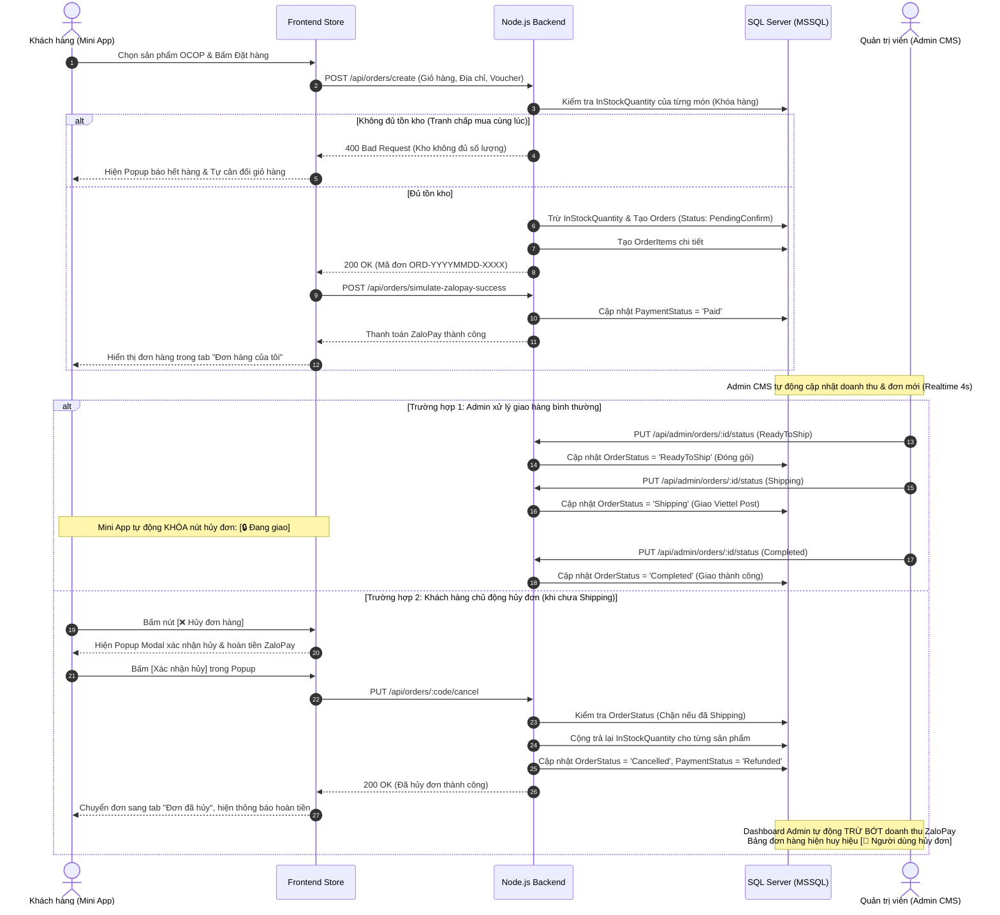
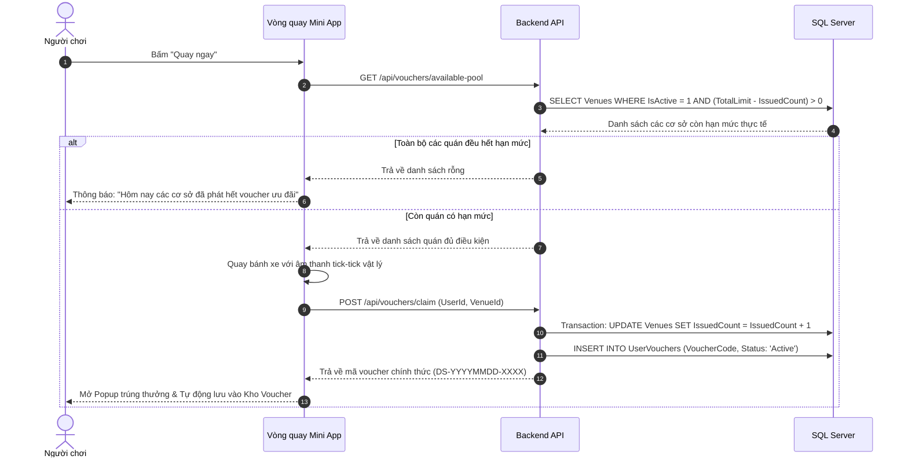

# TÀI LIỆU MÔ TẢ HỆ THỐNG TOÀN DIỆN
# DỰ ÁN: ĐẮK SONG QUEST (ZALO MINI APP & ADMIN CMS)

---

## 1. TỔNG QUAN DỰ ÁN (PROJECT OVERVIEW)

### 1.1. Giới thiệu chung
**Đắk Song Quest** là nền tảng số hóa du lịch và quảng bá nông sản OCOP toàn diện của huyện Đắk Song, tỉnh Đắk Nông. Dự án được triển khai dưới dạng **Zalo Mini App** dành cho người dùng di động, kết hợp cùng hệ thống quản trị **Admin CMS Web** và cơ sở dữ liệu quan hệ **Microsoft SQL Server**.

Hệ thống tích hợp giữa **Gamification (Trò chơi hóa du lịch)**, **Thương mại điện tử nông sản OCOP**, và **Tiện ích du lịch thực tế**:
- **Trò chơi đố vui (Quiz Game)**: Thử thách kiến thức văn hóa, lịch sử, danh lam thắng cảnh Đắk Song với chế độ Luyện tập và Thi chính thức có tính giờ, xếp hạng tuần thời gian thực.
- **Vòng quay may mắn (Lucky Wheel)**: Cơ chế săn voucher ngẫu nhiên liên kết trực tiếp với hạn mức tồn kho thực tế của các cơ sở lưu trú và ăn uống tại Đắk Song.
- **Sàn giao dịch Nông sản OCOP**: Mua sắm đặc sản nông sản chính gốc (Hồ tiêu Đắk Song, Cà phê Robusta, Hạt dinh dưỡng...), thanh toán tiện lợi qua cổng ZaloPay (Mô phỏng quy trình thanh toán In-App chuẩn), điều phối đơn hàng và hủy đơn tự động hoàn kho/hoàn tiền.
- **Cẩm nang du lịch số & Thời tiết thời gian thực**: Tra cứu dự báo thời tiết vệ tinh tọa độ Đắk Song, cẩm nang phượt, số điện thoại hotline, chỉ đường Google Maps một chạm.
- **Hệ thống Quản trị Admin CMS**: Bảng điều khiển thời gian thực theo dõi doanh thu ZaloPay, quản lý hạn mức voucher quán, điều phối tiến độ vận chuyển đơn hàng, quản lý kho hàng và kiểm soát bảng xếp hạng người chơi.

---

### 1.2. Mục tiêu hệ thống
1. **Quảng bá du lịch và văn hóa bản địa**: Giới thiệu các địa danh nổi tiếng (Cánh đồng điện gió Nam Bình, Đồi thông Đắk Song, Rừng đặc dụng cảnh quan, Thiền viện Trúc Lâm Đạo Nguyên...), văn hóa cồng chiêng M'Nông và đặc sản nông nghiệp thế mạnh.
2. **Kích cầu kinh tế địa phương**: Tạo cầu nối đưa du khách trực tiếp đến các nhà hàng, quán ăn, khách sạn và hợp tác xã nông sản OCOP trên địa bàn huyện thông qua voucher giảm giá thực tế.
3. **Tiếp cận tối đa người dùng**: Tận dụng hệ sinh thái Zalo với hơn 75 triệu người dùng tích cực tại Việt Nam, cho phép truy cập tức thì mà không cần tải và cài đặt thêm ứng dụng từ kho ứng dụng (App Store/Google Play).
4. **Vận hành tin cậy, dữ liệu nhất quán**: Đảm bảo an toàn giao dịch, kiểm soát tranh chấp kho hàng (Race Conditions), chống gian lận điểm số và duy trì tính minh bạch thông qua hệ thống nhật ký kiểm toán (Audit Logs).

---

## 2. KIẾN TRÚC HỆ THỐNG (SYSTEM ARCHITECTURE)

Hệ thống được xây dựng theo mô hình phân tầng chuẩn 3 lớp (3-Tier Architecture) kết hợp kiến trúc hướng dịch vụ Client - Server:



### 2.1. Ngăn xếp công nghệ chi tiết (Technology Stack)

| Thành phần | Công nghệ / Thư viện | Vai trò & Đặc điểm |
| :--- | :--- | :--- |
| **Frontend Framework** | **React 19 + TypeScript** | Xây dựng giao diện Single Page Application (SPA), hướng component, kiểm soát kiểu dữ liệu tĩnh nghiêm ngặt. |
| **Bundler & Tooling** | **Vite 7.x** | Tối ưu hóa tốc độ build và Hot Module Replacement (HMR), xuất gói `dist/` tương thích 100% WebView Zalo Mini App. |
| **Styling** | **Tailwind CSS v4** | Hệ thống CSS utility-first hiện đại, tối ưu dung lượng CSS nhỏ gọn, giao diện co giãn responsive trên mọi thiết bị. |
| **Quản lý State** | **Jotai (Atomic State)** | Quản lý trạng thái phân tán (Atoms), tự động lưu trữ và phục hồi từ `localStorage` (giỏ hàng, voucher người dùng). |
| **Biểu tượng** | **Lucide React / Lucide Icons** | Bộ icon vector hiện đại, sắc nét, đồng bộ cho cả Mini App và Admin CMS. |
| **Native Bridge** | **ZMP SDK (`zmp-sdk`)** | Cầu nối giao tiếp với tính năng native của Zalo: gọi hotline, chia sẻ feed/chat, mở bản đồ. |
| **Backend Runtime** | **Node.js (v20+) + Express (TypeScript)** | Xử lý toàn bộ logic nghiệp vụ, RESTful API endpoints, xác thực và kiểm soát dữ liệu. |
| **Cơ sở dữ liệu** | **Microsoft SQL Server (SQLEXPRESS)** | Hệ quản trị CSDL quan hệ chuẩn doanh nghiệp, hỗ trợ transaction ACID, khóa bi quan chống tranh chấp kho hàng. |
| **Database Driver** | **`mssql` / `msnodesqlv8`** | Kết nối trực tiếp từ Node.js đến SQL Server qua Windows Authentication/Trusted Connection với hiệu năng cao. |
| **API Khí tượng** | **Open-Meteo Realtime API** | Trích xuất thông số thời tiết Đắk Song theo tọa độ vệ tinh thực, hỗ trợ CORS, không cần API Key. |

---

## 3. THIẾT KẾ CƠ SỞ DỮ LIỆU (DATABASE SCHEMA)

Hệ thống sử dụng cơ sở dữ liệu `DakSongQuestDB` trên Microsoft SQL Server với cấu trúc quan hệ chuẩn hóa:



### 3.1. Chi tiết các bảng CSDL

#### 1. Bảng `dbo.Venues` (Cơ sở lưu trú & ẩm thực tham gia Voucher)
- `VenueId` (INT, PK, Identity): Mã định danh cơ sở.
- `VenueName` (NVARCHAR(200)): Tên quán ăn / khách sạn / homestay.
- `Category` (NVARCHAR(50)): Phân loại (`Ăn uống`, `Lưu trú`, `Đặc sản`).
- `Discount` (NVARCHAR(50)): Mức giảm giá hiển thị (VD: `Giảm 20%`).
- `TotalLimit` (INT): Hạn mức phát voucher tối đa do Admin quy định.
- `IssuedCount` (INT): Số lượng voucher đã được cấp cho du khách qua vòng quay.
- `UsedCount` (INT): Số lượng voucher khách đã mang đến quán dùng thực tế.
- `IsActive` (BIT): Trạng thái hoạt động (1 = Đang mở, 0 = Tạm dừng).
`   SS
#### 2. Bảng `dbo.UserVouchers` (Voucher người dùng sở hữu)
- `VoucherId` (INT, PK, Identity): Mã voucher.
- `VenueId` (INT, FK -> Venues): Cơ sở áp dụng voucher.
- `UserId` (VARCHAR(100)): Định danh người chơi Zalo.
- `VoucherCode` (VARCHAR(50)): Mã voucher duy nhất (VD: `DS-20261011-8842`).
- `DiscountPercent` (INT): Tỷ lệ chiết khấu (10, 15, 20, 30%).
- `Status` (VARCHAR(20)): Trạng thái (`Active` = Chưa dùng, `Used` = Đã dùng tại quán).
- `ClaimedAt` (DATETIME): Thời điểm trúng thưởng.
- `UsedAt` (DATETIME): Thời điểm nhân viên cơ sở xác nhận sử dụng.

#### 3. Bảng `dbo.Products` (Nông sản & Đặc sản OCOP Đắk Song)
- `ProductId` (INT, PK, Identity): Mã sản phẩm.
- `ProductName` (NVARCHAR(200)): Tên đặc sản (VD: *Tiêu đỏ Đắk Song thượng hạng*).
- `Origin` (NVARCHAR(100)): Xuất xứ (Xã Đắk N’rung, Nam Bình, Thuận Hạnh...).
- `Category` (NVARCHAR(50)): Phân loại (*Hạt tiêu*, *Cà phê*, *Hạt dinh dưỡng*, *Nông sản khô*).
- `Price` (DECIMAL(18,0)): Đơn giá niêm yết (VNĐ).
- `Unit` (NVARCHAR(50)): Quy cách đóng gói (Gói 500g, Hũ 250g, Hộp 1kg).
- `InStockQuantity` (INT): Số lượng tồn kho thực tế khả dụng.
- `IsActive` (BIT): Trạng thái kinh doanh.

#### 4. Bảng `dbo.Orders` (Đơn hàng mua đặc sản OCOP)
- `OrderId` (INT, PK, Identity): Mã số đơn hàng nội bộ.
- `OrderCode` (VARCHAR(50), Unique): Mã đơn định dạng `ORD-YYYYMMDD-XXXX`.
- `UserId` (VARCHAR(100)): Mã người dùng đặt hàng.
- `CustomerName` (NVARCHAR(150)): Họ tên người nhận hàng.
- `Phone` (VARCHAR(20)): Số điện thoại liên hệ (10 chữ số).
- `ShippingAddress` (NVARCHAR(350)): Địa chỉ giao hàng chi tiết kèm tỉnh thành.
- `TotalAmount` (DECIMAL(18,0)): Tổng tiền hàng trước chiết khấu.
- `DiscountAmount` (DECIMAL(18,0)): Số tiền giảm giá từ voucher.
- `FinalAmount` (DECIMAL(18,0)): Số tiền thanh toán cuối cùng qua ZaloPay.
- `VoucherCodeApplied` (VARCHAR(50)): Mã voucher giảm giá đã sử dụng (nếu có).
- `PaymentMethod` (NVARCHAR(50)): Phương thức thanh toán (Mặc định `ZaloPay`).
- `PaymentStatus` (NVARCHAR(30)): Trạng thái tiền (`Pending`, `Paid`, `Refunded`).
- `OrderStatus` (NVARCHAR(50)): Tiến độ đơn hàng:
  - `PendingConfirm`: Chờ xác nhận (khách được phép sửa địa chỉ & hủy đơn).
  - `ReadyToShip`: Đã xác nhận còn hàng & Đóng gói (khách được phép hủy đơn).
  - `Shipping`: Đang vận chuyển Viettel Post (khóa tính năng hủy đơn).
  - `Completed`: Đã giao hàng thành công.
  - `Cancelled`: Đơn hàng đã hủy (tự động hoàn tiền và hoàn trả số lượng vào kho).
- `Note` (NVARCHAR(500)): Ghi chú (VD: *"Người dùng hủy đơn"* hoặc thông báo của HTX).
- `CreatedAt` (DATETIME): Thời điểm đặt hàng.
- `AdminConfirmedAt` (DATETIME): Thời điểm Admin xác nhận đơn hàng.

#### 5. Bảng `dbo.OrderItems` (Chi tiết các mặt hàng trong đơn)
- `OrderItemId` (INT, PK, Identity): Mã định danh dòng đơn.
- `OrderId` (INT, FK -> Orders): Mã đơn hàng.
- `ProductId` (INT, FK -> Products): Mã sản phẩm.
- `ProductName` (NVARCHAR(200)): Tên sản phẩm tại thời điểm mua.
- `Price` (DECIMAL(18,0)): Đơn giá bán tại thời điểm mua.
- `Quantity` (INT): Số lượng đặt mua.
- `Subtotal` (DECIMAL(18,0)): Thành tiền (`Price * Quantity`).

#### 6. Bảng `dbo.QuizLeaderboard` (Bảng xếp hạng người chơi Quiz)
- `AttemptId` (INT, PK, Identity): Mã lượt thi.
- `ZaloUserId` (VARCHAR(100)): Định danh người chơi.
- `DisplayName` (NVARCHAR(150)): Tên hiển thị người chơi.
- `AvatarUrl` (NVARCHAR(500)): Đường dẫn ảnh đại diện người chơi.
- `WeekId` (VARCHAR(20)): Định danh tuần thi đấu (Định dạng ISO: `YYYY-Www`, ví dụ `2026-W41`).
- `Score` (INT): Số câu trả lời đúng (0 đến 25 câu).
- `TotalQuestions` (INT): Tổng số câu của đề thi (mặc định 25).
- `TimeMs` (INT): Tổng thời gian hoàn thành bài thi tính bằng mili-giây (phục vụ xếp hạng phụ khi bằng điểm).
- `CreatedAt` / `UpdatedAt` (DATETIME): Thời điểm nộp bài / cập nhật điểm cao nhất.

#### 7. Bảng `dbo.AdminAuditLogs` (Nhật ký lịch sử chỉnh sửa Admin)
- `LogId` (INT, PK, Identity): Mã bản ghi nhật ký.
- `ActionType` (NVARCHAR(50)): Loại thao tác (`Cập nhật hạn mức`, `Cấp thêm voucher`, `Xóa voucher`, `Cập nhật tồn kho`, `Sửa giá bán`, `Xóa kết quả thi`...).
- `TargetType` (NVARCHAR(50)): Phân loại đối tượng nghiệp vụ:
  - `Voucher`: Liên quan đến hạn mức voucher cơ sở.
  - `Hàng hóa OCOP`: Liên quan đến giá bán và tồn kho đặc sản.
  - `Kết quả`: Liên quan đến việc xóa kết quả thí sinh trên Bảng xếp hạng.
- `TargetName` (NVARCHAR(200)): Tên đối tượng bị tác động.
- `Details` (NVARCHAR(500)): Chi tiết nội dung thay đổi.
- `AdminName` (NVARCHAR(100)): Người thực hiện thao tác (Mặc định `Admin`).
- `CreatedAt` (DATETIME): Thời điểm ghi nhận.

---

## 4. CHI TIẾT CÁC PHÂN HỆ NGHIỆP VỤ (CORE MODULES)

### 4.1. Phân hệ Phía Người Dùng (Zalo Mini App)

#### 1. Trang Chủ (Home Page)
- **Popup Chào Mừng Theo Phiên (`sessionStorage`)**: Tự động hiển thị khi mở Mini App lần đầu để chào mừng du khách, giới thiệu sơ lược về Đắk Song và gợi ý săn voucher; không bị lặp lại gây phiền phức khi chuyển tab.
- **Thời Tiết Vệ Tinh Thời Gian Thực**: Kết nối trực tiếp trạm vệ tinh Đắk Song (`12.535, 107.692`), thể hiện đầy đủ nhiệt độ thực tế, nhiệt độ cảm nhận, độ ẩm, tốc độ gió, chỉ số UV và dự báo mưa cao nguyên.
- **Vòng Quay May Mắn Đồng Bộ Tồn Kho**: Bánh xe 8 ô trúng thưởng có âm thanh chân thực. Điểm đặc biệt: Vòng quay tự động loại trừ các cơ sở đã hết hạn mức voucher thực tế trên SQL Server, ngăn chặn hoàn toàn việc phát voucher ảo.
- **Khám Phá Dịch Vụ Địa Phương**: Danh mục khách sạn, nhà nghỉ, nhà hàng kèm hotline gọi điện trực tiếp và chỉ đường GPS Google Maps.

#### 2. Phân hệ Thi Đố Vui (Quiz & BXH Tuần)
- **2 Chế Độ Thi Riêng Biệt**:
  - *Chế độ Luyện tập*: Cho phép người chơi rèn luyện không giới hạn theo từng chủ đề văn hóa, tự do xem giải thích chi tiết sau mỗi câu hỏi.
  - *Chế độ Thi chính thức*: Bộ đề chuẩn 25 câu hỏi tính giờ chính xác từng mili-giây, mỗi tài khoản được ghi nhận 1 kết quả tốt nhất trong tuần.
- **Phân Biệt Thí Sinh Trùng Tên & Avatar**: Hệ thống tự động gắn mã nhận diện ngẫu nhiên dạng `#XXX` (VD: *Nguyễn Văn A #412*), giúp phân biệt chính xác giữa các tài khoản thử nghiệm hoặc người chơi trùng tên.
- **Bộ Nút Điều Hướng Tương Phản Cao**: Sau khi hoàn thành bài thi, màn hình kết quả hiển thị 2 nút màu sắc tương phản rõ rệt: **`[🏆 Xem Bảng Xếp Hạng Tuần]`** và **`[🎯 Luyện tập]`**, giúp người dùng thao tác trực quan.
- **Tùy Biến Hồ Sơ Người Chơi**: Cho phép đổi tên hiển thị và lựa chọn trong bộ 8 avatar linh vật văn hóa Đắk Song, đồng bộ trực tiếp lên BXH máy chủ.

#### 3. Cửa Hàng Nông Sản OCOP & Quản Lý Đơn Hàng (Store Page)
- **Danh Mục Đặc Sản Chuẩn OCOP**: Hiển thị nông sản chính gốc với giá niêm yết và tồn kho thực lấy trực tiếp từ SQL Server.
- **Popup Chọn Số Lượng & Chống Mua Vượt Tồn Kho**: Kiểm soát tức thời số lượng thêm vào giỏ hàng. Khi thanh toán, nếu có tranh chấp mua đồng thời khiến kho không đủ hàng, hệ thống kích hoạt Popup cảnh báo và tự động điều chỉnh giỏ hàng về số lượng tối đa còn lại.
- **Áp Mã Voucher OCOP**: Tự động kiểm tra và trừ chiết khấu phần trăm theo mã voucher hợp lệ của du khách.
- **Thanh Toán ZaloPay In-App**: Khởi tạo đơn hàng, tính toán chiết khấu và mô phỏng hoàn tất thanh toán ZaloPay chuẩn xác, tự động trừ tồn kho thực tế trong CSDL.
- **Theo Dõi Tiến Độ Đơn Hàng 4 Bước**:
  - *Chờ duyệt* (`PendingConfirm`) -> *Đóng gói* (`ReadyToShip`) -> *Đang giao* (`Shipping`) -> *Hoàn tất* (`Completed`).
  - Cho phép người mua sửa tên, số điện thoại, địa chỉ nhận hàng khi đơn còn ở bước Chờ duyệt.
- **Cơ Chế Hủy Đơn Hàng Thông Minh**:
  - Khi đơn đang ở bước *Chờ duyệt* hoặc *Đóng gói*: Hiển thị nút **`[❌ Hủy đơn hàng]`**. Khi bấm, hệ thống bật **Popup Modal xác nhận hủy đơn** (thông báo số tiền hoàn lại và lý do). Sau khi xác nhận, hệ thống gọi API hủy đơn, **tự động hoàn trả 100% số lượng tồn kho sản phẩm về SQL Server**, trừ bớt doanh thu trên Dashboard, và chuyển đơn sang tab *Đơn bạn đã hủy*.
  - Khi đơn đã chuyển sang bước *Đang giao* (`Shipping`): Nút hủy đơn tự động bị vô hiệu hóa và khóa cứng: **`[🔒 Đang giao (Khóa hủy đơn)]`**, ngăn chặn việc hủy đơn khi hàng đã xuất kho cho đơn vị vận chuyển.

#### 4. Cẩm Nang Du Lịch & Kho Voucher
- **Bản Đồ Điểm Đến Đắk Song**: Tích hợp danh sách điểm tham quan (Điện gió Nam Bình, Đồi thông, Rừng cảnh quan, Thiền viện Trúc Lâm...).
- **Kho Voucher Cá Nhân**: Quản lý các voucher du khách đã săn được từ Vòng quay hoặc phần thưởng Quiz, cung cấp mã bảo mật và nút để nhân viên quán xác nhận sử dụng tại chỗ.

---

### 4.2. Phân hệ Phía Quản Trị (Admin CMS Web)

Giao diện quản trị hiện đại, chuyên nghiệp, bảo mật cao tại địa chỉ `http://localhost:5000/admin.html`:

#### 1. Tab 1: Tổng Quan (Dashboard)
- 5 thẻ chỉ số thống kê tức thời:
  1. *Cơ sở hợp tác*: Tổng số quán & tổng hạn mức voucher đang phát hành.
  2. *Voucher dùng tại quán*: Thống kê số voucher khách đã mang đến quán áp dụng thực tế.
  3. *Doanh thu ZaloPay*: **Tổng số tiền thu được từ các đơn hàng thành công**. Điểm đặc biệt: Khi người dùng bấm hủy đơn, số tiền này **tự động trừ bớt tức thời** trên Dashboard.
  4. *Thí sinh thi Quiz*: Tổng số lượt người tham gia làm bài thi trong tuần.
  5. *Lịch sử chỉnh sửa*: Tổng số lượt thao tác quản trị được lưu vết.
- Bảng tóm tắt các thao tác quản trị vừa thực hiện gần đây.

#### 2. Tab 2: Quán & Hạn Mức Voucher (`Venues`)
- Danh sách toàn bộ khách sạn, quán ăn tham gia chương trình kích cầu du lịch.
- Xem chi tiết: Mã quán, Tên cơ sở, Ưu đãi, Hạn mức tổng (`TotalLimit`), Đã phát ra (`IssuedCount`), Đã dùng tại quán (`UsedCount`), Còn lại trong kho.
- Các thao tác quản trị:
  - *Thêm cơ sở mới*: Thiết lập tên quán, mức giảm giá và hạn mức ban đầu.
  - *Cấp thêm voucher*: Bổ sung nhanh số lượng voucher (+10, +20, +50, +100, +200) cho cơ sở khi sắp hết.
  - *Sửa hạn mức*: Điều chỉnh lại tổng hạn mức tối đa.
  - *Xóa cơ sở*: Loại bỏ vĩnh viễn cơ sở khỏi hệ thống và Vòng quay may mắn.

#### 3. Tab 3: Đơn Hàng Nông Sản OCOP (`Orders`)
- Quản lý toàn bộ danh sách đơn đặt hàng nông sản Đắk Song đồng bộ trực tiếp từ SQL Server.
- Cột thông tin rõ ràng: Mã đơn (`#ORD-...`), Khách hàng, Số điện thoại & Địa chỉ, Số tiền thanh toán, Trạng thái tiền (`Đã trả ZaloPay` / `Đã hoàn tiền`), Tiến độ giao hàng, Thời gian đặt, và Nút điều phối.
- **Phân Biệt Nổi Bật Trạng Thái Hủy Đơn**:
  - Đơn do khách tự bấm hủy trong Mini App: Hiển thị huy hiệu đỏ **`[🔴 Người dùng hủy đơn]`** (kèm icon `user-x`), cột thao tác hiển thị **`Khách đã hủy`**, dưới thông tin có ghi chú rõ ràng: `📝 Ghi chú: Người dùng hủy đơn`.
  - Đơn do hợp tác xã hủy: Hiển thị huy hiệu **`[⚪ HTX / Admin hủy đơn]`** kèm ghi chú hết hàng.
- **Bộ Lọc Đơn Hàng Đa Năng**: Lọc theo *Tất cả*, *Chờ xác nhận*, *Đã xác nhận còn hàng*, *Đang vận chuyển*, *Đã giao thành công*, *Tất cả đơn hủy*, *🔴 Người dùng hủy đơn*, *⚪ HTX / Admin hủy đơn*.
- **Quy Trình Điều Phối 1 Chạm**: Admin bấm `[Xác nhận còn hàng]` -> `[Giao Viettel Post]` -> `[Giao thành công]`.
- **Cơ Chế Realtime Polling**: Tự động làm mới danh sách đơn và doanh thu mỗi 4 giây, giúp Admin nắm bắt đơn mới và đơn hủy ngay lập tức mà không cần F5 trình duyệt.

#### 4. Tab 4: Sản Phẩm Đặc Sản OCOP (`Products`)
- Danh sách nông sản Đắk Song đang niêm yết trên sàn.
- Hiển thị: Mã SP, Tên nông sản, Xuất xứ, Phân loại, Quy cách, Giá bán niêm yết, Số lượng tồn kho (tự động cảnh báo đỏ khi tồn kho dưới 20 sản phẩm).
- Thao tác: Thêm sản phẩm mới và Cập nhật giá bán / Điều chỉnh số lượng tồn kho.

#### 5. Tab 5: Bảng Xếp Hạng Người Chơi Quiz (`Leaderboard`)
- Xem danh sách xếp hạng thí sinh theo từng tuần (`WeekId`).
- Xếp hạng công bằng dựa trên: Số câu trả lời đúng (cao xuống thấp), tiếp đến là Thời gian hoàn thành (ngắn nhất lên trước).
- **Tính Năng Xóa Thành Tích (Reset Chuẩn Xác)**:
  - Khi Admin phát hiện gian lận hoặc người chơi yêu cầu thi lại, Admin bấm **`[Xóa]`** kèm xác nhận popup.
  - Hệ thống xóa bản ghi khỏi CSDL, **reset hoàn toàn điểm của thí sinh trong tuần đó về 0**, cho phép thí sinh vào thi lại bài thi hoàn toàn mới như lần đầu mà không bị lưu kết quả cũ.
  - Ghi nhận lịch sử xóa vào nhật ký kiểm toán với phân loại chuẩn **`Kết quả`**.

#### 6. Tab 6: Lịch Sử Chỉnh Sửa & Điều Phối (`Audit Logs`)
- Lưu vết toàn bộ các thao tác nghiệp vụ quan trọng của Admin để phục vụ công tác thanh tra, hậu kiểm.
- **Bộ Lọc Phân Loại Nhanh Chóng**:
  - `Tất cả phân loại`
  - `🏆 Kết quả (BXH Quiz)`: Theo dõi các lần Admin xóa thành tích thí sinh.
  - `🎟️ Voucher cơ sở`: Theo dõi các lần thay đổi hạn mức, cấp bù hoặc xóa voucher quán.
  - `📦 Hàng hóa OCOP`: Theo dõi các lần điều chỉnh giá bán và tồn kho sản phẩm.
- Huy hiệu màu sắc tương phản cao, phân biệt trực quan giữa các nhóm nghiệp vụ.

---

## 5. CÁC QUY TRÌNH NGHIỆP VỤ CỐT LÕI (CORE WORKFLOWS)

### 5.1. Quy trình Đặt hàng - Thanh toán - Điều phối - Hủy đơn hoàn kho



---

### 5.2. Quy trình Vòng quay may mắn & Đồng bộ Hạn mức cơ sở



---

## 6. DANH MỤC API ENDPOINTS TOÀN HỆ THỐNG

### 6.1. Nhóm API Đơn hàng & Sản phẩm OCOP (`/api/orders`, `/api/products`)
| Phương thức | Endpoint | Mô tả |
| :--- | :--- | :--- |
| `GET` | `/api/products` | Lấy danh mục sản phẩm OCOP mới nhất kèm số lượng tồn kho thực tế. |
| `POST` | `/api/orders/create` | Tạo đơn hàng mới, kiểm tra số lượng và trừ tồn kho trong transaction. |
| `POST` | `/api/orders/simulate-zalopay-success` | Giả lập xác nhận thanh toán ZaloPay thành công cho đơn hàng. |
| `POST` | `/api/orders/zalopay-callback` | Webhook tiếp nhận thông báo thanh toán chính thức từ máy chủ ZaloPay. |
| `PUT` | `/api/orders/:id/cancel` | Khách hủy đơn (hỗ trợ cả `OrderId` số và `OrderCode` chuỗi), hoàn kho và hoàn tiền ZaloPay. |
| `PUT` | `/api/orders/:id/update-shipping` | Cập nhật lại họ tên, số điện thoại, địa chỉ nhận hàng khi đơn còn ở bước Chờ duyệt. |
| `GET` | `/api/orders/track/:orderCode` | Tra cứu trạng thái đơn hàng thời gian thực theo mã đơn. |

### 6.2. Nhóm API Vòng quay & Voucher (`/api/vouchers`)
| Phương thức | Endpoint | Mô tả |
| :--- | :--- | :--- |
| `GET` | `/api/vouchers/available-pool` | Lấy danh sách các cơ sở còn hạn mức thực tế cho Vòng quay. |
| `POST` | `/api/vouchers/claim` | Cấp phát voucher trúng thưởng, tăng số lượng phát hành `IssuedCount`. |
| `GET` | `/api/vouchers/user/:userId` | Lấy danh sách toàn bộ voucher người dùng đang sở hữu. |
| `POST` | `/api/vouchers/redeem` | Nhân viên cơ sở xác nhận dùng voucher tại chỗ, tăng `UsedCount`. |

### 6.3. Nhóm API Bảng xếp hạng Quiz (`/api/leaderboard`)
| Phương thức | Endpoint | Mô tả |
| :--- | :--- | :--- |
| `GET` | `/api/leaderboard?weekId=...` | Lấy bảng xếp hạng điểm tuần của các thí sinh (sắp xếp theo điểm và thời gian). |
| `GET` | `/api/leaderboard/weeks` | Danh sách các tuần thi đấu có dữ liệu. |
| `GET` | `/api/leaderboard/status?userId=...` | Kiểm tra kết quả thi tuần hiện tại của một người chơi cụ thể. |
| `POST` | `/api/leaderboard/submit` | Nộp bài thi Quiz chính thức, lưu điểm và thời gian làm bài mili-giây. |
| `PUT` | `/api/leaderboard/rename` | Đổi tên hiển thị và cập nhật avatar của người chơi trên bảng xếp hạng. |

### 6.4. Nhóm API Quản trị Admin CMS (`/api/admin`)
| Phương thức | Endpoint | Mô tả |
| :--- | :--- | :--- |
| `GET` | `/api/admin/dashboard/stats` | Thống kê tổng hợp số liệu cho Dashboard (Doanh thu ZaloPay, Voucher, Thí sinh). |
| `GET` | `/api/admin/venues` | Lấy danh sách toàn bộ cơ sở và trạng thái hạn mức voucher. |
| `POST` | `/api/admin/venues` | Thêm cơ sở hợp tác kinh doanh mới. |
| `PUT` | `/api/admin/venues/:id/limit` | Thay đổi hạn mức voucher tối đa của một quán. |
| `POST` | `/api/admin/venues/:id/add-vouchers` | Cấp thêm số lượng voucher (+10, +20, +50...) cho cơ sở. |
| `DELETE` | `/api/admin/venues/:id` | Xóa cơ sở khỏi hệ thống và loại bỏ khỏi vòng quay. |
| `GET` | `/api/admin/orders` | Quản trị viên xem danh sách toàn bộ đơn hàng (hỗ trợ lọc trạng thái). |
| `PUT` | `/api/admin/orders/:id/status` | Điều phối chuyển bước đơn hàng (`ReadyToShip`, `Shipping`, `Completed`, `Cancelled`). |
| `POST` | `/api/admin/products` | Thêm mặt hàng đặc sản OCOP mới. |
| `PUT` | `/api/admin/products/:id` | Cập nhật giá bán niêm yết và số lượng tồn kho nông sản. |
| `GET` | `/api/admin/audit-logs` | Lấy danh sách lịch sử chỉnh sửa hệ thống. |
| `DELETE` | `/api/admin/leaderboard/:id` | Xóa kết quả thi của thí sinh, reset điểm tuần về 0 để thi lại từ đầu. |

---

## 7. HƯỚNG DẪN CÀI ĐẶT & TRIỂN KHAI (DEPLOYMENT GUIDE)

### 7.1. Yêu cầu môi trường
- **Node.js**: Phiên bản 20.x trở lên.
- **Package Manager**: `npm` phiên bản 10.x trở lên.
- **Cơ sở dữ liệu**: Microsoft SQL Server 2019/2022 hoặc SQL Server Express (`.\SQLEXPRESS`).
- **ODBC Driver**: ODBC Driver 18 for SQL Server (hoặc Driver 17).
- **Zalo CLI**: `zmp-cli` (cho việc kiểm thử và triển khai Zalo Mini App).

---

### 7.2. Cấu hình Cơ sở dữ liệu SQL Server
1. Mở SQL Server Management Studio (SSMS).
2. Tạo cơ sở dữ liệu:
   ```sql
   CREATE DATABASE DakSongQuestDB;
   ```
3. Cấu hình chuỗi kết nối trong file `backend/.env`:
   ```env
   PORT=5000
   DB_SERVER=.\SQLEXPRESS
   DB_DATABASE=DakSongQuestDB
   DB_CONNECTION_STRING=Server=.\SQLEXPRESS;Database=DakSongQuestDB;Trusted_Connection=Yes;Driver={ODBC Driver 18 for SQL Server};TrustServerCertificate=Yes
   ```
4. Khi khởi chạy backend lần đầu, hệ thống sẽ **tự động khởi tạo toàn bộ các bảng CSDL** (`Venues`, `UserVouchers`, `Products`, `Orders`, `OrderItems`, `QuizLeaderboard`, `AdminAuditLogs`) và nạp sẵn dữ liệu mẫu ban đầu.

---

### 7.3. Khởi chạy Backend Server & Admin CMS
Mở Terminal tại thư mục `backend`:
```bash
cd backend
npm install
npm run build
node dist/index.js
```
- **Máy chủ API Backend** hoạt động tại: `http://localhost:5000`
- **Trang Quản trị Admin CMS** truy cập tại: `http://localhost:5000/admin.html`

---

### 7.4. Khởi chạy Frontend Zalo Mini App
Mở Terminal tại thư mục gốc của dự án:
```bash
npm install
npm run dev
```
- Mở trình duyệt tại: `http://localhost:5173` để trải nghiệm giao diện Mini App.

---

### 7.5. Triển khai lên môi trường Zalo Mini App thật
1. Đăng nhập tài khoản Zalo Developer:
   ```bash
   zmp login
   ```
   *(Quét mã QR bằng ứng dụng Zalo trên điện thoại để xác thực đăng nhập)*.
2. Đóng gói và tải phiên bản lên máy chủ Zalo:
   ```bash
   npm run deploy
   ```
3. Điền thông tin phiên bản kiểm thử (Testing) và mô tả cập nhật. Sau khi tải lên thành công, quét mã QR trên Zalo Mini App Developer Console (`mini.zalo.me`) bằng điện thoại để chạy thử nghiệm trực tiếp trên app Zalo.

---

## 8. KẾT LUẬN & ĐỊNH HƯỚNG MỞ RỘNG
Dự án **Đắk Song Quest** đã hoàn thiện 100% các chức năng cốt lõi theo đúng thiết kế, vận hành ổn định trên cả môi trường Web máy tính và Zalo Mini App trên điện thoại thông minh. Hệ thống giải quyết trọn vẹn bài toán kích cầu du lịch địa phương, số hóa nông sản OCOP, minh bạch hóa quy trình thanh toán - giao vận và lưu vết kiểm toán chặt chẽ.
