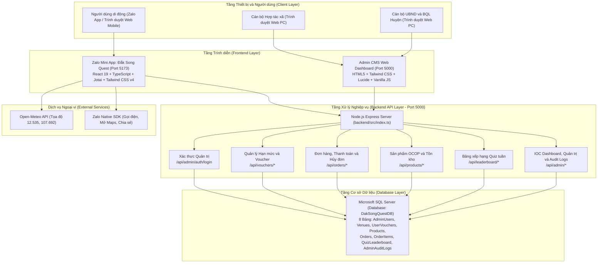
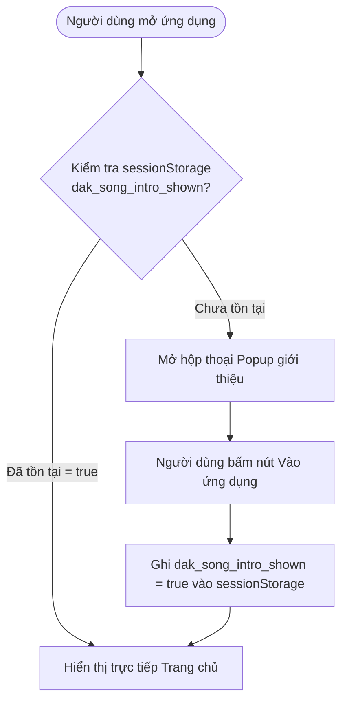
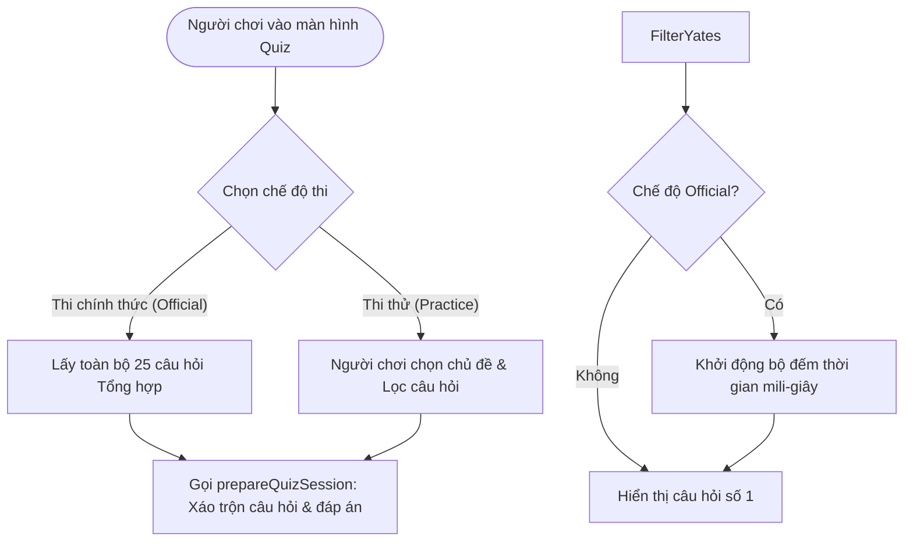
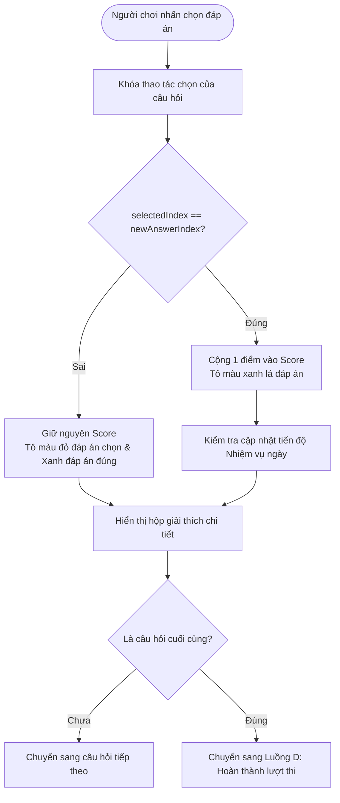
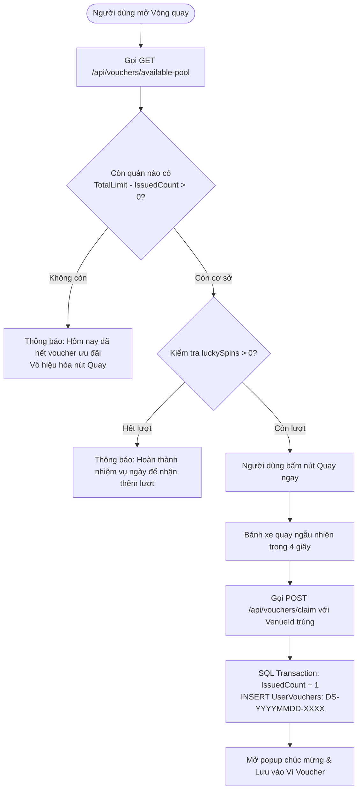
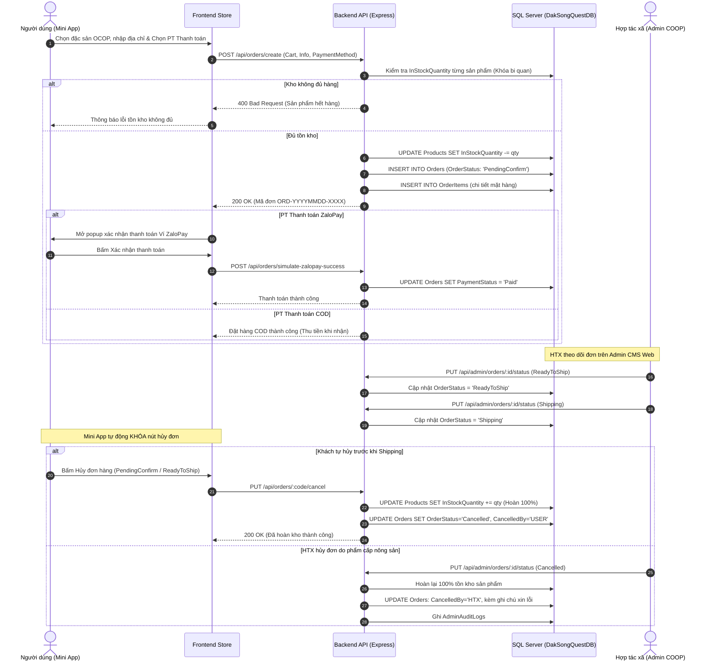
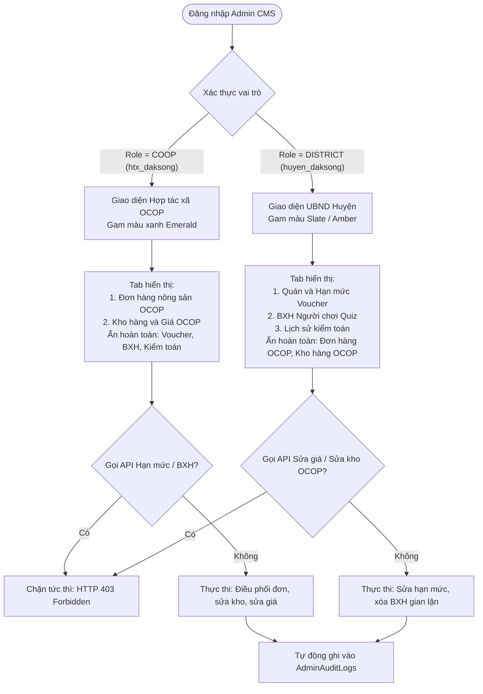
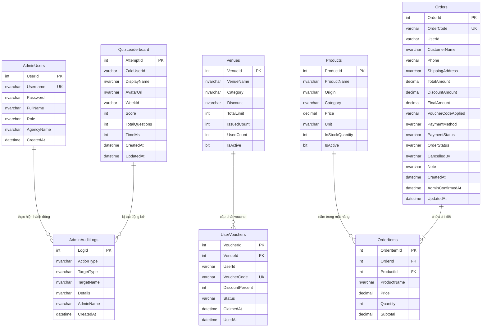
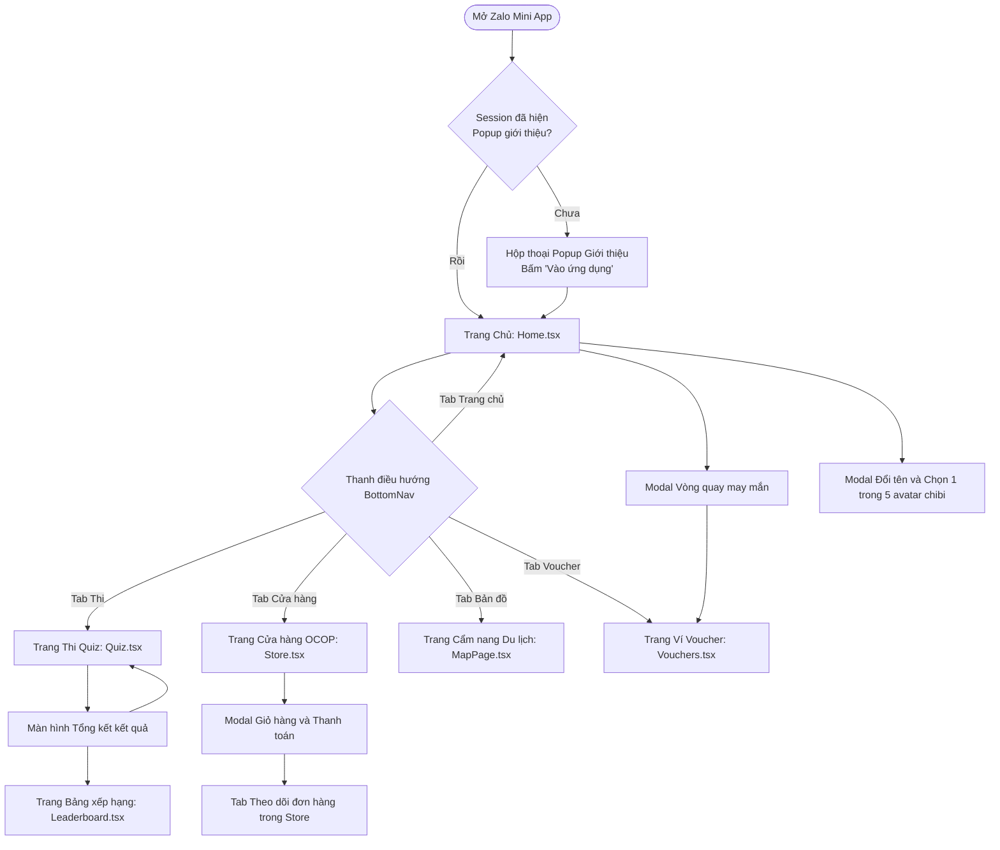

# TÀI LIỆU MÔ TẢ HỆ THỐNG TOÀN DIỆN
# DỰ ÁN: ĐẮK SONG QUEST (ZALO MINI APP VÀ HỆ THỐNG QUẢN TRỊ ADMIN CMS)

---

## 1. TỔNG QUAN HỆ THỐNG

### 1.1. Tên hệ thống
- Tên dự án: Đắk Song Quest.
- Phiên bản tài liệu: 2.2 (Cập nhật tiếng Việt đầy đủ dấu theo kiến trúc hệ thống và mã nguồn thực tế).
- Loại hình hệ thống: Ứng dụng di động tích hợp Zalo Mini App kết hợp Cổng thông tin Quản trị nội bộ Web Admin CMS và Cơ sở dữ liệu quan hệ Microsoft SQL Server.

### 1.2. Mục đích xây dựng
Đắk Song Quest được xây dựng với mục tiêu thúc đẩy chuyển đổi số trong lĩnh vực du lịch và nông nghiệp tại huyện Đắk Song, tỉnh Đắk Nông. Hệ thống ứng dụng cơ chế trò chơi hóa (Gamification) để thu hút du khách tìm hiểu về lịch sử, danh lam thắng cảnh, văn hóa bản địa; đồng thời tạo kênh kết nối thương mại trực tiếp giữa du khách, các cơ sở dịch vụ lưu trú - ẩm thực và các hợp tác xã nông nghiệp sản xuất đặc sản OCOP trên địa bàn huyện.

### 1.3. Bài toán nghiệp vụ cần giải quyết
1. Tiếp cận du khách qua kênh số: Giải quyết hạn chế về kênh quảng bá truyền thống bằng cách tiếp cận hơn 75 triệu người dùng trên nền tảng Zalo mà không yêu cầu người dùng phải cài đặt thêm ứng dụng từ kho ứng dụng App Store hay Google Play.
2. Nâng cao nhận thức văn hóa - du lịch địa phương: Cung cấp hệ thống câu hỏi trắc nghiệm sinh động về các địa danh (Cánh đồng điện gió Nam Bình, Đồi thông Đắk Song, Rừng đặc dụng cảnh quan, Thiền viện Trúc Lâm Đạo Nguyên...) và văn hóa truyền thống (sử thi, cồng chiêng Tây Nguyên).
3. Kích cầu tiêu dùng tại chỗ: Tạo động lực thực tế cho du khách đến trải nghiệm tại các cơ sở ẩm thực, nhà hàng, khách sạn thông qua cơ chế săn voucher giảm giá thực tế được kiểm soát hạn mức phát hành chặt chẽ trên hệ thống.
4. Số hóa chuỗi cung ứng nông sản đặc sản OCOP: Xây dựng sàn thương mại điện tử thu nhỏ giúp Hợp tác xã Nông sản Đắk Song tiếp cận trực tiếp khách hàng, kiểm soát tồn kho thực tế, điều phối vận chuyển và minh bạch hóa quy trình thanh toán tiền mặt hoặc ví điện tử.
5. Phân định rõ ràng trách nhiệm quản lý hành chính và sản xuất kinh doanh: Tích hợp hai phân hệ quản trị riêng biệt trên cùng một hạ tầng máy chủ duy nhất: Hợp tác xã chỉ quản lý đơn hàng và sản phẩm OCOP; UBND và Ban Quản lý Huyện chỉ quản lý hạn mức voucher du lịch, bảng xếp hạng và giám sát nhật ký kiểm toán toàn hệ thống.

### 1.4. Đối tượng sử dụng hệ thống
1. Khách du lịch và người dân địa phương: Sử dụng Zalo Mini App trên điện thoại di động để tham gia đố vui, quay thưởng voucher, mua nông sản OCOP và tra cứu thông tin du lịch, thời tiết địa phương.
2. Cán bộ Hợp tác xã Nông sản Đắk Song (Vai trò COOP): Sử dụng hệ thống Quản trị Admin CMS Web để quản lý danh mục đặc sản OCOP, điều chỉnh giá bán, theo dõi tồn kho, xác nhận đơn hàng, điều phối vận chuyển và xử lý hủy đơn hoàn kho.
3. Cán bộ UBND và Ban Quản lý Huyện Đắk Song (Vai trò DISTRICT): Sử dụng hệ thống Quản trị Admin CMS Web để quản lý danh bạ cơ sở ẩm thực - lưu trú, cấp phát hạn mức voucher du lịch, giám sát bảng xếp hạng người chơi quiz, xử lý gian lận và theo dõi nhật ký kiểm toán hệ thống.
4. Nhân viên cơ sở kinh doanh dịch vụ (Nhà hàng, khách sạn): Tiếp nhận và xác thực mã voucher của khách hàng mang đến sử dụng tại quán.

### 1.5. Phạm vi chức năng
- Phạm vi hỗ trợ hiện tại:
  - Trải nghiệm người dùng trên trình duyệt di động và môi trường WebView của Zalo Mini App.
  - Trò chơi đố vui với 2 chế độ: Thi chính thức tính giờ lưu bảng xếp hạng tuần và Chế độ Luyện tập theo chủ đề tích lũy voucher.
  - Vòng quay may mắn quay thưởng voucher với cơ chế lọc cơ sở còn hạn mức thực tế từ cơ sở dữ liệu.
  - Hệ thống nhiệm vụ hàng ngày tự động làm mới theo ngày để tăng lượt quay thưởng.
  - Sàn thương mại nông sản OCOP với giỏ hàng, chiết khấu voucher, 2 phương thức thanh toán (Ví ZaloPay mô phỏng và Tiền mặt COD), cập nhật thông tin giao hàng và theo dõi tiến độ 4 bước.
  - Cơ chế hủy đơn hoàn trả 100% tồn kho sản phẩm vào cơ sở dữ liệu SQL Server.
  - Tra cứu thông tin thời tiết thời gian thực tại tọa độ Đắk Song thông qua API vệ tinh Open-Meteo.
  - Hệ thống Quản trị Admin CMS đã phân quyền nghiêm ngặt dựa trên Role (COOP và DISTRICT), ngăn chặn truy cập trái phép ở cả giao diện và tầng API (mã lỗi 403 Forbidden).
  - Ghi nhận nhật ký kiểm toán hệ thống (Admin Audit Logs) cho mọi hành vi thay đổi hạn mức, giá cả, tồn kho, hủy đơn và xóa kết quả thi.
- Phạm vi ngoài hệ thống hiện tại:
  - Hệ thống chưa tích hợp cổng thanh toán trực tuyến thật với ZaloPay Merchant Gateway (đang dùng cơ chế mô phỏng thanh toán in-app).
  - Dữ liệu câu hỏi quiz hiện được lưu trữ tĩnh tại tệp mã nguồn chứ chưa được quản trị động qua cơ sở dữ liệu.
  - Chưa tích hợp dịch vụ tin nhắn Zalo ZNS thông báo trạng thái giao hàng đến số điện thoại người mua.

### 1.6. Mối liên hệ giữa trò chơi khám phá và thông tin du lịch địa phương
Hệ thống thiết kế trò chơi đố vui và vòng quay may mắn như một công cụ dẫn dụ du khách:
- Bộ câu hỏi đố vui được biên soạn trực tiếp từ các thông tin địa danh, di tích lịch sử, đặc sản nông nghiệp và tập quán văn hóa của đồng bào Dân tộc thiểu số tại Đắk Song.
- Người chơi trả lời đúng câu hỏi trong chế độ luyện tập sẽ nhận được voucher giảm giá từ 10% đến 20% tại các nhà hàng, quán ăn, khách sạn trên địa bàn.
- Thông tin voucher được gắn liền với tên quán, địa chỉ và số điện thoại, kèm tính năng mở bản đồ Google Maps để chỉ đường trực tiếp cho du khách đến tận cơ sở tiêu thụ dịch vụ.

---

## 2. CÔNG NGHỆ VÀ KIẾN TRÚC HỆ THỐNG

### 2.1. Ngăn xếp công nghệ chi tiết

| Thành phần | Công nghệ hoặc Vị trí mã nguồn | Vai trò | Ghi chú kỹ thuật |
| :--- | :--- | :--- | :--- |
| Framework giao diện Mini App | React 19.0.0, TypeScript 5.7 | Xây dựng giao diện Single Page Application phía người dùng | Sử dụng Functional Components và React Hooks |
| Công cụ đóng gói và chạy dev | Vite 7.3.0 | Bundler và dev server với tốc độ biên dịch cao | Hỗ trợ Hot Module Replacement (HMR) và cấu hình dev proxy |
| CSS và Giao diện | Tailwind CSS 4.0.0 | Hệ thống class tiện ích (utility-first) | Tối ưu CSS nhỏ gọn, co dãn giao diện tương thích màn hình điện thoại |
| Quản lý trạng thái ứng dụng | Jotai 2.12.1 | Atomic State Management | Quản lý trạng thái toàn cục, tự động lưu cache qua atomWithStorage vào localStorage |
| Bộ biểu tượng vector | Lucide React 1.16.0 | Hiển thị icon trực quan trên giao diện | Icon vector nhẹ, không dùng ảnh bitmap |
| Tích hợp nền tảng Zalo | ZMP SDK (zmp-sdk 2.53.0) | Thư viện giao tiếp với tính năng native của ứng dụng Zalo | Hỗ trợ gọi điện thoại thoại, chia sẻ chat/feed, điều hướng ứng dụng |
| Máy chủ Backend | Node.js (v20+), Express 4.21.2 | Xây dựng RESTful API backend và máy chủ tĩnh | Ngôn ngữ TypeScript, biên dịch bằng tsc sang dist/ |
| Trình điều khiển CSDL | mssql 11.0.1, msnodesqlv8 4.2.3 | Kết nối và thực thi truy vấn trên Microsoft SQL Server | Hỗ trợ Windows Authentication (Trusted Connection) và Transaction ACID |
| Hệ quản trị CSDL | Microsoft SQL Server (SQLEXPRESS / LocalDB) | Lưu trữ toàn bộ dữ liệu nghiệp vụ quan hệ | Tên cơ sở dữ liệu mặc định: DakSongQuestDB |
| Giao diện Quản trị Admin | Single Page Application (HTML5, Tailwind CSS, Vanilla JS) | Bảng điều khiển quản trị dành cho Hợp tác xã và Huyện | File backend/public/admin.html, tích hợp trực tiếp trên máy chủ Express |
| Dự báo khí tượng thời gian thực | Open-Meteo Satellite API | Lấy thông số nhiệt độ, độ ẩm, gió, UV tại tọa độ Đắk Song | Tọa độ: 12.535, 107.692. API mở, không cần API key |

### 2.2. Sơ đồ kiến trúc tổng thể

Kiến trúc hệ thống tuân thủ mô hình 3 tầng tiêu chuẩn (3-Tier Architecture) kết hợp Client-Server:



### 2.3. Tổ chức mã nguồn dự án

Cấu trúc thư mục mã nguồn được tổ chức rõ ràng giữa phần frontend và backend:

```text
dak-song-quest-fixed/
|-- app-config.json              Cấu hình thông tin Zalo Mini App
|-- package.json                 Khai báo thư viện Frontend (React, Jotai, Tailwind...)
|-- tsconfig.json                Cấu hình biên dịch TypeScript phía Frontend
|-- vite.config.ts               Cấu hình Vite, Port 5173 và Dev Proxy đến Backend
|-- MO_TA_HE_THONG.md            Tài liệu mô tả kiến trúc và nghiệp vụ hệ thống
|-- README.md                    Tài liệu hướng dẫn cài đặt và vận hành hệ thống
|-- backend/                     Phân hệ Backend Node.js Express và Admin CMS
|   |-- .env                     Biến môi trường: PORT và Chuỗi kết nối SQL Server
|   |-- package.json             Khai báo thư viện Backend (express, mssql, cors...)
|   |-- tsconfig.json            Cấu hình biên dịch TypeScript Backend
|   |-- public/
|   |   `-- admin.html           Giao diện Admin CMS Dashboard đã phân quyền RBAC
|   `-- src/
|       |-- index.ts             Khởi tạo máy chủ Express, đăng ký routes và static files
|       |-- config/
|       |   `-- db.ts            Kết nối CSDL SQL Server, khởi tạo bảng và dữ liệu mẫu ban đầu
|       `-- routes/
|           |-- admin.ts         API Dashboard stats, CRUD cơ sở, phân quyền và Audit Logs
|           |-- leaderboard.ts   API Bảng xếp hạng, nộp điểm và cập nhật tên thí sinh
|           |-- orders.ts        API Tạo đơn hàng, ZaloPay, COD, hủy đơn hoàn kho và đổi địa chỉ
|           |-- products.ts      API Lấy danh sách sản phẩm OCOP và tồn kho
|           `-- vouchers.ts      API Hạn mức voucher, quay thưởng và đổi voucher tại quán
`-- src/                         Phân hệ Frontend Zalo Mini App
    |-- App.tsx                  Router ứng dụng và Layout khung chính
    |-- main.tsx                 Entry point khởi chạy React DOM
    |-- components/              Các thành phần giao diện tái sử dụng
    |   |-- BottomNav.tsx        Thanh điều hướng dưới màn hình (Trang chủ, Thi, Cửa hàng, Map, Voucher)
    |   |-- Header.tsx           Thanh tiêu đề ứng dụng và thông tin người dùng
    |   |-- LuckyWheelModal.tsx  Modal Vòng quay may mắn kiểm tra hạn mức cơ sở
    |   |-- UserProfileModal.tsx Modal đổi tên và chọn 1 trong 5 avatar chibi Tây Nguyên
    |   |-- WeatherCard.tsx      Thẻ hiển thị thời tiết vệ tinh thời gian thực
    |   `-- ...
    |-- data/                    Dữ liệu tĩnh
    |   |-- questions.ts         Ngân hàng 25 câu hỏi quiz về lịch sử, địa lý, văn hóa Đắk Song
    |   `-- venues.ts            Danh bạ cơ sở ẩm thực, lưu trú, hotline và tọa độ Google Maps
    |-- pages/                   Các màn hình nghiệp vụ chính
    |   |-- Home.tsx             Trang chủ: Popup giới thiệu, thời tiết, vòng quay, danh bạ dịch vụ
    |   |-- Quiz.tsx             Trang thi quiz: Chế độ thi chính thức và Chế độ luyện tập
    |   |-- Leaderboard.tsx      Trang bảng xếp hạng tuần, thể hiện Tag ID và thời gian mili-giây
    |   |-- Store.tsx            Trang cửa hàng OCOP: Giỏ hàng, thanh toán, theo dõi và hủy đơn
    |   |-- Vouchers.tsx         Trang ví voucher người dùng và mã QR đổi ưu đãi tại quán
    |   `-- MapPage.tsx          Trang cẩm nang du lịch, danh lam thắng cảnh và bản đồ
    |-- services/                Giao tiếp dịch vụ bên ngoài
    |   |-- api.ts               Axios/Fetch client giao tiếp RESTful API backend
    |   |-- weather.ts           Service gọi Open-Meteo API lấy thời tiết vệ tinh
    |   `-- zalo.ts              Service bọc ZMP SDK cho các tính năng native Zalo
    |-- state/                   Quản lý trạng thái
    |   `-- store.ts             Jotai atoms lưu giữ giỏ hàng, voucher, điểm số, lượt quay
    |-- types/                   Định nghĩa kiểu dữ liệu TypeScript toàn hệ thống
    `-- utils/                   Các hàm tiện ích
        `-- quiz.ts              Thuật toán Fisher-Yates, tính tuần ISO, tính Tag ID người chơi
```

### 2.4. Cơ chế lưu trữ và phân loại dữ liệu

Hệ thống phân định rõ ràng 3 cấp độ lưu trữ dữ liệu:

1. Dữ liệu lưu trữ lâu dài trên Cơ sở dữ liệu SQL Server (Server Persistence):
   - Tài khoản quản trị và vai trò phân quyền (AdminUsers).
   - Danh mục cơ sở du lịch, hạn mức tổng, số lượng voucher đã phát và đã dùng (Venues).
   - Danh sách voucher đã cấp cho người dùng kèm mã duy nhất (UserVouchers).
   - Danh mục đặc sản OCOP, bảng giá niêm yết và số lượng tồn kho khả dụng (Products).
   - Danh sách đơn hàng, trạng thái giao hàng, nguồn hủy đơn và phương thức thanh toán (Orders).
   - Chi tiết các mặt hàng trong từng đơn hàng (OrderItems).
   - Bảng xếp hạng kết quả thi quiz tuần theo điểm số và thời gian mili-giây (QuizLeaderboard).
   - Toàn bộ nhật ký kiểm toán các hành vi quản trị trên hệ thống (AdminAuditLogs).

2. Dữ liệu lưu trữ cục bộ trên trình duyệt người dùng (Client LocalStorage):
   - Hồ sơ người dùng bao gồm tên hiển thị, mã người dùng nội bộ và avatar được chọn (dak_song_user_profile).
   - Số lượt quay may mắn còn lại của người chơi (luckySpinsStorageAtom).
   - Số lượng voucher đã nhận trong ngày qua chế độ thi thử (dailyPracticeVouchersCountAtom).
   - Danh sách mã các nhiệm vụ hàng ngày đã hoàn thành trong ngày (dailyTasksCompletedStorageAtom).
   - Danh sách voucher cá nhân đã nhận để người dùng xem nhanh khi ngoại tuyến (claimedVouchersAtom).
   - Giỏ hàng hiện tại và danh sách mã đơn hàng đã đặt trên thiết bị (cartStorageAtom, ordersStorageAtom).
   - Kết quả lượt thi quiz gần nhất của người chơi (weeklyAttemptStorageAtom).

3. Dữ liệu tạm thời trong phiên truy cập (Session / In-Memory State):
   - Cờ kiểm tra hiển thị hộp thoại popup giới thiệu ứng dụng (dak_song_intro_shown trong sessionStorage). Hộp thoại này chỉ xuất hiện đúng 1 lần khi người dùng bắt đầu phiên làm việc mới, không lặp lại khi bấm nút điều hướng về Trang chủ.
   - Trình tự xáo trộn câu hỏi và thứ tự đáp án trong phiên thi quiz (được tạo mới mỗi lần bắt đầu lượt thi bằng thuật toán Fisher-Yates và chỉ tồn tại trong bộ nhớ RAM).
   - Thời gian đếm mili-giay bài thi đang chạy (sử dụng Date.now() nội bộ component Quiz.tsx).

---

## 3. DANH SÁCH CHỨC NĂNG HỆ THỐNG

Bảng tổng hợp toàn bộ các chức năng nghiệp vụ thực tế được triển khai trong mã nguồn:

| Mã chức năng | Tên chức năng | Mục đích | Đầu vào | Cách xử lý | Kết quả đầu ra | Trạng thái triển khai | Giới hạn hoặc Lưu ý |
| :--- | :--- | :--- | :--- | :--- | :--- | :--- | :--- |
| FN-HOME-01 | Hộp thoại popup giới thiệu ứng dụng | Giới thiệu tổng quan về Đắk Song Quest cho người dùng mới vào | Sự kiện mount component Trang chủ | Kiểm tra sessionStorage khóa dak_song_intro_shown; nếu chưa có thì bật openIntroModal, sau đó đánh dấu đã hiển thị | Hộp thoại giới thiệu xuất hiện, cho phép bấm nút Vào ứng dụng | Hoàn thiện và hoạt động | Chỉ xuất hiện 1 lần mỗi phiên, không lặp lại khi bấm chuyển tab về Trang chủ |
| FN-HOME-02 | Thẻ thời tiết vệ tinh thời gian thực | Hiển thị thông số khí tượng thực tế tại Đắk Song | Tọa độ vệ tinh (12.535, 107.692) | Gọi Open-Meteo API, lấy nhiệt độ, độ ẩm, tốc độ gió, chỉ số UV, ánh xạ mã WMO code sang mô tả tiếng Việt | Thẻ thời tiết hiển thị thông số thực và hình ảnh minh họa | Hoàn thiện và hoạt động | Tự động fallback về dữ liệu khí tượng mẫu nếu mất kết nối mạng |
| FN-HOME-03 | Danh bạ cơ sở lưu trú và ẩm thực | Giúp du khách tra cứu nhà hàng, khách sạn và liên hệ | Danh sách cơ sở từ data/venues.ts và SQL Server | Hiển thị thông tin, địa chỉ, hotline và nút chỉ đường | Du khách xem được danh sách, bấm gọi hotline hoặc mở Google Maps | Hoàn thiện và hoạt động | Sử dụng ZMP SDK openPhoneApp hoặc tel: protocol |
| FN-QUIZ-01 | Khởi tạo phiên thi đố vui | Thiết lập đề thi ngẫu nhiên và xáo trộn đáp án | Chế độ thi (Official hoặc Practice), Chủ đề lựa chọn | Chọn 25 câu (Official) hoặc lọc theo chủ đề (Practice), áp dụng Fisher-Yates xáo trộn cả câu hỏi lẫn thứ tự đáp án | Phiên thi sẵn sàng, lưu index đáp án đúng mới, reset bộ đếm giờ | Hoàn thiện và hoạt động | Toàn bộ 25 câu hỏi đều từ tập dữ liệu questions.ts |
| FN-QUIZ-02 | Chọn đáp án và kiểm tra kết quả | Xử lý câu trả lời của người chơi và tính điểm | Index đáp án được người chơi chọn | So sánh với newAnswerIndex của câu hỏi, cộng điểm nếu đúng, hiện giải thích và cập nhật tiến độ | Giao diện đổi màu xanh/đỏ, hiển thị hộp lời giải chi tiết | Hoàn thiện và hoạt động | Trong chế độ Practice cho xem giải thích ngay, chế độ Official chuyển câu tiếp |
| FN-QUIZ-03 | Nộp bài và xếp hạng tuần | Ghi nhận kết quả bài thi vào bảng xếp hạng thời gian thực | ZaloUserId, DisplayName, AvatarUrl, Score, TimeMs | Gửi POST /api/leaderboard/submit lên backend, SQL Server kiểm tra và chỉ cập nhật nếu thành tích mới cao hơn | Bản ghi BXH được lưu, hiển thị thứ hạng cá nhân | Hoàn thiện và hoạt động | Sắp xếp ưu tiên: Điểm cao hơn -> Thời gian nhanh hơn -> Nộp trước |
| FN-QUIZ-04 | Hồ sơ người chơi và Avatar chibi | Cho phép cá nhân hóa thông tin người thi | Tên hiển thị mới, mã avatar chọn (1 trong 5 avatar chibi) | Lưu thông tin vào localStorage và gọi PUT /api/leaderboard/rename lên backend | Thông tin người chơi cập nhật trên toàn ứng dụng và BXH | Hoàn thiện và hoạt động | 5 avatar chibi Tây Nguyên mang bản sắc văn hóa địa phương |
| FN-WHEEL-01 | Vòng quay may mắn | Phát voucher ngẫu nhiên cho người chơi từ kho thực | Sự kiện bấm nút Quay ngay | Gọi GET /api/vouchers/available-pool để lấy quán còn hạn mức; nếu còn thì quay và gọi POST /api/vouchers/claim để trừ hạn mức | Bánh xe dừng ở ô trúng thưởng, sinh mã voucher DS-YYYYMMDD-XXXX | Hoàn thiện và hoạt động | Tự động bỏ qua quán đã hết hạn mức trên CSDL, không phát voucher ảo |
| FN-TASK-01 | Nhiệm vụ hàng ngày | Tạo động lực cho người chơi quay lại và tích lũy lượt quay | Kết quả hoàn thành hành động trong ngày | Kiểm tra điều kiện nhiệm vụ (trả lời 3 câu, hoàn thành quiz, đúng chủ đề), cộng thêm 1 lượt quay | Tăng số lượt quay may mắn trong luckySpinsStorageAtom | Hoàn thiện và hoạt động | Tự động reset trạng thái nhiệm vụ vào 00:00 mỗi ngày theo giờ VN (UTC+7) |
| FN-STORE-01 | Danh mục và tồn kho OCOP | Cho phép khách hàng xem đặc sản và số lượng khả dụng | Danh sách sản phẩm từ SQL Server | Gọi GET /api/products, hiển thị ảnh, xuất xứ, đơn giá, đơn vị và InStockQuantity | Danh sách nông sản hiển thị kèm trạng thái còn hàng/hết hàng | Hoàn thiện và hoạt động | Dữ liệu lấy trực tiếp từ bảng Products trong SQL Server |
| FN-STORE-02 | Tạo đơn hàng và Đặt mua | Tiếp nhận đơn hàng của khách, kiểm tra tồn kho an toàn | Giỏ hàng, họ tên, số điện thoại, địa chỉ, mã voucher, PT thanh toán | Gọi POST /api/orders/create; backend bật Transaction, kiểm tra InStockQuantity, trừ kho và tạo đơn ORD-YYYYMMDD-XXXX | Đơn hàng tạo thành công với trạng thái PendingConfirm, giảm tồn kho | Hoàn thiện và hoạt động | Hỗ trợ 2 phương thức: Ví ZaloPay (mô phỏng) và COD (Tiền mặt) |
| FN-STORE-03 | Cập nhật thông tin nhận hàng | Cho phép người mua sửa địa chỉ/số điện thoại khi đơn chưa đóng gói | Họ tên, số điện thoại, địa chỉ nhận hàng mới | Gọi PUT /api/orders/:id/update-shipping; chỉ cho phép khi OrderStatus = 'PendingConfirm' | Cập nhật thông tin đơn hàng trên SQL Server, hiện popup thông báo thành công | Hoàn thiện và hoạt động | Nút xác nhận đổi màu xanh rõ ràng, tự động ngăn chặn sửa khi đơn đã đóng gói |
| FN-STORE-04 | Hủy đơn hàng và Hoàn kho 100% | Người dùng hoặc Hợp tác xã hủy đơn, hoàn trả tồn kho | Mã đơn hàng, lý do hủy | Gọi PUT /api/orders/:code/cancel hoặc API admin; cộng lại 100% số lượng vào InStockQuantity và cập nhật CancelledBy | Đơn hàng chuyển sang Cancelled, kho hàng được hoàn lại đầy đủ trên DB | Hoàn thiện và hoạt động | Tự động khóa nút hủy đơn khi trạng thái đơn hàng đã chuyển sang Shipping |
| FN-ADMIN-01 | Xác thực và Phân quyền RBAC | Phân định quyền hạn giữa Hợp tác xã và Huyện | Username, Password | Gọi POST /api/admin/auth/login; trả về thông tin Role (COOP hoặc DISTRICT) | Giao diện Admin tự động hiển thị đúng giao diện và tab nghiệp vụ theo vai trò | Hoàn thiện và hoạt động | Hỗ trợ chuyển đổi nhanh vai trò 1-click trên header; chặn 403 ở tầng backend |
| FN-ADMIN-02 | Điều phối đơn hàng OCOP | Hợp tác xã quản lý tiến độ đơn hàng nông sản | Mã đơn hàng, trạng thái mới (ReadyToShip, Shipping, Completed, Cancelled) | Gọi PUT /api/admin/orders/:id/status; backend kiểm tra Role = COOP; nếu hủy đơn thì ghi lý do và hoàn kho | Trạng thái đơn hàng thay đổi, lưu vết nhật ký kiểm toán | Hoàn thiện và hoạt động | Chỉ tài khoản COOP mới được phép thao tác; DISTRICT bị chặn 403 Forbidden |
| FN-ADMIN-03 | Quản trị kho hàng và giá OCOP | Hợp tác xã điều chỉnh giá bán và bổ sung tồn kho nông sản | ProductId, giá bán mới, số lượng tồn kho bổ sung | Gọi PUT /api/admin/products/:id; backend cập nhật giá, tăng tồn kho và ghi Audit Log | Thông tin giá và tồn kho được cập nhật ngay trên Sàn OCOP Mini App | Hoàn thiện và hoạt động | Chỉ tài khoản COOP mới được phép thao tác; DISTRICT bị chặn 403 Forbidden |
| FN-ADMIN-04 | Quản trị hạn mức voucher du lịch | UBND Huyện quản lý danh bạ quán và cấp phát hạn mức voucher | VenueId, TotalLimit mới, số lượng voucher cấp thêm | Gọi các API PUT /api/admin/venues/:id/limit và POST .../add-vouchers | Hạn mức cơ sở được tăng, ảnh hưởng ngay đến tỷ lệ quay thưởng | Hoàn thiện và hoạt động | Chỉ tài khoản DISTRICT mới được phép thao tác; COOP bị chặn 403 Forbidden |
| FN-ADMIN-05 | Quản trị BXH và Kiểm toán | UBND Huyện giám sát thí sinh và nhật ký kiểm toán | AttemptId cần xóa | Gọi DELETE /api/admin/leaderboard/:id để xóa kết quả gian lận, xem nhật ký kiểm toán | Kết quả thi bị xóa khỏi BXH, ghi nhận thao tác vào AdminAuditLogs | Hoàn thiện và hoạt động | Chỉ tài khoản DISTRICT mới được phép thao tác; COOP bị chặn 403 Forbidden |

---

## 4. MÔ TẢ CHI TIẾT TỪNG LUỒNG NGHIỆP VỤ

### 4.1. Luồng A: Mở ứng dụng lần đầu và xem hướng dẫn
1. Mục đích: Cung cấp thông tin giới thiệu về Đắk Song Quest và hướng dẫn người dùng trải nghiệm các tính năng săn voucher, thi đố vui và mua đặc sản OCOP.
2. Tác nhân: Người dùng (Du khách / Người dân).
3. Điều kiện tiên quyết: Người dùng mở ứng dụng Zalo Mini App trên thiết bị.
4. Dữ liệu đầu vào: Khóa dak_song_intro_shown trong sessionStorage của phiên trình duyệt.
5. Các bước thực hiện:
   - Bước 1: Component Home.tsx được mount khi người dùng vào ứng dụng.
   - Bước 2: Hệ thống đọc giá trị từ sessionStorage với khóa dak_song_intro_shown.
   - Bước 3: Nếu khóa chưa tồn tại hoặc có giá trị khác 'true', hệ thống set openIntroModal = true để mở hộp thoại popup giới thiệu.
   - Bước 4: Hộp thoại giới thiệu hiển thị với tiêu đề Chào mừng đến với Đắk Song Quest và các nội dung: Săn voucher ẩm thực & lưu trú, Chinh phục thử thách đố vui văn hóa, Mua sắm đặc sản OCOP giao tận nơi.
   - Bước 5: Người dùng đọc thông tin và nhấn nút Vào ứng dụng.
   - Bước 6: Hệ thống đóng hộp thoại (openIntroModal = false) đồng thời ghi dak_song_intro_shown = 'true' vào sessionStorage và đánh dấu biến memory dak_song_intro_shown để ghi nhớ trong phiên.
6. Điểm rẽ nhánh:
   - Nếu người dùng đang ở tab khác (Quiz, Store, Map...) và nhấn chuyển về tab Trang chủ: Vì session đã ghi nhận cờ 'true', hộp thoại popup sẽ không hiển thị lại.
   - Nếu người dùng đóng trình duyệt/Zalo và mở lại trong phiên mới: sessionStorage được tạo mới, hộp thoại popup sẽ hiển thị lại 1 lần duy nhất.
7. Kết quả đầu ra: Người dùng nắm bắt được thông tin tổng quan và bắt đầu sử dụng các tính năng ứng dụng mà không bị làm phiền liên tục.
8. Xử lý ngoại lệ: Nếu trình duyệt chặn sessionStorage (chế độ Private đặc biệt), ứng dụng sử dụng biến in-memory fallback để đảm bảo popup không xuất hiện lặp lại khi người dùng chuyển giữa các tab.
9. Cập nhật trạng thái: Cập nhật sessionStorage (dak_song_intro_shown: 'true').
10. Giới hạn kỹ thuật: Hộp thoại chỉ lưu trong phiên (session), không lưu vĩnh viễn vào localStorage vì cần giới thiệu lại khi người dùng bắt đầu phiên truy cập mới trong tương lai.



---

### 4.2. Luồng B: Bắt đầu lượt chơi mới (Thi chính thức và Thi thử)
1. Mục đích: Cho phép người chơi lựa chọn giữa chế độ rèn luyện kiến thức (Thi thử) hoặc tham gia thi đua thành tích xếp hạng tuần (Thi chính thức).
2. Tác nhân: Người chơi.
3. Điều kiện tiên quyết: Người dùng đang ở màn hình Quiz.tsx.
4. Dữ liệu đầu vào: Chế độ thi được chọn (mode: 'official' hoặc 'practice'), chủ đề được chọn (nếu là practice).
5. Các bước thực hiện:
   - Bước 1: Giao diện màn hình sảnh chờ (Lobby) hiển thị 2 lựa chọn: Thi chính thức và Thi thử / Luyện tập.
   - Bước 2: Người chơi lựa chọn chế độ:
     - Trường hợp Thi chính thức: Hệ thống tự động chọn toàn bộ 25 câu hỏi trong tập questions.ts thuộc danh mục Tổng hợp.
     - Trường hợp Thi thử: Người chơi chọn 1 trong các chủ đề chuyên biệt (Địa lý, Lịch sử, Văn hóa, Nông nghiệp - OCOP) hoặc Tất cả. Hệ thống lọc các câu hỏi tương ứng.
   - Bước 3: Người chơi nhấn nút Bắt đầu.
   - Bước 4: Hệ thống gọi hàm tiện ích prepareQuizSession():
     - Sử dụng thuật toán Fisher-Yates để xáo trộn ngẫu nhiên thứ tự các câu hỏi.
     - Với từng câu hỏi, xáo trộn ngẫu nhiên thứ tự 4 đáp án lựa chọn, đồng thời truy vết và cập nhật chỉ số newAnswerIndex cho đáp án chính xác.
   - Bước 5: Hệ thống khởi tạo bộ đếm giờ:
     - Thi chính thức: Ghi nhận startTime = Date.now(), khởi động setInterval đo thời gian chính xác theo mili-giây.
     - Thi thử: Không áp dụng đếm ngược thời gian bắt buộc.
   - Bước 6: Chuyển sang màn hình giao diện hiển thị câu hỏi số 1.
6. Điểm rẽ nhánh:
   - Nếu người chơi đã tham gia thi chính thức trong tuần: Hệ thống vẫn cho phép thi lại, tuy nhiên kết quả trên bảng xếp hạng sẽ chỉ được ghi nhận đè lên nếu thành tích mới tốt hơn thành tích cũ.
7. Kết quả đầu ra: Giao diện câu hỏi đầu tiên xuất hiện với các đáp án đã được xáo trộn, sẵn sàng tiếp nhận thao tác chọn lựa.
8. Xử lý ngoại lệ: Nếu chủ đề được chọn không có câu hỏi nào thỏa mãn, hệ thống mặc định sử dụng toàn bộ 25 câu hỏi.
9. Cập nhật trạng thái: Cập nhật session state nội bộ: currentQuestionIndex = 0, score = 0, elapsedMs = 0, isFinished = false.
10. Giới hạn kỹ thuật: Số lượng câu hỏi tối đa hiện tại là 25 câu được biên soạn trong file questions.ts.



---

### 4.3. Luồng C: Trả lời câu hỏi và kiểm tra đáp án
1. Mục đích: Tiếp nhận đáp án người chơi lựa chọn, kiểm tra đúng/sai tức thì, phản hồi trực quan và cập nhật tiến độ bài thi.
2. Tác nhân: Người chơi.
3. Điều kiện tiên quyết: Phiên thi đang diễn ra ở câu hỏi thứ i.
4. Dữ liệu đầu vào: Chỉ số đáp án lựa chọn (selectedIndex: 0, 1, 2 hoặc 3).
5. Các bước thực hiện:
   - Bước 1: Người chơi nhấn chọn một trong 4 phương án trả lời A, B, C, D.
   - Bước 2: Hệ thống khóa thao tác chọn để ngăn chặn việc nhấn đúp hoặc thay đổi đáp án (isAnswered = true).
   - Bước 3: So sánh selectedIndex với newAnswerIndex của câu hỏi hiện tại:
     - Nếu selectedIndex == newAnswerIndex: Trả lời đúng. Hệ thống cộng 1 điểm vào score, phát âm thanh/hiệu ứng thông báo đúng, tô màu xanh lá cho lựa chọn.
     - Nếu selectedIndex != newAnswerIndex: Trả lời sai. Hệ thống tô màu đỏ cho lựa chọn sai, đồng thời tô màu xanh lá cho đáp án đúng để người chơi học hỏi.
   - Bước 4: Kiểm tra nhiệm vụ hàng ngày: Nếu trả lời đúng và câu hỏi thuộc danh mục yêu cầu của nhiệm vụ trong ngày, cập nhật tiến độ nhiệm vụ hàng ngày.
   - Bước 5: Hiển thị hộp thông tin lời giải thích chi tiết (explanation) bên dưới câu hỏi để cung cấp kiến thức bổ trợ cho người chơi.
   - Bước 6: Người chơi xem giải thích và nhấn nút Tiếp tục (hoặc hệ thống tự động chuyển sau khoảng trễ ở chế độ thi chính thức).
   - Bước 7: Nếu chưa phải câu cuối, tăng currentQuestionIndex lên 1 và hiển thị câu tiếp theo; nếu đã là câu cuối cùng, chuyển sang luồng Hoàn thành lượt chơi.
6. Điểm rẽ nhánh:
   - Chế độ Practice: Người chơi chủ động bấm nút Câu tiếp theo sau khi đọc kỹ lời giải.
   - Chế độ Official: Nhập đáp án xong sẽ lập tức chuyển câu sau 800ms để tối ưu hóa thời gian làm bài.
7. Kết quả đầu ra: Điểm số được cập nhật, người chơi nắm được lời giải thích đúng/sai.
8. Xử lý ngoại lệ: Nếu xảy ra lỗi không xác định chỉ số đáp án đúng, hệ thống mặc định ghi nhận sai và cho phép bỏ qua câu hỏi để không làm treo lượt thi.
9. Cập nhật trạng thái: Tăng biến điểm số score, cập nhật dailyTasksCompletedStorageAtom nếu hoàn thành nhiệm vụ ngày.
10. Giới hạn kỹ thuật: Mỗi câu hỏi chỉ được chọn một đáp án duy nhất và không thể quay lại sửa đáp án đã chọn.



---

### 4.4. Luồng D: Hoàn thành lượt chơi và tính điểm
1. Mục đích: Tổng kết điểm số, thời gian hoàn thành, xếp hạng danh hiệu và trao phần thưởng voucher tương ứng.
2. Tác nhân: Người chơi, Backend API.
3. Điều kiện tiên quyết: Người chơi hoàn thành toàn bộ số câu hỏi trong phiên thi.
4. Dữ liệu đầu vào: score, totalQuestions, startTime, mode.
5. Các bước thực hiện:
   - Bước 1: Hệ thống dừng bộ đếm giờ, tính tổng thời gian làm bài: elapsedMs = Date.now() - startTime.
   - Bước 2: Tính tỷ lệ phần trăm đúng: percentage = (score / totalQuestions) * 100.
   - Bước 3: Xác định danh hiệu thành tích:
     - Tỷ lệ >= 90%: Hạng Kim Cương (Nhà thông thái Đắk Song).
     - Tỷ lệ >= 80%: Hạng Vàng (Khám phá xuất sắc).
     - Tỷ lệ >= 70%: Hạng Bạc (Người yêu văn hóa).
     - Tỷ lệ < 70%: Hạng Đồng (Cần tiếp tục rèn luyện).
   - Bước 4: Xử lý phần thưởng theo chế độ thi:
     - Nếu là chế độ Thi thử (Practice):
       - Kiểm tra số lượng voucher thi thử đã nhận trong ngày (dailyPracticeVouchersCount). Nếu chưa vượt quá giới hạn MAX_PRACTICE_VOUCHERS = 3 voucher/ngày và đạt từ Hạng Bạc trở lên (>= 70%), hệ thống tự động cấp tặng 1 voucher giảm giá tương ứng vào Ví voucher của người chơi (Kim Cương: 20%, Vàng: 15%, Bạc: 10%).
       - Tăng biến đếm dailyPracticeVouchersCount lên 1 và lưu vào localStorage.
     - Nếu là chế độ Thi chính thức (Official):
       - Không phát voucher tức thì.
       - Tự động đóng gói payload: { userId, displayName, avatarUrl, score, totalQuestions: 25, timeMs: elapsedMs, weekId }.
       - Gửi POST /api/leaderboard/submit lên backend để cập nhật bảng xếp hạng tuần (xem Luồng E).
       - Lưu kết quả vào weeklyAttemptStorageAtom để hiển thị thông tin thí sinh đã tham gia tuần này.
   - Bước 5: Hiển thị màn hình Tổng kết kết quả kèm 2 nút điều hướng: Xem Bảng Xếp Hạng Tuần và Thi lại / Luyện tập.
6. Điểm rẽ nhánh:
   - Chế độ Thi thử vượt quá 3 voucher/ngày: Vẫn cho thi và hiện kết quả danh hiệu nhưng kèm thông báo Bạn đã nhận đủ 3 voucher luyện tập trong ngày hôm nay.
7. Kết quả đầu ra: Màn hình tổng kết điểm, thời gian định dạng mm:ss.S, danh hiệu, thông báo voucher nhận được (nếu có).
8. Xử lý ngoại lệ: Nếu mất kết nối mạng khi nộp bài thi chính thức, ứng dụng lưu tạm kết quả vào LocalStorage và thông báo người dùng kiểm tra lại kết nối.
9. Cập nhật trạng thái: Ghi vào weeklyAttemptStorageAtom, dailyPracticeVouchersCountAtom, claimedVouchersAtom (nếu nhận voucher).
10. Giới hạn kỹ thuật: Thời gian hoàn thành tính bằng mili-giây dựa trên thời điểm bắt đầu và kết thúc thực tế tại client.

---

### 4.5. Luồng E: Xử lý bảng xếp hạng và giải quyết trường hợp bằng điểm
1. Mục đích: Xếp hạng thành tích người chơi trong tuần thi đấu, đảm bảo tính công bằng và giải quyết triệt để trường hợp đồng điểm số.
2. Tác nhân: Backend API, Microsoft SQL Server, Người chơi xem BXH.
3. Điều kiện tiên quyết: Người chơi gửi kết quả từ chế độ Thi chính thức qua API /api/leaderboard/submit.
4. Dữ liệu đầu vào: ZaloUserId, DisplayName, AvatarUrl, Score, TotalQuestions (25), TimeMs, WeekId (định dạng YYYY-Www).
5. Các bước thực hiện:
   - Bước 1: Backend tiếp nhận POST /api/leaderboard/submit, tính weekId hiện tại theo chuẩn ISO-8601 giờ Việt Nam (UTC+7).
   - Bước 2: Backend truy vấn bảng QuizLeaderboard kiểm tra xem ZaloUserId đã có bản ghi trong weekId hiện tại chưa:
     ```sql
     SELECT * FROM QuizLeaderboard WHERE ZaloUserId = @userId AND WeekId = @weekId
     ```
   - Bước 3: Xét điều kiện ghi nhận thành tích tốt nhất (Best Record Policy):
     - Trường hợp A: Người chơi chưa có bản ghi nào trong tuần: Thực hiện INSERT bản ghi mới vào QuizLeaderboard.
     - Trường hợp B: Người chơi đã có bản ghi trước đó: So sánh thành tích mới với thành tích cũ:
       - Nếu Score_mới > Score_cũ: Thực hiện UPDATE điểm số và thời gian mới.
       - Nếu Score_mới == Score_cũ VÀ TimeMs_mới < TimeMs_cũ: Thực hiện UPDATE vì thời gian làm bài nhanh hơn.
       - Các trường hợp còn lại (điểm kém hơn hoặc bằng điểm nhưng thời gian chậm hơn): Giữ nguyên thành tích cũ, bỏ qua kết quả mới.
   - Bước 4: Khi người dùng mở trang Bảng xếp hạng (Leaderboard.tsx), frontend gọi GET /api/leaderboard?weekId=...
   - Bước 5: Backend thực thi truy vấn với thứ tự ưu tiên sắp xếp 3 cấp:
     ```sql
     SELECT * FROM QuizLeaderboard 
     WHERE WeekId = @weekId 
     ORDER BY Score DESC, TimeMs ASC, AttemptId ASC
     ```
   - Bước 6: Giải quyết trường hợp trùng tên thí sinh:
     - Để tránh nhầm lẫn khi nhiều người chơi đặt cùng tên (ví dụ: Nguyễn Văn A) hoặc dùng avatar mặc định giống nhau, hệ thống gọi hàm getPlayerTag(userId, displayName).
     - Hàm thực hiện băm chuỗi userId và displayName thành mã băm số học, ánh xạ vào khoảng 1000 đến 9999 để tạo Tag nhận diện duy nhất (ví dụ: Nguyễn Văn A #4821).
   - Bước 7: Xác định Top 5 tuần:
     - Vào cuối tuần (Chủ Nhật 23:59), top 5 thí sinh đứng đầu bảng xếp hạng sẽ được trao tặng voucher đặc biệt giảm giá 30% tại các nhà hàng, cơ sở du lịch lớn nhất huyện.
6. Điểm rẽ nhánh:
   - Nếu backend mất kết nối, frontend sử dụng danh sách mockFallbackLeaderboard lưu trong bộ nhớ để hiển thị giao diện mẫu cho người dùng xem thử.
7. Kết quả đầu ra: Bảng xếp hạng tuần thể hiện đầy đủ thứ hạng (Hạng 1, 2, 3 có màu huy chương vàng/bạc/đồng), tên thí sinh kèm Tag ID, avatar, điểm số trên 25 và thời gian làm bài mm:ss.S.
8. Xử lý ngoại lệ: Trường hợp gian lận hoặc cán bộ admin phát hiện bất thường, cán bộ Huyện (vai trò DISTRICT) có quyền xóa bản ghi qua API DELETE /api/admin/leaderboard/:id để yêu cầu thí sinh thi lại trung thực.
9. Cập nhật trạng thái: Cập nhật bảng QuizLeaderboard trong CSDL SQL Server.
10. Giới hạn kỹ thuật: Bảng xếp hạng được reset theo từng tuần (WeekId YYYY-Www). Người chơi có thể xem lại lịch sử các tuần trước bằng cách chọn dropdown tuần.


---

### 4.6. Luồng F: Cơ chế nhận và sử dụng voucher
1. Mục đích: Cấp phát voucher giảm giá thực tế cho người dùng và cho phép sử dụng tại các cơ sở kinh doanh trên địa bàn.
2. Tác nhân: Người dùng, Nhân viên cơ sở ăn uống / lưu trú, Backend API, SQL Server.
3. Điều kiện tiên quyết: Người dùng nhận được voucher qua Vòng quay may mắn, Thi đố vui hoặc Top BXH tuần.
4. Dữ liệu đầu vào: VoucherCode, VenueId, UserId, Status.
5. Các bước thực hiện:
   - Nhận voucher:
     - Khi người dùng trúng thưởng, backend thực thi transaction tạo bản ghi trong bảng UserVouchers với mã định dạng DS-YYYYMMDD-XXXX (ví dụ: DS-20261011-8842).
     - Hệ thống đồng thời tăng chỉ số IssuedCount của quán tương ứng trong bảng Venues lên 1.
     - Voucher được tự động thêm vào danh sách claimedVouchersAtom tại phía client để người dùng tra cứu trong tab Ví Voucher.
   - Sử dụng voucher tại quán:
     - Bước 1: Người dùng đến trực tiếp nhà hàng, quán ăn hoặc khách sạn tại Đắk Song.
     - Bước 2: Người dùng mở màn hình Vouchers.tsx, chọn thẻ voucher muốn sử dụng và nhấn nút Sử dụng tại quán.
     - Bước 3: Ứng dụng hiển thị hộp thoại chứa mã code voucher kèm mã QR trực quan và thông tin giảm giá (ví dụ: Giảm 20%).
     - Bước 4: Người dùng xuất trình mã QR hoặc mã code cho nhân viên thu ngân của quán.
     - Bước 5: Nhân viên cơ sở kiểm tra tính hợp lệ và xác nhận áp dụng giảm trừ trực tiếp vào hóa đơn thanh toán của khách.
     - Bước 6: Người dùng nhấn nút Xác nhận đã sử dụng trên ứng dụng (hoặc nhân viên quán gọi API /api/vouchers/redeem).
     - Bước 7: Hệ thống cập nhật trạng thái voucher thành Used trong CSDL và đồng thời tăng chỉ số UsedCount của quán lên 1 trong bảng Venues.
6. Điểm rẽ nhánh:
   - Voucher đã ở trạng thái Used: Giao diện hiển thị mờ với nhãn Đã sử dụng và không cho phép kích hoạt lại mã QR.
7. Kết quả đầu ra: Du khách được giảm trừ tiền mặt tại quán, cơ sở kinh doanh tiêu thụ được dịch vụ và dữ liệu được đồng bộ lên CSDL.
8. Xử lý ngoại lệ: Nếu mất kết nối mạng khi ở quán, người dùng vẫn có thể mở mã code offline đã được lưu trong claimedVouchersAtom tại localStorage để đối chiếu với thu ngân.
9. Cập nhật trạng thái: Cập nhật Status = 'Used', UsedAt = GETDATE() trong UserVouchers; cập nhật UsedCount = UsedCount + 1 trong Venues.
10. Giới hạn kỹ thuật: Mỗi voucher chỉ có giá trị sử dụng 1 lần duy nhất tại đúng cơ sở được chỉ định.

---

### 4.7. Luồng G: Vòng quay may mắn và nhiệm vụ hàng ngày
1. Mục đích: Kích thích tương tác hàng ngày, phát voucher ngẫu nhiên một cách công bằng dựa trên hạn mức tồn kho thực tế của các cơ sở.
2. Tác nhân: Người chơi, Backend API, SQL Server.
3. Điều kiện tiên quyết: Người chơi còn ít nhất 1 lượt quay (luckySpins > 0).
4. Dữ liệu đầu vào: UserId, Số lượt quay hiện có.
5. Các bước thực hiện:
   - Bước 1: Người chơi mở hộp thoại Vòng quay may mắn tại Trang chủ hoặc qua thẻ tiện ích.
   - Bước 2: Ứng dụng gọi GET /api/vouchers/available-pool lên backend.
   - Bước 3: Backend thực thi truy vấn SQL Server để lọc các quán còn hạn mức:
     ```sql
     SELECT * FROM Venues 
     WHERE IsActive = 1 AND (TotalLimit - IssuedCount) > 0
     ```
   - Bước 4: Xét danh sách cơ sở trả về:
     - Nếu không còn quán nào còn hạn mức (danh sách rỗng): Hệ thống thông báo Hôm nay các cơ sở đã phát hết voucher ưu đãi, vui lòng quay lại ngày mai. Bánh xe quay bị vô hiệu hóa.
     - Nếu còn cơ sở thỏa mãn: Backend trả về danh sách quán khả dụng cho frontend để gắn vào các ô của bánh xe quay.
   - Bước 5: Người chơi bấm nút Quay ngay.
   - Bước 6: Hệ thống giảm số lượt quay đi 1 (luckySpins = luckySpins - 1).
   - Bước 7: Bánh xe quay xoay ngẫu nhiên trong 4 giây với hiệu ứng giảm tốc và âm thanh mô phỏng.
   - Bước 8: Bánh xe dừng lại tại ô quán được chọn. Frontend gọi POST /api/vouchers/claim lên backend kèm { userId, venueId }.
   - Bước 9: Backend mở transaction SQL Server:
     - UPDATE Venues SET IssuedCount = IssuedCount + 1 WHERE VenueId = @venueId.
     - INSERT INTO UserVouchers (...) VALUES (...).
   - Bước 10: Backend trả về mã voucher chính thức, frontend mở hộp thoại chúc mừng và tự động lưu voucher vào Ví voucher người dùng.
   - Tích lũy lượt quay qua Nhiệm vụ hàng ngày:
     - Người chơi kiểm tra danh sách nhiệm vụ ngày trong modal:
       - Trả lời 3 câu hỏi bất kỳ (+1 lượt).
       - Hoàn thành 1 lượt thi quiz (+1 lượt).
       - Trả lời câu hỏi chủ đề Nông nghiệp / Địa lý (+1 lượt).
     - Khi người chơi thực hiện đúng yêu cầu, hàm checkDailyTask() sẽ ghi nhận hoàn thành vào dailyTasksCompletedStorageAtom và tự động cộng 1 lượt vào luckySpinsStorageAtom.
6. Điểm rẽ nhánh:
   - Nếu người chơi hết lượt quay: Hệ thống vô hiệu hóa nút quay và hiển thị gợi ý Hoàn thành nhiệm vụ ngày để nhận thêm lượt quay.
7. Kết quả đầu ra: Người chơi nhận được voucher thật được kiểm soát hạn mức, lượt quay và nhiệm vụ được cập nhật.
8. Xử lý ngoại lệ: Nếu trong lúc quay xảy ra lỗi mạng khi gọi /api/vouchers/claim, hệ thống sẽ hoàn lại 1 lượt quay cho người chơi và thông báo thử lại sau.
9. Cập nhật trạng thái: Cập nhật bảng Venues, UserVouchers trên DB; cập nhật luckySpinsStorageAtom trên client.
10. Giới hạn kỹ thuật: Mỗi ngày hệ thống tự động làm mới trạng thái nhiệm vụ và cấp lượt quay mặc định vào 00:00 theo giờ Việt Nam (UTC+7).



---

### 4.8. Luồng H: Đặt hàng OCOP và xử lý đơn hàng
1. Mục đích: Cho phép người dùng mua đặc sản OCOP, thanh toán linh hoạt, theo dõi tiến độ giao vận và cho phép hủy đơn hoàn trả tồn kho tự động.
2. Tác nhân: Người mua hàng, Hợp tác xã Nông sản Đắk Song (Admin COOP), Backend API, SQL Server.
3. Điều kiện tiên quyết: Người dùng đã thêm ít nhất 1 sản phẩm vào giỏ hàng trong Store.tsx.
4. Dữ liệu đầu vào: Danh sách sản phẩm trong giỏ (productId, quantity, price), Họ tên, Số điện thoại, Địa chỉ giao hàng, Mã voucher giảm giá OCOP, Phương thức thanh toán (ZaloPay hoặc COD).
5. Các bước thực hiện:
   - Bước 1: Người dùng chọn sản phẩm và vào màn hình Giỏ hàng / Thanh toán.
   - Bước 2: Người dùng nhập đầy đủ thông tin giao hàng gồm: Họ tên, Số điện thoại, Địa chỉ nhận hàng.
   - Bước 3: Chọn phương thức thanh toán:
     - Phương thức 1: Ví ZaloPay.
     - Phương thức 2: Tiền mặt khi nhận hàng (COD).
   - Bước 4: Người dùng nhấn nút Đặt hàng.
   - Bước 5: Frontend gọi POST /api/orders/create lên backend.
   - Bước 6: Backend mở Transaction SQL Server và thực hiện kiểm tra khóa bi quan (Pessimistic Locking):
     - Kiểm tra InStockQuantity của từng sản phẩm trong giỏ hàng.
     - Nếu bất kỳ sản phẩm nào có InStockQuantity < quantity đặt mua: Backend hủy bỏ Transaction, trả về HTTP 400 Bad Request với thông báo Số lượng tồn kho không đủ.
     - Nếu đủ tồn kho: Backend thực hiện trừ kho ngay lập tức:
       ```sql
       UPDATE Products SET InStockQuantity = InStockQuantity - @quantity WHERE ProductId = @productId
       ```
     - Sinh mã đơn hàng duy nhất ORD-YYYYMMDD-XXXX.
     - Tạo bản ghi Orders với trạng thái OrderStatus = 'PendingConfirm', PaymentMethod = 'ZaloPay' hoặc 'COD', PaymentStatus = 'Pending'.
     - Tạo các bản ghi chi tiết trong OrderItems.
     - Commit Transaction và trả về thông tin đơn hàng.
   - Bước 7: Xử lý theo phương thức thanh toán:
     - Nếu chọn ZaloPay: Frontend mở hộp thoại popup xác nhận thanh toán Ví ZaloPay (giao diện chuyên nghiệp không chữ sandbox). Người dùng bấm Xác nhận thanh toán -> Gọi POST /api/orders/simulate-zalopay-success -> Backend cập nhật PaymentStatus = 'Paid'.
     - Nếu chọn COD: Hệ thống xác nhận đơn hàng COD thành công, tiền thu hộ sẽ được shipper thu khi giao hàng.
   - Bước 8: Đơn hàng được lưu vào danh sách ordersStorageAtom tại client để người dùng tra cứu trong tab Đơn hàng của tôi.
   - Bước 9: Hợp tác xã tiếp nhận và điều phối đơn hàng trên Admin CMS (Role COOP):
     - Đơn hàng mới ở bước Chờ duyệt (PendingConfirm).
     - HTX liên hệ nhà vườn kiểm tra hàng và nhấn nút Xác nhận còn hàng -> Chuyển trạng thái sang Đóng gói (ReadyToShip).
     - HTX đóng gói xong, bàn giao cho đơn vị vận chuyển (Viettel Post) và nhấn nút Giao Viettel Post -> Chuyển trạng thái sang Đang giao (Shipping).
     - Khi giao hàng thành công, HTX nhấn nút Giao thành công -> Chuyển trạng thái sang Hoàn tất (Completed). Nếu là đơn COD, hệ thống tự động cập nhật PaymentStatus = 'Paid'.
   - Bước 10: Cập nhật thông tin giao hàng bởi khách hàng:
     - Khi đơn ở trạng thái Chờ duyệt (PendingConfirm), người dùng có thể bấm nút Sửa thông tin để cập nhật lại họ tên, số điện thoại hoặc địa chỉ. Form cập nhật hiển thị nút lưu màu xanh rõ ràng, sau khi lưu hiển thị popup thông báo thành công.
   - Bước 11: Quy trình Hủy đơn và Hoàn kho 100%:
     - Khách hàng tự hủy đơn:
       - Chỉ được phép khi đơn hàng đang ở trạng thái PendingConfirm hoặc ReadyToShip.
       - Khi đơn đã chuyển sang Shipping (Đang giao), hệ thống tự động KHÓA nút hủy để bảo vệ tiến độ của đơn vị vận chuyển.
       - Khi khách bấm Hủy đơn, hộp thoại popup xác nhận hiển thị. Khách xác nhận -> Frontend gọi PUT /api/orders/:code/cancel.
       - Backend mở Transaction cộng trả lại 100% số lượng vào InStockQuantity trong bảng Products, cập nhật OrderStatus = 'Cancelled', CancelledBy = 'USER', Note = 'Người dùng hủy đơn'.
     - Hợp tác xã chủ động hủy đơn:
       - Trong trường hợp kiểm tra nhà vườn phát hiện nông sản không đạt phẩm cấp hoặc đột biến thời tiết không thể thu hoạch, cán bộ HTX nhấn nút Hủy đơn trên Admin CMS.
       - Hệ thống cập nhật OrderStatus = 'Cancelled', CancelledBy = 'HTX', kèm ghi chú rõ ràng: Đơn hàng do Hợp tác xã hủy do một số vấn đề về chất lượng cũng như số lượng nông sản chưa đảm bảo tại thời điểm này. Hợp tác xã chân thành xin lỗi quý khách!
       - Backend tự động cộng trả lại 100% tồn kho về bảng Products và ghi nhật ký vào AdminAuditLogs.
6. Điểm rẽ nhánh:
   - Khi đơn đã chuyển sang trạng thái Shipping, cả khách hàng và HTX đều không thể hủy đơn qua các nút thao tác thông thường.
7. Kết quả đầu ra: Đơn hàng được lưu vết chi tiết, tồn kho sản phẩm luôn nhất quán với thực tế, người mua theo dõi được 4 bước tiến độ rõ ràng.
8. Xử lý ngoại lệ: Nếu thanh toán ZaloPay thất bại hoặc khách hủy thanh toán trong popup, đơn hàng vẫn ở trạng thái chờ thanh toán hoặc người dùng có thể chủ động hủy đơn để hoàn kho.
9. Cập nhật trạng thái: Cập nhật bảng Orders, OrderItems, Products, AdminAuditLogs trên CSDL SQL Server.
10. Giới hạn kỹ thuật: Tính năng ZaloPay hiện tại hoạt động dưới cơ chế mô phỏng in-app, chưa kết nối cổng IPN thanh toán ngân hàng thật.



---

### 4.9. Luồng I: Quản trị hệ thống và phân quyền RBAC (Role-Based Access Control)
1. Mục đích: Đảm bảo tính bảo mật, phân định rõ ràng quyền hạn giữa cơ quan quản lý nhà nước (UBND Huyện) và đơn vị sản xuất kinh doanh (Hợp tác xã) trên cùng một hệ thống.
2. Tác nhân: Cán bộ Hợp tác xã (COOP), Cán bộ UBND & Ban Quản lý Huyện (DISTRICT).
3. Điều kiện tiên quyết: Người dùng quản trị truy cập vào trang Web Admin CMS tại địa chỉ http://localhost:5000/admin.html.
4. Dữ liệu đầu vào: Username, Password (hoặc sử dụng tính năng chuyển đổi vai trò 1-click trên header).
5. Các bước thực hiện:
   - Bước 1: Đăng nhập vào hệ thống quản trị:
     - Tài khoản Hợp tác xã: htx_daksong / 123 -> Hệ thống xác thực trả về Role: COOP.
     - Tài khoản UBND Huyện: huyen_daksong / 123 -> Hệ thống xác thực trả về Role: DISTRICT.
   - Bước 2: Biến hóa giao diện tự động theo vai trò (Role-Based Dynamic UI):
     - Khi đăng nhập vai trò Hợp tác xã (COOP):
       - Header mang gam màu xanh nông nghiệp Emerald, tiêu đề SÀN NÔNG SẢN OCOP ĐẮK SONG.
       - Dashboard thể hiện số liệu kinh doanh: Doanh thu Sàn OCOP, Đơn chờ duyệt kho, Đóng gói & Vận chuyển, Kho nông sản OCOP, Đơn hoàn tất.
       - Hiển thị 2 tab nghiệp vụ: Đơn hàng nông sản OCOP và Kho hàng & Giá OCOP.
       - Ẩn hoàn toàn 3 tab quản lý nhà nước: Quán & Hạn mức Voucher, BXH Người chơi Quiz, Lịch sử kiểm toán.
     - Khi đăng nhập vai trò UBND và BQL Huyện (DISTRICT):
       - Header mang gam màu Slate và Vàng Amber, tiêu đề ĐẮK SONG QUEST (UBND HUYỆN - DISTRICT).
       - Dashboard thể hiện số liệu điều hành du lịch: Cơ sở hợp tác, Voucher dùng tại quán, Thí sinh thi Quiz, Lịch sử kiểm toán. Bảng kiểm toán gần đây trên Dashboard chỉ lọc hiển thị các thao tác về Voucher và BXH.
       - Hiển thị 3 tab nghiệp vụ: Quán & Hạn mức Voucher, BXH Người chơi Quiz, Lịch sử kiểm toán.
       - Ẩn hoàn toàn 2 tab kinh doanh: Đơn hàng nông sản OCOP và Kho hàng & Giá OCOP (UBND Huyện không dùng và không cần can thiệp vào khâu vận hành đơn hàng nông sản).
   - Bước 3: Bảo vệ phân quyền ở tầng Backend API (Backend Enforcement):
     - Backend không chỉ dựa vào ẩn giao diện mà kiểm tra quyền trên từng API endpoint bằng middleware xác thực:
       - Nếu tài khoản COOP gửi request can thiệp vào Voucher, BXH: Backend tự động trả HTTP 403 Forbidden.
       - Nếu tài khoản DISTRICT gửi request sửa giá sản phẩm hoặc sửa kho nông sản của HTX: Backend tự động trả HTTP 403 Forbidden.
   - Bước 4: Ghi nhận nhật ký kiểm toán (Admin Audit Trail):
     - Mọi thao tác thay đổi quan trọng (Sửa hạn mức voucher, Thêm/xóa quán, Sửa giá OCOP, Thay đổi tồn kho, Hủy đơn hàng, Xóa kết quả thi quiz) đều tự động tạo một bản ghi vào bảng AdminAuditLogs gồm: ActionType, TargetType, TargetName, Details, AdminName, CreatedAt.
   - Bước 5: Tiện ích Chuyển đổi vai trò 1-Click:
     - Trên thanh header có nút Chuyển đổi vai trò quản trị, giúp cán bộ kiểm thử và quản lý dễ dàng hoán đổi giữa giao diện COOP và DISTRICT trong 0.5 giây mà không phải đăng xuất và nhập lại mật khẩu.
6. Điểm rẽ nhánh:
   - Nếu người dùng đang ở tab Đơn hàng mà chuyển sang vai trò Huyện: Hệ thống tự động chuyển tab hiện tại về Dashboard để tránh lỗi hiển thị tab bị ẩn.
7. Kết quả đầu ra: Giao diện tách bạch hoàn toàn về chức năng, dữ liệu bảo mật, giám sát hành vi minh bạch qua nhật ký kiểm toán.
8. Xử lý ngoại lệ: Khi phát hiện truy cập bất hợp pháp hoặc session hết hạn, hệ thống đưa người dùng về hộp thoại đăng nhập.
9. Cập nhật trạng thái: Cập nhật bảng AdminAuditLogs cho mỗi thao tác quản trị.
10. Giới hạn kỹ thuật: Hiện tại phân quyền áp dụng token/session nội bộ đơn giản cho 2 vai trò định sẵn, chưa hoàn thiện module tự tạo nhóm quyền tùy biến.



---

## 5. QUY TẮC NGHIỆP VỤ HỆ THỐNG (BUSINESS RULES)

Bảng chi tiết các quy tắc logic được áp dụng xuyên suốt mã nguồn:

| Mã quy tắc | Tên quy tắc | Điều kiện áp dụng | Cách xử lý cụ thể | Kết quả nghiệp vụ | Nguồn xác minh trong mã nguồn |
| :--- | :--- | :--- | :--- | :--- | :--- |
| BR-QUIZ-01 | Phân tách chế độ Thi Chính thức vs Thi thử | Khi người chơi chọn bắt đầu bài thi | Thi chính thức: Lấy đúng 25 câu Tổng hợp, bật bộ đếm giờ ms, không tặng voucher tức thì, tính điểm vào BXH tuần. Thi thử: Cho lọc chủ đề, không ép giờ, tặng voucher nếu điểm cao. | Phiên thi được thiết lập đúng chế độ và cơ chế chấm điểm | src/pages/Quiz.tsx (hàm handleStartQuiz) |
| BR-QUIZ-02 | Xáo trộn ngẫu nhiên Fisher-Yates | Khi khởi tạo phiên thi bất kỳ | Duyệt ngược từ cuối mảng đến đầu, hoán đổi ngẫu nhiên phần tử i với phần tử j (j <= i). Áp dụng xáo trộn danh sách câu hỏi và xáo trộn 4 lựa chọn trong từng câu hỏi. | Thứ tự câu hỏi và đáp án A, B, C, D hoàn toàn khác biệt giữa các lượt chơi, chống gian lận học thuộc vị trí | src/utils/quiz.ts (hàm shuffle và prepareQuizSession) |
| BR-QUIZ-03 | Thứ tự ưu tiên xếp hạng tuần | Khi truy vấn bảng xếp hạng tuần trên SQL Server | Câu lệnh truy vấn: ORDER BY Score DESC, TimeMs ASC, AttemptId ASC. Ưu tiên 1: Số câu đúng cao hơn; Ưu tiên 2: Thời gian làm bài ít hơn; Ưu tiên 3: Nộp bài sớm hơn. | Xếp hạng chính xác, minh bạch, không xảy ra tranh chấp đồng hạng | backend/src/routes/leaderboard.ts (dòng 30-45) |
| BR-QUIZ-04 | Ghi nhận thành tích tốt nhất trong tuần | Khi nộp kết quả bài thi chính thức lên backend | Kiểm tra bản ghi cũ của thí sinh trong tuần: Chỉ UPDATE nếu Score_mới > Score_cũ HOẶC (Score_mới == Score_cũ VÀ TimeMs_mới < TimeMs_cũ). Nếu kém hơn thì giữ nguyên. | Thí sinh được phép thi lại nhiều lần để cải thiện điểm mà không sợ bị tụt hạng | backend/src/routes/leaderboard.ts (hàm submit) |
| BR-QUIZ-05 | Mã nhận diện thí sinh trùng tên (Tag ID) | Khi hiển thị thí sinh trên BXH | Băm chuỗi userId + displayName thành mã số nguyên tương đối, ánh xạ vào dải số 1000 đến 9999 bằng công thức: Math.abs(hash) % 9000 + 1000. | Mỗi người chơi có Tag nhận diện duy nhất dạng #1234, phân biệt được các thí sinh đặt cùng tên | src/utils/quiz.ts (hàm getPlayerTag) |
| BR-QUIZ-06 | Hạn mức voucher thi thử hàng ngày | Khi hoàn thành lượt thi thử | Nếu percentage >= 70% và dailyPracticeVouchersCount < 3: Cấp voucher tương ứng theo rank (Kim cương 20%, Vàng 15%, Bạc 10%) và tăng biến đếm. Nếu đã đạt 3 voucher: Không cấp thêm. | Chống lạm phát voucher, giới hạn tối đa 3 voucher thi thử mỗi ngày | src/pages/Quiz.tsx (MAX_PRACTICE_VOUCHERS = 3) |
| BR-WHEEL-01 | Lọc cơ sở còn hạn mức thực tế | Khi người dùng quay Vòng quay may mắn | Truy vấn CSDL: SELECT WHERE IsActive = 1 AND (TotalLimit - IssuedCount) > 0. Chỉ đưa các cơ sở này vào bánh xe quay. | Tuyệt đối không phát voucher của quán đã hết hạn mức phát hành | backend/src/routes/vouchers.ts (/available-pool) |
| BR-WHEEL-02 | Giao dịch cấp phát voucher an toàn | Khi xác nhận trúng thưởng voucher | Mở Transaction SQL Server: Tăng IssuedCount của quán thêm 1, đồng thời INSERT bản ghi vào UserVouchers với mã duy nhất DS-YYYYMMDD-XXXX. | Đảm bảo tính toàn vẹn dữ liệu, không xảy ra trừ âm hạn mức khi nhiều người quay đồng thời | backend/src/routes/vouchers.ts (/claim) |
| BR-TASK-01 | Tự động làm mới nhiệm vụ ngày | Khi sang ngày mới theo giờ Việt Nam | Sử dụng hàm getVietnamDate() (UTC+7) để xác định ngày YYYY-MM-DD. Nếu ngày hiện tại khác ngày lưu trong storage, tự động reset danh sách nhiệm vụ và biến đếm voucher. | Nhiệm vụ và lượt quay được làm mới công bằng vào 00:00 mỗi ngày | src/utils/quiz.ts (hàm getVietnamDate) |
| BR-ORDER-01 | Kiểm tra tồn kho bi quan khi tạo đơn | Khi khách nhấn Đặt hàng OCOP | Backend mở Transaction kiểm tra InStockQuantity từng mặt hàng. Nếu không đủ: rollback và trả 400. Nếu đủ: trừ kho ngay và tạo đơn hàng. | Ngăn chặn bán vượt tồn kho (Overselling) khi nhiều khách cùng đặt 1 mặt hàng | backend/src/routes/orders.ts (/create) |
| BR-ORDER-02 | Điều kiện sửa thông tin nhận hàng | Khi khách muốn sửa tên, sđt, địa chỉ | Chỉ cho phép khi OrderStatus == 'PendingConfirm' (Chờ duyệt). Khi đã ở ReadyToShip hoặc Shipping, hệ thống tự động khóa tính năng sửa. | Tránh sai lệch thông tin khi nhà vườn đã đóng gói hoặc shipper đã lấy hàng | backend/src/routes/orders.ts (/update-shipping) |
| BR-ORDER-03 | Khóa hủy đơn khi Đang vận chuyển | Khi đơn hàng ở tiến độ vận chuyển | Khi OrderStatus == 'Shipping' hoặc 'Completed', hệ thống tự động ẩn hoặc vô hiệu hóa nút Hủy đơn trên Mini App. | Bảo vệ quyền lợi của đơn vị vận chuyển, tránh hủy đơn khi hàng đang trên đường giao | src/pages/Store.tsx (kiểm tra canCancelOrder) |
| BR-ORDER-04 | Hoàn kho 100% khi hủy đơn hàng | Khi đơn hàng bị hủy bởi Khách hoặc HTX | Mở Transaction SQL Server: Cộng trả lại 100% số lượng của từng mặt hàng vào InStockQuantity trong bảng Products, cập nhật CancelledBy = 'USER' hoặc 'HTX'. | Số lượng tồn kho luôn chính xác tuyệt đối sau mỗi giao dịch hủy đơn | backend/src/routes/orders.ts (/cancel và admin status) |
| BR-ADMIN-01 | Phân quyền chức năng theo vai trò RBAC | Khi thực hiện các thao tác trên Admin CMS | Tài khoản COOP: Toàn quyền trên Orders và Products; cấm can thiệp Venues, Leaderboard (trả 403). Tài khoản DISTRICT: Toàn quyền trên Venues, Leaderboard, AuditLogs; cấm sửa Orders, Products (trả 403). | Phân định rõ trách nhiệm giữa doanh nghiệp nông sản và cơ quan quản lý nhà nước | backend/src/routes/admin.ts (kiểm tra role) |

---

## 6. MÔ HÌNH DỮ LIỆU HỆ THỐNG

### 6.1. Sơ đồ quan hệ thực thể (Entity Relationship Diagram - ERD)



### 6.2. Chi tiết các bảng trên Microsoft SQL Server

#### 1. Bảng dbo.AdminUsers (Tài khoản quản trị và phân quyền)
- UserId (INT, Identity, PK): Khóa chính, định danh duy nhất quản trị viên.
- Username (NVARCHAR(50), Unique, Not Null): Tên đăng nhập (mặc định: htx_daksong, huyen_daksong).
- Password (NVARCHAR(100), Not Null): Mật khẩu đăng nhập hệ thống.
- FullName (NVARCHAR(150), Not Null): Họ tên đầy đủ của cán bộ đại diện.
- Role (NVARCHAR(50), Not Null): Vai trò phân quyền (COOP: Hợp tác xã Nông sản; DISTRICT: UBND và BQL Huyện).
- AgencyName (NVARCHAR(200), Null): Tên cơ quan hoặc hợp tác xã trực thuộc.
- CreatedAt (DATETIME, Default: GETDATE()): Thời điểm tạo tài khoản.

#### 2. Bảng dbo.Venues (Cơ sở lưu trú và ẩm thực tham gia voucher)
- VenueId (INT, Identity, PK): Khóa chính cơ sở.
- VenueName (NVARCHAR(200), Not Null): Tên quán ăn, nhà hàng, khách sạn hoặc homestay.
- Category (NVARCHAR(50), Not Null): Nhóm dịch vụ (Ăn uống, Lưu trú, Đặc sản).
- Discount (NVARCHAR(50), Not Null): Mức giảm giá hiển thị (ví dụ: Giảm 20%, Giảm 15%).
- TotalLimit (INT, Default: 50): Tổng hạn mức voucher tối đa được cấp phát theo thỏa thuận với Huyện.
- IssuedCount (INT, Default: 0): Số lượng voucher thực tế đã được phát cho người dùng qua vòng quay.
- UsedCount (INT, Default: 0): Số lượng voucher khách đã đem đến sử dụng trực tiếp tại quán.
- IsActive (BIT, Default: 1): Trạng thái hoạt động (1: Đang hoạt động; 0: Tạm ngưng phát voucher).

#### 3. Bảng dbo.UserVouchers (Voucher người dùng sở hữu)
- VoucherId (INT, Identity, PK): Khóa chính voucher.
- VenueId (INT, FK -> Venues.VenueId): Mã cơ sở áp dụng voucher.
- UserId (VARCHAR(100), Not Null): Mã định danh người dùng Zalo.
- VoucherCode (VARCHAR(50), Unique, Not Null): Mã voucher duy nhất dạng DS-YYYYMMDD-XXXX.
- DiscountPercent (INT, Not Null): Tỷ lệ chiết khấu (10, 15, 20, 30%).
- Status (VARCHAR(20), Default: 'Active'): Trạng thái voucher ('Active': Chưa sử dụng; 'Used': Đã sử dụng tại quán).
- ClaimedAt (DATETIME, Default: GETDATE()): Thời điểm quay trúng hoặc nhận voucher.
- UsedAt (DATETIME, Null): Thời điểm xác nhận sử dụng tại quán.

#### 4. Bảng dbo.Products (Sản phẩm nông sản đặc sản OCOP)
- ProductId (INT, Identity, PK): Khóa chính sản phẩm.
- ProductName (NVARCHAR(200), Not Null): Tên sản phẩm đặc sản (Tiêu đen hữu cơ, Cà phê Robusta...).
- Origin (NVARCHAR(100), Not Null): Xuất xứ nguồn gốc (Xã Đắk N'drung, Xã Nam Bình...).
- Category (NVARCHAR(50), Not Null): Phân loại nông sản (Hạt tiêu, Cà phê, Hạt dinh dưỡng, Nông sản khô).
- Price (DECIMAL(18,0), Not Null): Giá niêm yết (VND).
- Unit (NVARCHAR(50), Not Null): Quy cách đóng gói (Gói 500g, Hộp 1kg, Hũ 250g).
- InStockQuantity (INT, Default: 0): Số lượng tồn kho thực tế khả dụng tại kho HTX.
- IsActive (BIT, Default: 1): Trạng thái kinh doanh (1: Đang mở bán; 0: Tạm dừng kinh doanh).

#### 5. Bảng dbo.Orders (Đơn hàng nông sản OCOP)
- OrderId (INT, Identity, PK): Khóa chính đơn hàng.
- OrderCode (VARCHAR(50), Unique, Not Null): Mã đơn hàng định dạng ORD-YYYYMMDD-XXXX.
- UserId (VARCHAR(100), Not Null): Mã định danh người dùng đặt hàng.
- CustomerName (NVARCHAR(150), Not Null): Họ tên người nhận hàng.
- Phone (VARCHAR(20), Not Null): Số điện thoại người nhận.
- ShippingAddress (NVARCHAR(350), Not Null): Địa chỉ giao hàng đầy đủ.
- TotalAmount (DECIMAL(18,0), Not Null): Tổng giá trị tiền hàng trước chiết khấu.
- DiscountAmount (DECIMAL(18,0), Default: 0): Số tiền giảm trừ từ voucher OCOP.
- FinalAmount (DECIMAL(18,0), Not Null): Số tiền phải thanh toán cuối cùng.
- VoucherCodeApplied (VARCHAR(50), Null): Mã voucher đã áp dụng cho đơn.
- PaymentMethod (NVARCHAR(50), Not Null): Phương thức thanh toán ('ZaloPay' hoặc 'COD').
- PaymentStatus (NVARCHAR(30), Default: 'Pending'): Trạng thái thanh toán ('Pending', 'Paid', 'Refunded', 'Cancelled').
- OrderStatus (NVARCHAR(50), Default: 'PendingConfirm'): Tiến độ đơn hàng ('PendingConfirm', 'ReadyToShip', 'Shipping', 'Completed', 'Cancelled').
- CancelledBy (NVARCHAR(50), Null): Nguồn hủy đơn ('USER' hoặc 'HTX').
- Note (NVARCHAR(500), Null): Ghi chú đơn hàng (kèm lý do khi hủy đơn).
- CreatedAt (DATETIME, Default: GETDATE()): Thời điểm đặt hàng.
- AdminConfirmedAt (DATETIME, Null): Thời điểm Hợp tác xã xác nhận còn hàng.
- UpdatedAt (DATETIME, Default: GETDATE()): Thời điểm cập nhật gần nhất.

#### 6. Bảng dbo.OrderItems (Chi tiết dòng đơn hàng)
- OrderItemId (INT, Identity, PK): Khóa chính chi tiết đơn.
- OrderId (INT, FK -> Orders.OrderId): Mã đơn hàng tương ứng.
- ProductId (INT, FK -> Products.ProductId): Mã sản phẩm được đặt.
- ProductName (NVARCHAR(200), Not Null): Tên sản phẩm tại thời điểm mua.
- Price (DECIMAL(18,0), Not Null): Đơn giá tại thời điểm mua.
- Quantity (INT, Not Null): Số lượng mua.
- Subtotal (DECIMAL(18,0), Not Null): Thành tiền (Price * Quantity).

#### 7. Bảng dbo.QuizLeaderboard (Bảng xếp hạng thành tích Quiz)
- AttemptId (INT, Identity, PK): Khóa chính lượt thi.
- ZaloUserId (VARCHAR(100), Not Null): Mã định danh người chơi.
- DisplayName (NVARCHAR(150), Not Null): Tên hiển thị của thí sinh.
- AvatarUrl (NVARCHAR(500), Null): Đường dẫn ảnh avatar chibi được chọn.
- WeekId (VARCHAR(20), Not Null): Định danh tuần thi đấu chuẩn ISO (ví dụ: 2026-W42).
- Score (INT, Not Null): Số câu trả lời đúng (từ 0 đến 25).
- TotalQuestions (INT, Default: 25): Tổng số câu hỏi của bài thi.
- TimeMs (INT, Not Null): Tổng thời gian làm bài tính bằng mili-giây.
- CreatedAt (DATETIME, Default: GETDATE()): Thời điểm nộp bài thi đầu tiên.
- UpdatedAt (DATETIME, Default: GETDATE()): Thời điểm đạt thành tích tốt nhất.

#### 8. Bảng dbo.AdminAuditLogs (Nhật ký kiểm toán hệ thống)
- LogId (INT, Identity, PK): Khóa chính bản ghi nhật ký.
- ActionType (NVARCHAR(50), Not Null): Loại hành động (ví dụ: Cập nhật hạn mức, Cấp thêm voucher, Xóa cơ sở, Sửa giá, Cập nhật tồn kho, Hủy đơn hàng, Xóa BXH).
- TargetType (NVARCHAR(50), Not Null): Loại đối tượng (Voucher, Hàng hóa OCOP, Đơn hàng, Kết quả thi).
- TargetName (NVARCHAR(200), Not Null): Tên đối tượng chịu tác động.
- Details (NVARCHAR(500), Not Null): Chi tiết nội dung thay đổi (giá trị cũ, giá trị mới).
- AdminName (NVARCHAR(100), Not Null): Người thực hiện thao tác (Hợp tác xã Nông sản hoặc Admin Huyện).
- CreatedAt (DATETIME, Default: GETDATE()): Thời điểm ghi nhận nhật ký.

### 6.3. Chi tiết các kiểu dữ liệu Client (TypeScript Interfaces)
- QuizQuestion: { id: string; category: string; question: string; options: string[]; answerIndex: number; explanation: string; points: number }
- QuizSession: { questions: QuizQuestion[]; currentQuestionIndex: number; score: number; selectedAnswer: number | null; isAnswered: boolean; startTime: number; elapsedMs: number }
- UserProfile: { id: string; name: string; avatar: string; phone?: string; address?: string }
- Voucher: { id: string; code: string; venueId: string; venueName: string; discount: string; discountPercent: number; expiryDate: string; isUsed: boolean; category: string }
- Product: { id: string; name: string; category: string; price: number; unit: string; origin: string; inStockQuantity: number; image: string; description: string }
- Order: { id: string; orderCode: string; items: OrderItem[]; customerName: string; phone: string; address: string; totalAmount: number; discountAmount: number; finalAmount: number; paymentMethod: 'ZaloPay' | 'COD'; paymentStatus: 'Pending' | 'Paid'; orderStatus: 'PendingConfirm' | 'ReadyToShip' | 'Shipping' | 'Completed' | 'Cancelled'; cancelledBy?: 'USER' | 'HTX'; createdAt: string }
- DailyTask: { id: string; title: string; reward: string; target: number; current: number; isCompleted: boolean }
- WeatherData: { temp: number; humidity: number; windSpeed: number; uvIndex: number; description: string; icon: string }

---

## 7. DANH SÁCH MÀN HÌNH VÀ ĐIỀU HƯỚNG

### 7.1. Bảng danh mục màn hình trên ứng dụng

| Tên màn hình | Đường dẫn Route / Hash | Mục đích | Thành phần chính | Điều kiện hiển thị |
| :--- | :--- | :--- | :--- | :--- |
| Trang chủ (Home) | / hoặc #/ | Màn hình chính khi vào ứng dụng | Header, Popup giới thiệu phiên, Thẻ thời tiết vệ tinh, Nút Vòng quay, Danh bạ quán ăn & lưu trú, BottomNav | Luôn hiển thị khi truy cập gốc ứng dụng |
| Thi đố vui (Quiz) | /quiz hoặc #/quiz | Tham gia đố vui văn hóa và luyện tập | Sảnh chờ (Lobby), Chọn chủ đề, Bộ đếm giờ ms, Câu hỏi, 4 phương án lựa chọn, Hộp giải thích, Màn hình tổng kết | Khi người dùng chuyển đến tab Thi hoặc từ nút chơi ở Trang chủ |
| Bảng xếp hạng (Leaderboard) | /leaderboard hoặc #/leaderboard | Xem bảng vàng thành tích tuần của các thí sinh | Dropdown chọn tuần, Thẻ Top 3 huy chương, Danh sách thí sinh kèm Tag ID và thời gian ms, Thứ hạng cá nhân | Khi nhấn Xem BXH từ màn hình tổng kết quiz hoặc thẻ thống kê |
| Cửa hàng OCOP (Store) | /store hoặc #/store | Mua sắm đặc sản nông nghiệp Đắk Song | Bộ lọc phân loại, Danh sách đặc sản kèm tồn kho, Modal giỏ hàng, Form nhập địa chỉ, Tab theo dõi đơn hàng 4 bước | Khi người dùng chuyển đến tab Cửa hàng trên BottomNav |
| Ví Voucher (Vouchers) | /vouchers hoặc #/vouchers | Quản lý voucher cá nhân đã sở hữu | Danh sách thẻ voucher (Chưa dùng và Đã dùng), Modal hiển thị mã QR và code đổi thưởng tại quán | Khi người dùng chuyển đến tab Voucher trên BottomNav |
| Cẩm nang Du lịch (MapPage) | /map hoặc #/map | Hướng dẫn địa điểm tham quan và chỉ đường | Danh sách địa danh du lịch nổi tiếng (Điện gió, Đồi thông, Thiền viện...), Thông tin mô tả, Nút mở Google Maps | Khi người dùng chuyển đến tab Bản đồ trên BottomNav |
| Cổng Quản trị Admin CMS | http://localhost:5000/admin.html | Bảng điều khiển quản trị dành cho cán bộ | Form đăng nhập, Header phân quyền, Nút chuyển vai trò 1-click, Dashboard IOC/Seller, Các tab quản trị nghiệp vụ | Cán bộ truy cập trên trình duyệt Web máy tính |

### 7.2. Sơ đồ luồng điều hướng người dùng



---

## 8. GIỚI HẠN VÀ RỦI RO KỸ THUẬT

Bảng phân tích các giới hạn kỹ thuật hiện tại và giải pháp xử lý:

| Giới hạn kỹ thuật | Chi tiết hạn chế trong mã nguồn | Rủi ro tiềm ẩn | Biện pháp kiểm soát hiện tại | Giải pháp khuyến nghị nâng cấp |
| :--- | :--- | :--- | :--- | :--- |
| Ngân hàng câu hỏi lưu trữ tĩnh | Dữ liệu 25 câu hỏi nằm trong file src/data/questions.ts chứ chưa được lưu trong bảng CSDL | Mỗi khi muốn sửa nội dung, thêm bớt câu hỏi thì phải sửa mã nguồn và deploy lại ứng dụng | Sử dụng cấu trúc dữ liệu chuẩn TypeScript để kiểm soát lỗi cú pháp | Xây dựng thêm bảng QuizQuestions trên SQL Server và giao diện CMS thêm sửa câu hỏi |
| Thanh toán ZaloPay mô phỏng | Luồng thanh toán ZaloPay hiện tại sử dụng modal xác nhận in-app và API mô phỏng simulate-zalopay-success | Không có dòng tiền thật chạy qua hệ thống ngân hàng; chưa kiểm soát được tài khoản nguồn | Giao diện mô phỏng chuyên nghiệp không chữ sandbox, phù hợp cho mục đích trình diễn nghiệm thu | Đăng ký tài khoản ZaloPay Merchant chính thức, tích hợp ZaloPay Gateway và IPN Webhook thật |
| Định danh người dùng di động | Client sinh mã người dùng ngẫu nhiên hoặc lấy qua ZMP SDK và lưu trong LocalStorage | Người dùng nếu xóa cache trình duyệt trên điện thoại sẽ bị mất mã định danh, tạo thành người dùng mới | Toàn bộ dữ liệu quan trọng (Đơn hàng, Voucher) đều lưu song song theo mã code trên SQL Server | Tích hợp Zalo Login OAuth 2.0 để định danh duy nhất theo Zalo User ID toàn hệ thống |
| Bản đồ mở liên kết ngoài | Nút chỉ đường đang gọi mở ứng dụng Google Maps ngoài hoặc qua trình duyệt thay vì nhúng bản đồ native | Người dùng phải rời khỏi ứng dụng để xem chỉ đường, giảm tính liền mạch của trải nghiệm | Sử dụng ZMP SDK openOutApp hoặc window.open() an toàn | Tích hợp thư viện bản đồ tương tác trực tiếp (Mapbox GL hoặc Leaflet) vào bên trong Mini App |
| Đồng bộ đơn hàng và voucher | Client lưu một bản sao cục bộ trong LocalStorage để hỗ trợ ngoại tuyến, CSDL lưu bản gốc | Có thể lệch số liệu hiển thị nếu người dùng mở đồng thời trên nhiều thiết bị khác nhau | Mỗi khi có kết nối mạng, hệ thống chủ động fetch API để lấy danh sách đơn hàng và voucher mới nhất | Bỏ hẳn cơ chế lưu cục bộ, sử dụng cơ chế React Query để cache và revalidate tự động |

---

## 9. HƯỚNG PHÁT TRIỂN VÀ KHUYẾN NGHỊ KỸ THUẬT

### 9.1. Tính năng hiện có (Đã hoàn thiện và nghiệm thu)
- Zalo Mini App với giao diện tối ưu hóa trên di động, hỗ trợ đầy đủ 5 màn hình nghiệp vụ.
- Popup giới thiệu xuất hiện đúng 1 lần mỗi phiên truy cập (session).
- Dự báo thời tiết vệ tinh thực tế tại tọa độ Đắk Song.
- 2 chế độ thi quiz: Thi thử nhận voucher và Thi chính thức lưu BXH tuần theo thời gian ms.
- Xáo trộn câu hỏi và đáp án ngẫu nhiên bằng Fisher-Yates, sinh Tag ID #1000-#9999 chống trùng tên.
- Vòng quay may mắn tích hợp kiểm tra hạn mức thực tế từ CSDL SQL Server, không phát voucher ảo.
- Hệ thống nhiệm vụ hàng ngày tự động làm mới 00:00 UTC+7.
- Sàn OCOP với giỏ hàng, thanh toán ZaloPay mô phỏng và COD, cập nhật thông tin nhận hàng, theo dõi 4 bước.
- Cơ chế hủy đơn hoàn kho 100% tự động, khóa hủy đơn khi đang giao vận, phân biệt khách hủy vs HTX hủy.
- Admin CMS Web 1 Server 2 Giao diện phân quyền nghiêm ngặt COOP và DISTRICT, chặn 403 ở tầng backend và ghi AdminAuditLogs toàn diện.

### 9.2. Đề xuất mở rộng cho giai đoạn tiếp theo
1. Tích hợp Cổng thanh toán ZaloPay Merchant:
   - Đăng ký giấy phép doanh nghiệp cho Hợp tác xã Nông sản Đắk Song với công ty ZION (ZaloPay).
   - Thay thế modal mô phỏng bằng luồng thanh toán thật (Tạo đơn hàng app_trans_id -> Mở ZaloPay SDK thanh toán -> Nhận kết quả qua Server Webhook IPN).
2. Tích hợp Thông báo Zalo ZNS (Zalo Notification Service):
   - Gửi tin nhắn thông báo tự động đến số điện thoại Zalo của khách hàng khi: Đơn hàng được HTX xác nhận, đơn hàng đã bàn giao Viettel Post, và đơn hàng giao thành công.
3. Quản lý ngân hàng câu hỏi động trên Admin CMS:
   - Bổ sung bảng dbo.QuizQuestions trên SQL Server.
   - Mở rộng tab Quản trị dành cho Ban Quản lý Huyện để thêm, sửa, ẩn/hiện câu hỏi quiz mà không cần can thiệp vào mã nguồn.
4. Tích hợp đơn vị vận chuyển qua API (Viettel Post / GHTK):
   - Tích hợp API tạo vận đơn tự động khi Hợp tác xã nhấn nút Bàn giao Viettel Post, tự động sinh mã vận đơn tracking thật để người mua tra cứu vị trí bưu kiện.
